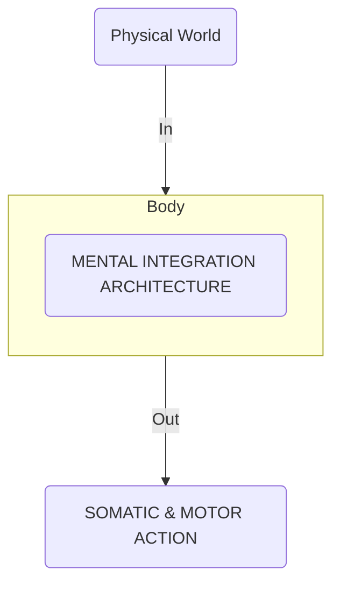
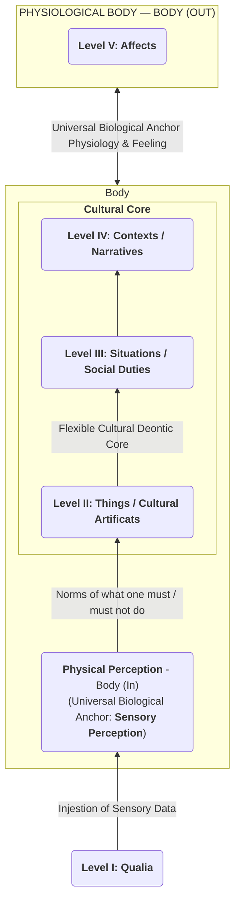

[[atomic]]

# Combined Sources on Cognitive Semiotics {#title}

[[toc]]

## Source Overviews

<PostCollection :tags="['Semiotics']" />

### Cognitive Semiotics: Signs, Mind and Meaning (Per Aage Brandt)

Human conscious awareness is organized into **five distinct layers of integration**, ranging from basic sensory qualia up to complex emotional states, which collectively form the architecture of the embodied mind. This mental framework acts as an **opening between bodily input and output**, remaining biologically grounded at its sensory and affective peripheries while allowing for immense cultural and intellectual flexibility in its intermediate layers. Through this structured architecture, phenomena can be understood as **signs that bridge a semantic gap** between lower-level perceptions and higher-level conceptual meanings, enabling effective communication and interpretation.

### Human Lifeworlds: The Cognitive Semiotics of Cultural Evolution (David Dunér / Göran Sonesson)

The provided source introduces a **cognitive-semiotic theory of cultural evolution** that examines how humans uniquely shape their **Lifeworld** through shared meaning-making and cultural artefacts. To explain this evolutionary trajectory, the text integrates **phenomenology**—specifically the Husserlian concept of the **Homeworld** and **Alienworld**—with **Merlin Donald's evolutionary schema**, tracing human development from episodic and mimetic stages to mythic and theoretic cultures. It further expands cultural semiotics by analyzing how an **Ego-culture** interacts with outside groups, distinguishing between those treated as human equals (**Alter-culture**) and those treated merely as external things (**Alius-culture**). Ultimately, the text aims to bridge the gap between **biological evolution and human history**, demonstrating that human specificity arises not solely from genetics, but from a continuous bio-cultural interaction with our environment.

### Meaning, Mind and Communication: Explorations in Cognitive Semiotics (Jordan Zlatev / Göran Sonesson / Piotr Konderak)

This excerpt from an anthology on **cognitive semiotics** explores the intersection of **phenomenology and cognitive science**, using Husserl's philosophical framework to critique and reinterpret the **embodied simulation hypothesis**. The text begins by outlining how **cognitive semiotics** serves as a transdisciplinary bridge between the natural sciences and the humanities, driven by **meaning, mind, and communication** through a continuous spiral of conceptual and empirical research. It then examines experimental data on how people process linguistic meaning, contrasting mainstream claims about **unconscious mental simulations** with Husserlian theories of **intentionality, perception, and temporality**. Ultimately, the author demonstrates that **phenomenological analysis** provides a more rigorous and coherent foundation for understanding how human beings connect linguistic expressions to practical, embodied experiences in the world.

### Ritual Textuality: Pattern and Motion in Performance (Matt Tomlinson)


Matt Tomlinson's **Ritual Textuality** investigates how **ritual performance relies on pattern and motion** to shape social life, focusing primarily on Fiji as a key field site. By examining religious and political events, the book demonstrates that **rituals function through specific textual patterns** like sequence, conjunction, contrast, and substitution rather than random action. These patterns are not static; rather, they **emerge dynamically in performance** as participants use language to connect themselves with divine or societal authority. Ultimately, the work reveals how individuals **use entextualization to navigate modern instability**, such as political coups and religious shifts, by creating powerful frameworks of meaning.

## **Decoding Meaning: The Five-Level Architecture of the Embodied Mind** {#decoding-meaning}

### 1. Introduction: From Perception to Affect in Meaning Production

For students beginning their journey in linguistics and cognitive science, one of the most fundamental mysteries of human existence is how physical consciousness bridge the gap between raw sensory experience and deeply felt emotional meaning. When a flash of crimson light breaks through a fog, when a minor chord echoes in a vaulted hall, or when a sudden scent wafts across a room, our experience is not a mere registration of physical wavelengths or acoustic frequencies. Almost instantaneously, these sensory inputs trigger complex interpretations, historical memories, social evaluations, and physical surges of feeling. How does the human mind perform this extraordinary feat?

For decades, classical artificial intelligence and early computational linguistics treated the mind as a "flat," single-layer processing cabinet—a repository of static concepts, logical propositions, and dictionary definitions. Cognitive semiotics, drawing upon the foundational work of Danish semiotician Per Aage Brandt, demonstrates that flat models fail to account for the actual phenomenology of human cognition. A flat computational model cannot explain qualitative transitions across distinct structural layers: it cannot explain how an outer, physical sensation at the boundary of perception is systematically converted into a structured object, contextualized within a spatiotemporal story, evaluated against cultural values, and finally translated into a visceral physiological reaction.

To account for these qualitative transformations, we must model the **embodied mind** not as an isolated software program, but as a dynamic, layered integration machine. Anatomically and phenomenologically, the mind is a functional architectural opening in cerebral tissue, situated directly between two physical boundaries of the biological organism:

**Sensory Entry Point — BODY (IN):** The afferent, outer boundary where somatic sensory receptors gather raw physical data (light wavelengths, mechanical vibrations, chemical molecules) from the surrounding environment.

**Somatic Response Point — BODY (OUT):** The efferent, inner-somatic boundary where neural signals terminate in physiological responses, hormonal shifts, muscular tension, and physical action within the world.

**Mind-Body Integration Axis:**

**[ PHYSICAL WORLD ]** \rightarrow **BODY (IN)** \rightarrow **[ MENTAL INTEGRATION ARCHITECTURE ]** \rightarrow **BODY (OUT)** \rightarrow **[ SOMATIC & MOTOR ACTION ]**



Why is a stratified, multi-level model indispensable for cognitive science? If human thought were a flat propositional network, every perceptual input would directly map to a uniform conceptual node. But human consciousness does not work in flat equivalences. We do not merely record raw colors or shapes; we integrate those sensory qualities into physical objects, locate those objects within dynamic situations, interpret those situations within encyclopedic narrative histories, and evaluate those histories against values to feel distinct emotional states. A stratified model demonstrates how simple sensory building blocks are progressively built into higher-order meaning structures and, conversely, how emotional goals retro-process back down into concrete plans for bodily action.

**Core Concept:** Human consciousness operates as a dynamic, stratified architecture situated between sensory intake (**BODY IN**) and somatic output (**BODY OUT**). Meaning is produced through a sequential cascade of architectural integrations—progressively transforming raw sensory qualia into objects, situations, narrative contexts, and evaluative affects.

To understand how this stratified mental machine converts physical energy into subjective human experience and sign systems, we must examine the five distinct levels of its integrative hierarchy.

### 2. The Five-Level Hierarchy of Mental Integration

In the cognitive semiotic framework articulated by Per Aage Brandt, meaning production proceeds through five distinct, ascending levels of mental integration. Content ascends from afferent sensory entry (**BODY IN**) at the base of the architecture to efferent affective response (**BODY OUT**) at the peak.

**The Stratified Hierarchy of Mental Integration:**

**BODY (OUT)** $\leftarrow$ **Level V: Affects** _(Emotions, Moods, Passions)_
$\quad\quad\quad\quad\quad\quad\quad\quad\uparrow$ _Integration_ $\quad\quad\quad\quad\quad\quad$
**Level IV: Contexts** _(Encyclopedic Narratives, States of Affairs)_
$\quad\quad\quad\quad\quad\quad\quad\quad\uparrow$ _Integration_ $\quad\quad\quad\quad\quad\quad$

**Level III: Situations** _(Scenarios, Persons, Causal Forces)_
$\quad\quad\quad\quad\quad\quad\quad\quad\uparrow$ _Integration_ $\quad\quad\quad\quad\quad\quad$
**Level II: Things** _(Multimodal Objects, Acts, Events)_
$\quad\quad\quad\quad\quad\quad\quad\quad\uparrow$ _Integration_
**BODY (IN)** $\rightarrow$ **Level I: Qualia** _(Mono-modal Sensory Forms)_

#### Level I: Qualia (Sensory Forms)

Directly touching the perceptual boundary (**BODY IN**), Level I consists of mono-modal sensory forms—isolated visual contours, surface colors, sound shapes, pitches, tactile textures, and odors. These are raw perceptual elements. In normal consciousness, attention rarely stays at Level I; qualia are rapidly absorbed into higher-order integrations. However, conscious attention can intentionally isolate qualia, foregrounding them as pure aesthetic or formal properties (e.g., listening to the pure acoustic timbre of a cello string without thinking of the instrument or the performer).

#### Level II: Things (Objects, Acts, Events)

At Level II, isolated mono-modal qualia integrate into unified, multimodal entities: physical **objects** (e.g., a violin), physical **acts** (e.g., drawing a bow across a string), and natural **events** (e.g., a thunderclap). Level II turns scattered sensory inputs into stable, recognizable items in space and time.

#### Level III: Situations (Scenarios, Persons, Forces)

At Level III, multimodal things integrate into spatiotemporal scenarios governed by personal agency, intentionality, causal forces, and physical dynamics. Level III formats "who is doing what to whom, where, and why." It is the layer where force-dynamics, interpersonal conflict, and intentional actions unfold within an immediate surround-space.

#### Level IV: Contexts / Encyclopedic Narratives (States of Affairs)

At Level IV, localized scenarios integrate into broader contextual histories, background narrative knowledge, and global states of affairs. Level IV does not rely on immediate physical perception; rather, it operates through conception and encyclopedic memory. It allows an interpreter to understand the historical preconditions of a situation and forecast its long-term social, legal, or personal consequences.

#### Level V: Affects (Emotions, Moods, Passions)

At the architectural summit, contextual understandings are evaluated against personal and cultural criteria (such as truth, justice, beauty, utility, or moral horror). This evaluative integration generates personal emotions (e.g., pride, guilt), general moods (e.g., serenity, anxiety), and enduring passions (e.g., love, hostility). Level V connects directly to the efferent boundary (**BODY OUT**), sending neural and chemical signals throughout the physical organism to produce somatic reactions, glandular secretions, and neuromuscular preparations for motor behavior.

#### Linguistic Mapping Nuance

When mapping human language to this architecture, a crucial theoretical distinction must be recognized. Human language _cannot easily name Level I qualia or Level V affects directly without heavy reliance on metaphorical projection_ (e.g., describing an affect as "feeling blue" or a tone as "sharp"). Because literal language evolved primarily to coordinate social interactions in physical space, literal linguistic expressions anchor predominantly in the intermediate layers: Level II (category-naming nouns and lexemes), Level III (verb constructions and clause syntax), and Level IV (discourse, texts, and dialogue).

| Level & Name              | Primary Mental Content                                                               | Linguistic / Cultural Mapping                                                | Integrative Function                                                                                      |
| ------------------------- | ------------------------------------------------------------------------------------ | ---------------------------------------------------------------------------- | --------------------------------------------------------------------------------------------------------- |
| **Level I: Qualia**       | Mono-modal sensory forms (colors, shapes, pitches, odors).                           | Modifying expressions, color/sensory terms _(heavily metaphorical)_.         | Absorbed into multimodal objects or foregrounded as pure aesthetic forms at the **BODY (IN)** boundary.   |
| **Level II: Things**      | Multimodal entities (physical objects, discrete acts, natural events).               | Category-naming lexemes, nouns, nominal phrases _(literal anchor)_.          | Integrates isolated sensory qualia into recognizable physical items, acts, and occurrences.               |
| **Level III: Situations** | Spatiotemporal scenarios governed by persons, causal forces, and intentional agency. | Sentence verb constructions, clause syntax, transitivity _(literal anchor)_. | Contextualizes objects and acts into dynamic, force-driven interpersonal scenarios.                       |
| **Level IV: Contexts**    | Contextual history, states of affairs, encyclopedic narrative knowledge.             | Texts, discourse structures, dialogical networks _(literal anchor)_.         | Integrates localized situations into broader historical, social, and conceptual frameworks.               |
| **Level V: Affects**      | Evaluative personal emotions, general moods, and passionate commitments.             | Evaluative adverbs, affective markers _(heavily metaphorical)_.              | Evaluates narrative contexts against values, triggering somatic reactions at the **BODY (OUT)** boundary. |

While these five levels define the structural baseline of consciousness, mental life is inherently dynamic. Meaning is continually generated by directional flows moving up and down across these strata.

### 3. Directional Dynamics: Ascending Integration vs. Descending Retro-Processing

Mental content never remains statically frozen at a single layer. Consciousness operates through two distinct directional dynamics: **ascending integration** and **descending retro-processing**.

**Directional Vector Dynamics:**

**Ascending Processing (Afferent / Reflective):**
**BODY (IN)** $\rightarrow$ **Qualia (I)** $\rightarrow$ **Things (II)** $\rightarrow$ **Situations (III)** $\rightarrow$ **Contexts (IV)** $\rightarrow$ **Affects (V)** $\rightarrow$ **BODY (OUT)**

**Descending Retro-Processing (Efferent / Imaginative):**
**BODY (OUT)** $\leftarrow$ **Affects (V)** $\xRightarrow{\text{"What if...?"}}$ **Contexts (IV)** $\xRightarrow{\text{Fantasy/Plan}}$ **Situations (III)** $\xRightarrow{\text{Targeting}}$ **Qualia (I)** $\rightarrow$ **BODY (IN)**

#### 1. Ascending Processing (Upward Integration)

- **Operational Character:** Passively reflective, observational, and afferent.
- **Directional Flow:** Bottom-up $(I \rightarrow II \rightarrow III \rightarrow IV \rightarrow V)$.
- **Function:** It receives raw, incoming physical sensory qualia at **BODY (IN)** and systematically integrates them into recognized multimodal objects, force-driven scenarios, encyclopedic narrative contexts, and final affective evaluations.

#### 2. Descending Retro-Processing (Downward "What-If..." Planning)

- **Operational Character:** Active, imaginative, goal-directed, and efferent.
- **Directional Flow:** Top-down $(V \rightarrow IV \rightarrow III \rightarrow II \rightarrow I)$.
- **Function:** Driven by emotional motives, desires, or felt needs at Level V, the mind retro-processes downward by asking _"What if...?"_ This downward flow generates imaginative representational fantasies, hypothetical narrative predictions, concrete situational strategies, and specific sensory target selections for bodily action.

#### The 3-Step Cycle of Action Planning

When an individual formulates, tests, and executes a plan of action within the environment, the mind completes a closed three-step cycle that bridges both processing directions:

1. **Affective Motivation & Fantasy Generation (Downward Flow):** An emotional motive at Level V triggers downward retro-processing (_"What if I performed action X?"_). The mind constructs a hypothetical narrative context (Level IV), projects an imagined situational scenario (Level III), and anticipates specific sensory targets (Level I).
2. **Ascending Reflective Examination (Upward Simulation):** The mind runs this hypothetical action plan back up through the ascending architecture. It tests the plan's force-dynamics at Level III, verifies its social/historical consequences at Level IV, and checks whether the outcome resolves the initial problem.
3. **Emotional Stamp of Decision (Execution at somatic boundary):** Upon reaching Level V again, the simulated plan receives an evaluative emotional judgment—a affective "stamp of approval" that validates the plan and releases efferent neuromuscular commands to the body (**BODY OUT**) for physical execution.

This internal, bidirectional architecture structures private cognition and action planning. Crucially, it also provides the structural engine for creating and interpreting external signs (**semiosis**).

### 4. Semiosis in Mental Architecture: Bridging the Semantic Gap (Symbols vs. Icons)

A **semiotic sign** occurs when a lower-level perceptible expression—the **signifier** (sa)—is coupled to a higher-level mental content—the **signified** (sé). Signs operate by deliberately introducing a **semantic gap**: they bypass the default, step-by-step intermediate layer integrations that normally connect perception to affect.

To interpret a sign, the human interpreter must actively supply the missing architectural layer.

#### **Structural Gaps in Semiosis:**

##### **Symbolic Sign Architecture:**

**Signifier:** $sa\text{ (Level II Object)} \longrightarrow$ **[SEMANTIC GAP: Level III Skipped]** $\longrightarrow$ **Signified:** $sé\text{ (Level IV Instruction)}$ $\quad\quad\quad\quad\quad\quad\quad\quad\quad\quad\quad\quad\quad\downarrow$ _Interpreter supplies missing step:_
$\quad\quad\quad\quad\quad\quad\quad\quad\quad\quad\quad\quad\quad\quad$ **Action:** $act\text{ (Level III Situational Act)}$

##### **Iconic Sign Architecture:**

**Signifier:** $sa\text{ (Level I Free Qualia)} \longrightarrow$ **Signified:** $sé\text{ (Level II Representation)} \quad \text{and/or} \quad sé\text{ (Level V Affect)}$ $\quad\quad\quad\quad\quad\quad\quad\quad\quad\quad\quad\quad\quad\quad\quad\quad\downarrow$ _Narrative Feeling Circuit:_ $\quad\quad\quad\quad\quad\quad\quad\quad$
**Narrative Concept:** $sé\text{ (Level V Affect)} \rightarrow sé\text{ (Level IV Narrative Context)} \rightarrow act\text{ (Level III Act)}$

#### Symbolic Signs: $sa (II) \rightarrow sé (IV) \rightarrow act (III)$

In symbolic semiosis, the signifier (sa) is a Level II object or physical artifact (such as a metal traffic sign, a printed word, or a written musical score). This Level II object directly triggers a Level IV encyclopedic rule, instruction, or narrative law, skipping immediate Level III situational integration.

- **Operational Example:** A driver approaches a red octagon bearing the word "STOP" $(sa\text{ at Level II})$. The physical metal sign post itself does not mechanically block the car. Instead, the signifier directly evokes the social/legal rule requiring vehicles to halt $(sé\text{ at Level IV})$. To interpret and obey the symbol, the driver must actively supply the missing Level III situational act $(act\text{ at Level III})$ by pressing the brake pedal.

Because symbolic signs rely on skipped architectural steps and socially imposed rules, their codes are conventional, arbitrary, and must be learned within a specific culture.

#### Iconic Signs, Proto-Iconicity, and the Narrative Feeling Circuit

In iconic semiosis, the signifier (sa) consists of "free qualia" at Level I—isolated colors, lines, shapes, or acoustic tones—that have been intentionally detached from standard object integration.

- **Proto-Iconic Signs $(sa\text{ [I]} \rightarrow sé\text{ [V]})$:** Pure sensory forms $(sa\text{ at Level I})$ directly evoke immediate affective states and emotional moods $(sé\text{ at Level V})$. This direct form-affect linkage underpins all aesthetic experience (e.g., how a minor musical chord directly evokes sadness without needing a verbal story).
- **Iconic Representations $(sa\text{ [I]} \rightarrow sé\text{ [II]})$:** Arranged qualia $(sa\text{ at Level I})$ naturally guide the mind to construct a mental image of an object or event $(sé\text{ at Level II})$, such as a landscape painting representing a mountain.
- **The Complete Circuit of Narrative Feeling $(sé\text{ [V]} \rightarrow sé\text{ [IV]} \rightarrow act\text{ [III]})$:** In artistic and iconic experience, the direct triggering of an affect at Level V does not remain isolated. As Per Aage Brandt demonstrates, this felt affect feeds downward into Level IV encyclopedic narratives $(sé\text{ [V]} \rightarrow sé\text{ [IV]})$, generating imaginative narrative concepts and "narrative feelings" (such as a feeling of loss evoking a story of longing). These narrative concepts, in turn, inspire potential situational behaviors $(act\text{ at Level III})$. This explains how art moves human beings from raw sensory form to profound existential action.

| Dimension                  | Symbolic Semiosis                                                                              | Iconic Semiosis                                                                                                                                                               |
| -------------------------- | ---------------------------------------------------------------------------------------------- | ----------------------------------------------------------------------------------------------------------------------------------------------------------------------------- |
| **Signifier Level $(sa)$** | **Level II:** Multimodal objects, physical sign posts, written text artifacts.                 | **Level I:** Mono-modal free qualia (isolated colors, lines, acoustic tones).                                                                                                 |
| **Signified Level $(sé)$** | **Level IV:** Encyclopedic instructions, legal rules, narrative contexts.                      | **Level II:** Represented objects, or **Level V:** Direct affective feelings _(proto-iconicity)_.                                                                             |
| **Gap-Filling Mechanism**  | The interpreter actively supplies the missing Level III situational act $(act\text{ III})$.    | Qualia naturally form representations $(sé\text{ II})$ or directly evoke affect $(sé\text{ V})$, which feeds into narrative feeling $(sé\text{ V} \rightarrow sé\text{ IV})$. |
| **Cultural Universality**  | **Low:** Strictly dependent on culturally specific codes, conventions, and institutional laws. | **High:** Cross-cultural and species-universal; grounded in shared sensory and emotional neurobiology.                                                                        |

### 5. Cultural Mapping, Embodiment, and Key Takeaways for Learners

The five-level architectural model yields a crucial insight into how biological evolution and human culture interact:

#### The Biological Anchors vs. The Cultural Deontic Core

- **Peripheral Layers (Levels I and V) as Universal Biological Anchors:** Level I (sensory qualia) and Level V (affective feelings) are physiologically locked to the biological body (**BODY IN** and **BODY OUT**). Bound to human sensory organs, hormonal systems, and neuromuscular circuits, these peripheral layers ensure cross-cultural resonance. Pain, joy, basic visual contrast, and musical rhythm are recognized across all human societies.
- **Central Layers (Levels II, III, and IV) as the Cultural Deontic Core:** Levels II, III, and IV form the flexible **deontic core** of human consciousness. Derived from the Greek _deon_ (meaning "duty" or "that which is binding"), this central mass is termed "deontic" because it is where societies format obligations, institutional rules, legal duties, moral norms, and cultural instructions regarding _what one must or must not do_. While all humans naturally organize experience into things, situations, and stories, the specific deontic content stored within this core varies widely across historical eras and cultures.

**Architectural Mapping of Culture and Embodiment:**



#### Critical Takeaways for Students of Linguistics and Cognitive Science

- **1. The Mind is an Embodied Structural Opening:** Consciousness is neither an immaterial spirit nor a flat computer program. It is a dynamic architectural opening in cerebral tissue, situated between physical perception (**BODY IN**) and somatic output (**BODY OUT**), transforming environmental energy into human meaning.
- **2. Meaning is Stratified Across Distinct Levels of Complexity:** Flat propositional models fail because human thought relies on a strict hierarchy of structural integration—moving systematically from mono-modal qualia (I), to multimodal things (II), to force-driven scenarios (III), to encyclopedic narrative contexts (IV), and to evaluative affects (V).
- **3. Cognition is Bidirectional:** Mental life requires two complementary processing directions: passive, bottom-up _ascending integration_ (building sensory inputs into emotional evaluations) and active, top-down _descending retro-processing_ (using "what-if...?" imagination to turn emotional motives into concrete action plans).
- **4. Language Literalness Anchors in the Central Deontic Core:** While literal language primarily operates across Levels II, III, and IV to regulate social duties and institutional norms, it must resort to metaphorical projection to articulate Level I qualia and Level V affects.
- **5. Iconicity Transcends Cultural Boundaries:** While symbolic signs enforce learned social conventions within the central deontic core, iconic signs leverage "free qualia" and direct affect. This proto-iconic connection $(sa\text{ [I]} \rightarrow sé\text{ [V]})$ and its resulting narrative feeling $(sé\text{ [V]} \rightarrow sé\text{ [IV]})$ provide humanity with a universal, cross-cultural foundation for art, empathy, and creative freedom.

## **Primer: Navigating Meaning—Mental Spaces, Architecture, and Conceptual Blending in Daily Communication** {#primer}

### 1. Foundations of Cognitive Semiotics: Mind, Matter, and Meaning

#### 1.1 Philosophical Roots: Descartes vs. Spinoza on Mind and Body

To understand how human beings construct, communicate, and navigate meaning, we must first confront a foundational debate in seventeenth-century philosophy: the conflict between René Descartes and Baruch Spinoza regarding the relationship between the human mind, the physical body, and the nature of truth.

To build a scientific framework for language, art, and imagination, cognitive semiotics relies on a Cartesian-friendly, phenomenological approach rather than a Spinozan, truth-conditional framework. René Descartes proposed a **substance dualism** that separated immaterial thoughts (_res cogitans_) from physical, extended matter (_res extensa_). Crucially, Cartesian rationalism operates on **causal monism**—the idea that even though mind and body belong to distinct ontological domains, they causally interact in both directions. Your physical body senses a hot stove, which causes a mental feeling of pain; conversely, your mental decision to move causes your physical arm to pull away. Because mental representations can exist independently of an immediate physical object, human minds can entertain hypothetical scenarios, construct fictions, formulate doubts, and separate signified _meaning_ from empirical physical _truth_.

Baruch Spinoza, by contrast, offered a radical **substance monism**. He asserted that mind and body are not distinct substances, but merely two attributes or facets of a single, unified reality (_Deus sive Natura_, or God/Nature). In Spinoza’s view, a mind is simply the internal "idea of" its corresponding physical body. Because mind and body are functionally identical, Spinoza rejected causal interaction between them, creating a system of **causal dualism**: physical events are caused strictly by prior physical events, and mental ideas are caused strictly by prior mental ideas.

In modern semantics, this Spinozan framework leads directly to logical positivism and truth-conditional semantics: a statement or thought is deemed meaningful _only_ if it directly corresponds to a true, verifiable state of affairs in the physical world. For Spinoza, because what is real is governed by absolute necessity, non-veridical thoughts (fictions, errors, or unanalyzed sensory impressions) are dismissed as meaningless noise or chaotic "imaginations" (_imaginationes_).

| Cartesian Dualism / Causal Monism                                                                  | Spinozan Monism / Causal Dualism                                                                                   |
| -------------------------------------------------------------------------------------------------- | ------------------------------------------------------------------------------------------------------------------ |
| **Ontological Premise:** Mind (_res cogitans_) and body (_res extensa_) are distinct substances.   | **Ontological Premise:** Mind and body are two facets of the exact same physical reality.                          |
| **Causal Interaction:** Causal Monism—mind and body directly influence each other bidirectionally. | **Causal Interaction:** Causal Dualism—physical states cause physical states; ideas cause ideas.                   |
| **Nature of Meaning:** Autonomous mental representations exist independently of physical presence. | **Nature of Meaning:** Meaning is defined strictly by physical reference, truth, and natural necessity.            |
| **Epistemic Capacity:** Accommodates hypotheses, counterfactuals, fictions, and false statements.  | **Epistemic Capacity:** Meaning Skepticism—unanalyzed sensory impressions (_imaginationes_) are meaningless noise. |
| **Modern Legacy:** Phenomenology (Husserl, Merleau-Ponty) and Cognitive Semiotics.                 | **Modern Legacy:** Analytic philosophy, logical empiricism, and extreme behaviorism.                               |

**So What? Why Representations Matter for Human Imagination and Language:**

- **Freedom from Immediate Physical Reference:** Because human minds form autonomous mental representations, we can think, speak, and write about non-existent entities, past events, future plans, and counterfactual possibilities ("What if?").
- **The Semantic Gap:** Spinoza’s necessitarianism ("what is true is so by necessity") eliminates the possibility of fictional or hypothetical thought. Cartesian dualism provides the necessary "semantic gap"—granting autonomous reality to mental representations so that a sign can mean something even if its object is physically absent or non-existent.
- **Separation of Meaning from Truth:** A sentence can be completely _meaningful_ and fully understood by a listener even if it is empirically _false_ or counterfactual. Cognitive semiotics studies how we construct these meaningful mental worlds.

#### 1.2 Defining Cognitive Semiotics

**Cognitive semiotics** is an integrative discipline that acts as a bridge between **cognitive science** (the empirical investigation of internal mental structures, neural architecture, and perception) and **semiotics** (the study of external signs, communicative symbols, and social meaning).

Rather than reducing human communication to raw biological behavior (as physicalist behaviorism does) or to rigid mathematical truth conditions (as formal logic does), cognitive semiotics studies how internal cognitive processing and external sign exchange inform one another. It treats meaning as an organized, real phenomenon operating across both subjective experience (consciousness, feeling, and imagination) and objective intersubjective communication (discourse, art, gesture, and culture).

By establishing that mental representations are ontologically real, cognitive semiotics can systematically explore how the human mind organizes these internal representations into structured layers of conscious awareness.

### 2. The Architecture of the Embodied Mind: The 5 Levels of Integration

#### 2.1 The Ascending and Descending Cascades of Consciousness

To understand how raw biological sensations transform into complex thoughts, Per Aage Brandt developed a structural model of mental architecture. This model organizes human conscious awareness into five stratified layers of integration. The human mind operates as an open continuum, suspended between incoming sensory perception (**BODY IN**) and outgoing emotional/somatic responses (**BODY OUT**).

This embodied architecture operates through two opposing mental cascades:

1. **The Ascending Cascade (Passively Reflective):** An afferent, integrative stream that moves upward from raw, single-sense inputs (_qualia_) into structured physical objects, situational scenarios, conceptual narratives, and ultimately affective emotional states.
2. **The Descending Cascade (Imaginative Action-Planning):** An efferent, retro-processing movement driven by "What if..." projections. Here, affective decisions and creative intentions descend back through scenarios, objects, and forms to plan physical actions and expressive responses.

Rather than relying on visual diagrams, we can outline these five ascending levels of mental integration from sensory input to emotional output:

1. **Level I: Qualia (**_**BODY IN**_**)** — Raw, single-sense (mono-modal) sensory inputs and aesthetic forms, such as a pure musical pitch, a specific frequency of red light, or a solitary aroma.
2. **Level II: Things** — Integrated, multi-sensory (multimodal) physical entities, including recognizable objects, physical acts, and bounded physical events (e.g., recognizing a wooden violin, a hand gesture, or a falling drop of water).
3. **Level III: Situations** — Spatiotemporal scenarios populated by acting human agents (_persons_), causal forces, and intentions unfolding in immediate surround space (e.g., observing a musician playing a violin on a concert stage).
4. **Level IV: Contexts** — Broad, encyclopedic narratives, background knowledge, social histories, and overarching states of affairs (e.g., understanding the cultural history of classical music, performance etiquette, and ticket pricing).
5. **Level V: Affects (**_**BODY OUT**_**)** — Somatic and psychological emotional reactions, deep moods, and passionate evaluations (e.g., feeling profound grief, exhilaration, or awe triggered by the performance).

#### 2.2 Linguistic and Cultural Mapping Across the Architecture

Human language and cultural creations are not arbitrary abstractions; they anchor precisely into these five architectural levels. Core conscious human awareness operates primarily across the intermediate levels (**Levels II, III, and IV**), which host our social institutions, everyday language, and intellectual creativity.

| Architectural Level       | Linguistic Equivalent                               | Cultural Manifestation                              |
| ------------------------- | --------------------------------------------------- | --------------------------------------------------- |
| **Level I: Qualia**       | Adjectives (Sensory attributes: _crimson_, _sharp_) | Free Qualia, Aesthetic Styles, Pure Composition     |
| **Level II: Things**      | Nouns & Nominal Phrases (Category-naming terms)     | Physical Artifacts, Tools, and Material Technology  |
| **Level III: Situations** | Verbs & Sentence Constructions (Actions, events)    | Social Institutions and Interactional Routines      |
| **Level IV: Contexts**    | Text & Discourse Concatenations (Narratives)        | Encyclopedic Histories, Mythologies, Cultural Norms |
| **Level V: Affects**      | Adverbs (Evaluative/Emotional modifiers: _sadly_)   | Psychosomatic Affects, Emotional Rituals, Passions  |

By organizing raw experience into these stratified levels of increasing complexity, the 5-level architecture creates an internal "semantic gap"—a structural disconnect between non-adjacent levels that allows physical objects to act as signs for abstract ideas.

### 3. How Signs Work: Symbols, Icons, and Semiosis

#### 3.1 Bridging the Gap: Symbolic Communication

A **symbolic sign** is a cognitive instruction that bridges non-adjacent levels of our mental architecture by skipping intermediate integration steps. Instead of merging a physical object naturally into its immediate situational scene, a symbol takes a physical signifier at Level II and jumps straight to an abstract rule or narrative context at Level IV, which then dictates a concrete action at Level III.

To make this semiotic notation intuitive, let's decode the standard algebraic shorthand:

- $\text{sa}$ = **Signifier** (_signifiant_): The perceptible physical form or expression.
- $\text{sé}$ = **Signified** (_signifié_): The mental concept, rule, or meaning invoked.
- $\text{act}$ = **Action / Behavior**: The resulting physical or mental conduct.
- **Roman Numerals (I–V)** = The corresponding level within the 5-level mental architecture.

The formal structural formula for a symbol is: $$\text{sa (II)} \rightarrow \text{sé (IV)} \rightarrow \text{act (III)}$$

Picture yourself driving down a busy street:

1. **Perception of the Signifier ($\text{sa}$ at Level II):** Your eyes register a physical object—a circular metal plate painted red with a white horizontal stripe attached to a post.
2. **Activation of the Signified ($\text{sé}$ at Level IV):** Your mind bypasses the physical properties of the painted metal and jumps directly to an encyclopedic legal rule stored in your memory context: _"Do Not Enter; driving down this road is prohibited and illegal."_
3. **Execution of Action ($\text{act}$ at Level III):** This mental leap immediately directs your situational behavior, prompting you to turn your steering wheel and avoid entering the street.

#### 3.2 Iconic and Proto-Iconic Signs: Aesthetics, Form, and Possibility

While symbols enforce cultural rules and social obligations, **iconic signs** are natural signs grounded in shared sensory form, geometry, and spatial appearance.

- **Full Iconic Representation $(\text{sa (I)} \rightarrow \text{sé (II)})$:** Occurs when a specific arrangement of sensory qualia at Level I (such as strokes of oil paint on canvas) directly guides the mind to recognize a multimodal object at Level II (a realistic painting of an apple).
- **Proto-Iconic Aesthetic Experience $(\text{sa (I)} \rightarrow \text{sé (V)})$:** Occurs when raw sensory forms at Level I are isolated from physical objects ("free qualia") and trigger immediate emotional reactions at Level V. This direct form-to-affect leap explains how abstract art, musical melodies, and architectural lines evoke deep emotional moods across cultural boundaries without needing a literal translation.

While symbols communicate societal rules and obligations (**deontics**—what one _must_ or _must not_ do), icons communicate open-ended **possibilities**—offering vivid representations of what _could_ be across human cultures.

#### 3.3 Indexical Semiosis and the Typology Matrix

To complete our understanding of sign mechanisms, we must examine the **indexical sign** $(\text{sa (II)} \rightarrow \text{sé (III)})$. An index operates via physical contiguity, directional pointing, or direct cause-and-effect traces.

When you see a plume of dark smoke rising above a tree line (\text{sa} at Level II), your mind does not jump to a legal rule or an abstract painting; it makes an immediate cognitive leap to an active situational cause (\text{sé} at Level III): _"There is a fire burning over there."_ Similarly, a footprint in the mud, a weather vane turned north, or a pointing finger are indexical signs that physically anchor our attention to immediate spatial and temporal realities.

| Sign Type             | Architectural Formula                                                                                      | Core Mechanism                                    | Communicative Function                                                             |
| --------------------- | ---------------------------------------------------------------------------------------------------------- | ------------------------------------------------- | ---------------------------------------------------------------------------------- |
| **Symbol**            | $\text{sa (II)} \rightarrow \text{sé (IV)} \rightarrow \text{act (III)}$                                   | Cultural Convention, Arbitrary Codes, Speech Acts | Transmits deontic social rules, legal injunctions, and cultural obligations.       |
| **Icon / Proto-Icon** | $\text{sa (I)} \rightarrow \text{sé (II)} _(Icon)_ \text{sa (I)} \rightarrow \text{sé (V)}$ _(Proto-Icon)_ | Aesthetic Form, Mimesis, Direct Sensory Affect    | Communicates cross-cultural possibilities, open imagination, and artistic emotion. |
| **Index**             | $\text{sa (II)} \rightarrow \text{sé (III)}$                                                               | Causal Traces, Physical Contiguity, Spatial Links | Provides spatial/temporal localization, physical tracking, and situational focus.  |

These fundamental sign mechanisms provided the evolutionary springboard required for early hominin minds to expand beyond isolated perception into complex social intersubjectivity.

### 4. The 5 Layers of Intersubjectivity and Consciousness

#### 4.1 The Situational Drama: Primary Actantial Roles

Everyday animal and human awareness does not occur in a passive, static environment. Instead, our minds automatically structure surrounding space as an immediate intersubjective drama. We can think of **actantial roles** as the basic dramatic slots—such as hero, rival, and helper—that our minds automatically assign to organisms and objects around us.

The central conscious **Subject $(S)$** operates within a surround space occupied by three primary categories of **Relevant Others**:

- **$O_1$** **(Prey / Desired Object):** The primary attractor in the environment. $O_1$ triggers indexical desire and activates physical motor routines aimed at approaching, capturing, and possessing the target.
- **$O_2$** **(Antagonist / Competitor):** A rival competing for $O_1$ or a predator targeting $S$. The presence of $O_2$ triggers antagonistic mimesis and introduces the critical cognitive dimension of **veridiction**—the mental tension between _being_ and _appearing_. To survive $O_2$, S must detect trickery, pretense, and deceit, while achieving self-awareness by learning to "see oneself as seen by the rival."
- **$O_3$** **(Ally / Adjuvant):** A cooperative helper. $O_3$ triggers symbolic exchange, politeness rituals, and shared intentionality. Interacting with $O_3$ establishes the foundational **Maussian gift/gratitude exchange loop**: _"If you help me fight $O_2$ , I will share $O_1$ with you."_ This reciprocal obligation forms the evolutionary bedrock of social ethics and mutual duty.

#### 4.2 The Evolutionary Ladder of Human Consciousness

As these semiotic actantial interactions deepened over evolutionary time, human consciousness expanded through five ascending, cumulative stages:

1. **Situational Consciousness:** Grounded in _Indexical Cognition_. The Subject navigates immediate physical space, reading direct causal traces (footprints, odors) of nearby objects and organisms.
2. **Narrative Consciousness:** Grounded in _Iconic Cognition_. The Subject recognizes actantial drama (competitors, preys) and develops basic self-awareness by internalizing how it appears through the eyes of the antagonist $(O_2)$.
3. **Ethical Consciousness:** Grounded in _Symbolic Cognition_. Cooperative interactions with the ally $(O_3)$ establish long-term social bonds, personal responsibility, gratitude, and moral obligation via the gift-exchange loop.
4. **Aesthetic / Passionate Consciousness:** Grounded in _Erotic Cognition_. The Subject attributes singular, irreplaceable value to specific individuals or artistic creations using proper names, metonymy, love, and artistic form.
5. **Linguistic Consciousness:** Grounded in _Musical / Metric Cognition_. The mind achieves an "Olympian," disembodied stance capable of declaring objective, universal truths ("It is the case that...") structured by shared temporal rhythms, formal grammar, and discourse.

This highest layer—linguistic consciousness—enables human minds to step outside immediate personal experience and establish real-time, shared communication through dialogical discourse networks.

### 5. The "Dia-logic" of Discourse: How Minds Construct Shared Meaning

#### 5.1 Implicit Dialogue as the Engine of Textual Coherence

Even when a text appears on the surface as an uninterrupted, single-speaker monologue (such as a written essay, a commercial invoice, or a formal speech), its underlying semantic structure is inherently **dialogical**.

A writer (Implicit Speaker A) maintains textual coherence by continuously anticipating the unstated objections, doubts, and questions of the reader (Implicit Listener B). Connective terms like _but_, _although_, and _so_ act as logical pivots that address B's silent mental counters.

Consider how a simple payment reminder stays coherent by conducting a hidden, implicit dialogue between sender and recipient:

**[Implicit Speaker A]:** You haven't paid your magazine subscription invoice. **[Implicit Listener B]:** _Oh, haven't I? I must have overlooked it in the mail. I'm sorry!_

**Explicit Sentence (A):** "We understand how easy it is to overlook a small invoice." **[Implicit Listener B]:** _Right, so no big deal! You know I'm good for it, so keep sending the magazine._

**Explicit Sentence (A):** "But the fact is, the above invoice remains unpaid. And although we know you intend to pay it, I'm sure you can understand that we can't keep sending you our magazine on faith." **[Implicit Listener B]:** _Fair enough. So what do you want me to do right now?_

**Explicit Sentence (A):** "So please use the enclosed envelope to return this duplicate invoice with your payment today!"

Notice how the explicit text never directly attacks the reader; instead, it uses concessive transitions (_although_, _but_) to validate the reader's perspective while firmly asserting the required action. Monological text is, at its core, a suppressed conversation.

#### 5.2 Mental Space Networks, Conceptual Blending, and Conditionality

To understand how minds construct creative, complex meanings during discourse, we must move beyond rigid formal logic and explore **Mental Space Theory** and **Conceptual Blending**, pioneered by Gilles Fauconnier, Mark Turner, and Per Aage Brandt.

When we speak or listen, our minds assemble small, temporary cognitive containers called **mental spaces**. To construct emergent meanings, counterfactuals, or metaphors, the mind links these spaces into a **4-Space Blending Network**:

1. **Input Space 1:** Contains a specific conceptual frame or set of elements (e.g., a modern surgeon performing an operation).
2. **Input Space 2:** Contains a contrasting conceptual frame (e.g., a crude butcher carving meat).
3. **Generic Space:** Maps the shared structural properties common to both inputs (an agent using a sharp blade to cut physical flesh).
4. **Blended Space (The Blend):** A new, hybrid mental space created by **cross-space mapping** and **selective projection**. Elements from both inputs combine to produce an **emergent structure** that exists in neither input alone.

Consider the classic metaphor: _"That surgeon is a butcher."_ In the Blended Space, we do not picture a doctor literally selling pork chops. Instead, the surgeon's clinical context (Input 1) blends with the butcher's crude, heavy-handed mannerisms (Input 2). The emergent structure is a vivid, critical evaluation of gross incompetence and horrific care.

This mental space mechanism also explains how natural logic operators, such as conditional statements ("If X, then Y"), function in daily speech. In traditional logic, a conditional is analyzed purely by truth tables. In cognitive semiotics, conditional expressions operate at Level III of our mental architecture as intersubjective enunciation networks.

A conditional statement like _"If it snows tomorrow, I may cancel my trip"_ connects two spaces:

- The **Protasis Space $(X)$** (The 'if' clause: imagining a mental space where snow falls).
- The **Apodosis Space $(Y)$** (The 'then' clause: imagining a mental space where the trip is canceled).

The connection succeeds not because of abstract mathematical truth, but because speaker and listener share an intersubjective understanding of **causal relevance**—knowing that heavy snowfall blocks highways, rendering travel unsafe.

**Key Takeaway for Aspiring Learners:** Discursive coherence is an active process of **distributed cognition**. Meaning is never a static string of words frozen on a printed page; it is a dynamic, shared mental dance. A speaker continuously models the listener's mind, building networks of mental spaces and conceptual blends to navigate real-time human communication.

# Cognitive Semiotic Research Methodology Framework: A Four-Level Empirical Trajectory {#cognitive-semiotic-research}

## 1. Epistemological Foundations and Ontological Grounding

Empirical research into meaning requires an explicit, methodologically sound philosophical grounding to navigate successfully between anti-phenomenological physicalism and ungrounded historicism. Cognitive semiotics occupies the interdisciplinary intersection of cognitive science—incorporating semantics, linguistics, and neuroscience—and general semiotics, synthesizing structural, Saussurean, and Peircean traditions. To establish a rigorous empirical science of human meaning, research must resist reductionist physicalism, which dismisses conscious mental content as an epiphenomenal byproduct of neural computation or behavior, while simultaneously rejecting ungrounded historicism and pure hermeneutics, which treat meaning as an arbitrary, culturally floating construction detached from evolutionary and neurobiological constraints. Grounding cognitive semiotic inquiry in a coherent metaphysics allows researchers to recognize meaning as an autonomous, representationally real object of scientific study—one that structurally links biological neural substrates with the communicative, experiential, and symbolic networks of human culture.

The foundational epistemological divide in modern rationalist philosophy stems from the divergent metaphysical frameworks of René Descartes and Baruch Spinoza. Descartes established an experiential rationalism based on a categorical dualism of substances: _res cogitans_ (immaterial, unextended thought and signified content) and _res extensa_ (material, spatiotemporal reality). Crucially, Cartesian dualism contains a profound metaphysical paradox: while maintaining an ontological dualism of substances, it operates as a **causal monism** in scientific practice by asserting bi-directional causal interaction between mind and body (res\ cogitans \leftrightarrow res\ extensa). Physical stimuli acting upon sensory organs cause changes in mental representation, while intentional mental contents directly cause physical somatic actions. This causal interaction permits an autonomous semantics by explicitly distinguishing conceptual signified meaning (_le sens_) from veridical reference or truth-conditional state of affairs (_la signification_). Cartesian cognitive semiotics thus validates mental representations, mental spaces, and imagistic constructs as real, studyable scientific objects regardless of whether they correspond to immediate physical facts or veridical reference.

In contrast, Spinoza’s substance monism identifies mind and body as parallel attributes of a single, unified substance (_Deus sive Natura_). Because mind and body are ontologically identical facets of one reality, direct causal interaction between neural brain processes and mental representations is logically ruled out, resulting in a **causal dualism**: ideas can only be caused by preceding ideas, and physical body states by preceding physical body states. Spinoza collapses signified meaning directly into referential truth. Unorganized sensory impressions are dismissed as meaningless "imaginations" (_imaginationes_), attaining cognitive value only when structured through formal, axiomatic logic into true "ideas" (_rationes_). This yields a radical meaning skepticism: false, hypothetical, counterfactual, or fictional mental representations are denied real ontological existence and dismissed as meaningless noise or mechanical imagery. Modern analytic philosophy and logical empiricism derive directly from this Spinozan lineage, reducing semantics to truth conditions and replacing the structural study of mental meaning with behavioral observation or formal logical calculus.

| Epistemic Dimension                | Spinozan Analytic Cognitivism                                                                                                                                              | Cartesian Cognitive Semiotics                                                                                                                                             |
| ---------------------------------- | -------------------------------------------------------------------------------------------------------------------------------------------------------------------------- | ------------------------------------------------------------------------------------------------------------------------------------------------------------------------- |
| **Epistemology**                   | Logical empiricism, positivism, and truth-conditional analysis; knowledge is derived from the axiomatic, geometric ordering (_ordine geometrico_) of natural observations. | Experiential rationalism and semiotic phenomenology; knowledge integrates first-person introspection and third-person extrospection.                                      |
| **Ontological Status of Meaning**  | Substance Monism; meaning is collapsed into referential truth and external objects (_Deus sive Natura_); non-veridical meaning is dismissed as meaningless noise.          | Autonomous and Representationally Real; meaning exists as immaterial content (_res cogitans_) distinct from, but causally linked to, physical space-time (_res extensa_). |
| **Causal Architecture**            | **Causal Dualism;** physical body states only cause body states; ideas only cause ideas; mind and body cannot causally interact.                                           | **Causal Monism;** bi-directional causal interaction (res\ cogitans \leftrightarrow res\ extensa); mental contents directly drive somatic action and vice-versa.          |
| **View of Mental Representations** | Anti-representationalist or referentialized; rejects internal imagistic representations; views "mind" as an enminded biological body or behavior.                          | Strongly representationalist; acknowledges autonomous internal semiosis, mental spaces, diagrams, and imagistic constructs.                                               |
| **Epistemic Goal**                 | Coherence and Truth; establishing logical consistency, veridical reference, and direct mapping between signifiers and world states.                                        | Signified Meaning and Correspondence; mapping shared cognitive structures, narrative architecture, and communicative semiosis across domains.                             |

To operationalize empirical investigation, cognitive semiotics formulates a precise definition of **meaning**: _the internal cognitive structure of a thought—including how a story, argument, description, evaluation, or complex emotion is construed—and the corresponding organization of its external expression across communicative networks._ Meaning constitutes the ontological foundation of cognitive semiotics. It exists as a representationally real object of scientific study, held within the human mind and brain, while simultaneously operating through semiosis across intersubjective exchange and sociocultural discourse. While distinct from physical brain states in its structural properties, meaning remains causally interconnected with neural soma and somatic responses.

Because Cartesian cognitive semiotics establishes that signified mental content possesses bi-directional causal efficacy with physical reality, first-person phenomenological experience cannot be dismissed as epiphenomenal. Consequently, direct phenomenological observation serves as the mandatory empirical entry point for the four-level research trajectory, establishing the baseline of pre-modelized human consciousness.

## 2. Level 1 Trajectory: Phenomenological Observation & Primary Experience

The strategic function of Level 1 in the empirical trajectory is to establish immediate human experience and conscious awareness as the primary, pre-modelized data for cognitive semiotics. Because internal cognitive mechanics cannot be directly observed through third-person neuroimaging alone, researchers must begin by systematically capturing raw experience. Within this framework, human subjects are not merely external observers evaluating passive objects; rather, human consciousness itself provides the foundational data ("we are data ourselves"). Level 1 anchors inquiry in first-person and intersubjective phenomenology, gathering baseline observations of how meaning naturally presents itself to conscious awareness before formal theoretical models are applied.

The operational methodology for Level 1 focuses on capturing the immediate phenomenology of meaning as it occurs in real-time, waking presence. Primary consciousness is organized through a dual spatial arrangement that superimposes two distinct perceptual modes:

1. **Frontal Angle (Vantage Space):** A vision-based, directional schema fanning out frontally from the sensing body toward intentional targets of sensory attention. This space governs active intentional targeting, visual scanning, and foregrounded focus.
2. **Surround Space:** An auditive and situational soundscape schema in which the subject is positioned as a mobile entity in the center of a stationary place. The surround space acts as a background horizon that frames environmental presence.

In conscious experience, these two spatial modes form a dual installation: an "Olympian" perspective (observing the spatial scene as if from above, detached) superimposed onto a "Subjective" perspective (observing directly from the physical, embodied position of the subject's body).

### Spatial Architecture of Primary Consciousness

- **Background Horizon (Surround Space):** Auditive Soundscape / Situational Horizon / Environmental Traces / Spatial Location of Entities
  - **Foreground Focus (Frontal Vantage Space):** Vision-Based Intentional Targeting \rightarrow Directed Attention to Target
  - **Embodied Position:** Subject Body (S) anchored at origin (0,0,0)
  - **Superimposed Perceptual Modes:** Dual Installation of Olympian Perspective (Overview) over Subjective Perspective (Body-Bound)

Primary awareness within the surround space is natively formatted as a plurisubjective drama involving **Relevant Others**—mobile, conscious beings categorized by their relational stance toward the Subject (S):

- **Prey / Attractor $(O_1)$:** Salient objects or beings of desire that the subject intends to access, acquire, incorporate, or hold.
- **Antagonist / Predator $(O_2)$:** Dangerous opponents or competitors that threaten the subject or compete for O_1, triggering defensive, aggressive, or evasive behavior.
- **Ally / Adjuvant $(O_3)$:** Conspecifics or helper figures capable of cooperative interaction, mutual negotiation, and shared action.

Primary perception operates by projecting semiotic "windows" onto the background of the surround space, using distinct semiotic mechanisms to interpret environmental cues and guide situational responses:

- **Indexical Windows $(S \rightarrow O_1)$:** Function through causal markers, traces, and directional indices (visual, olfactory, auditive) left by hidden or proximal entities. Indexicality couples perceptual detection with somatic desire, initiating behavioral action programs designed to locate, approach, and secure $O_1$.
- **Iconic Windows $(S \rightarrow O_2)$:** Function through **antagonistic iconicity** and dynamic mapping. The appearance of an antagonist prompts mirror-image mental representations where $O_2$'s desire is an inverted mental image of S's own desire projected onto the surround space:
  - _Serial Mapping $S:O_1 :: O_2:S$:_ "I want to consume $O_1$, but $O_2$ wants to consume S."
  - _Parallel Mapping $S:O_1 :: O_2:O_1$:_ "I want $O_1$, and $O_2$ wants $O_1$." This antagonistic iconicity permits iconic pretense, such as staging mock attacks or mimicking prey behaviors to manipulate the opponent's spatial calculations.
- **Symbolic Windows $(S \rightarrow O_3)$:** Function through politeness, turn-taking, and conditional negotiation with allies. Symbolic interaction establishes rule-based exchanges ("IF you help me fight $O_2$, THEN we share $O_1$"). This conditional coupling (X/Y, where action X guarantees yield Y) forms the primary grounding of conventional symbolicity and shared intentionality.

Raw phenomenological data gathered at Level 1 captures immediate conscious experiences, but simple introspection cannot reveal the underlying cognitive mechanisms that generate these experiences. To expose these implicit structures, Level 1 observations must be translated into structured formalisms at Level 2 through modelization.

## 3. Level 2 Trajectory: Methodological Modelization & Formal Abstraction

Level 2 constructs formal structural models to expose the implicit mechanisms of meaning production that generate conscious experience. Because the mind's inner machinery cannot be accessed through direct introspection, cognitive semiotics builds "small meaning-production machines"—such as dependency schemas, mental space networks, force-barrier topologies, and conceptual blending models. These formal abstractions translate first-person phenomenological data into precise, structural mechanics that explain how lower-level sensory inputs integrate into higher-level conceptual and affective constructs.

Meaning construction relies on the five-level stratified architecture of the embodied mind. Consciousness operates through two opposing directional flows:

1. **Afferent Integrative Processes:** Upward flow from raw sensory soma (**BODY IN**) through progressive integrations of qualia, objects, situations, and contexts up to affective evaluation (**Level V**).
2. **Efferent Imaginative Processes:** Downward flow ("what-if" imaginative retro-processing) originating at **Level V** affects, descending through scenario modeling and action planning at **Level III** down to simulated sensory qualia at **Level I** to prepare expressive motor responses (**BODY OUT**).

| Integration Level                                   | Linguistic / Cultural Correlates                                                                                    | Semiotic Sign Functions                                                                                                                                                                       | Direction of Cognitive Flow                                                                                  |
| --------------------------------------------------- | ------------------------------------------------------------------------------------------------------------------- | --------------------------------------------------------------------------------------------------------------------------------------------------------------------------------------------- | ------------------------------------------------------------------------------------------------------------ |
| **Level V: Affects** _(Emotions, Moods, Passions)_  | Expressed via modal adverbs, stylistic tone, and emotional prosody; non-malleable, physiological body-out boundary. | **Proto-Iconic Signified $(sé [\text{V}])$:** Target of pure forms $(sa [\text{I}] \rightarrow sé [\text{V}])$; triggers somatic, emotional, and visceral states.                             | Afferent terminus / Efferent origin; evaluates integrated scenarios to stamp decisions for action execution. |
| **Level IV: Contexts** _(Encyclopedic Narratives)_  | Expressed via discourse, extended texts, complex narratives, and cultural genres.                                   | **Symbolic Signified $(sé [\text{IV}])$:** Content of conventional symbols $(sa [\text{II}] \rightarrow sé [\text{IV}])$; provides narrative and contextual framework.                        | Afferent integration from Level III / Efferent downward retro-processing ("what if...").                     |
| **Level III: Situations** _(Persons, Causes, Acts)_ | Expressed via verbs, clause structures, sentence grammar, and societal institutions.                                | **Interpretive Action $(\text{act} [\text{III}])$:** Resolves symbolic gaps $(sa [\text{II}] \rightarrow sé [\text{IV}] \rightarrow \text{act} [\text{III}])$; executes situational behavior. | Afferent integration from Level II / Efferent scenario modeling for action planning.                         |
| **Level II: Things** _(Objects, Acts, Events)_      | Expressed via nouns, nominal phrases, category labels, and physical artifacts.                                      | **Symbolic Signifier $(sa [\text{II}])$ / Iconic Target $(sé [\text{II}])$:** Physical supports, artifacts, and mapped object representations.                                                | Afferent integration from Level I / Efferent concrete object selection.                                      |
| **Level I: Qualia** _(Sensory Forms)_               | Expressed via sensory adjectives; non-malleable, physiological body-in boundary.                                    | **Proto-Iconic / Iconic Signifier $(sa [\text{I}])$:** Raw sensory forms (colors, shapes, beats) detached from objectal source.                                                               | Afferent origin; passive perceptual reflection moving upward into higher integration.                        |

To operationalize space network construction from raw empirical data, investigators apply the **Aarhus Model of Semiotic Blending**. Unlike nominalist blending models that treat conceptual integration as pure logical fusion, the Aarhus model grounds blending within real-time communicative discourse and physical interaction.

### The Aarhus Semiotic Blending Framework

1. **Discourse Base Space:** Establishes the real-time communicative situation, anchoring speaker/hearer positions, pragmatic goals, deictic coordinates, and cultural orientation.
2. **Space Delegation Cusp:** Projects reference structures from the Discourse Base into specialized mental spaces across temporal, spatial, or counterfactual conditions (e.g., "If I were you...").
3. **Input Spaces (Input 1 & Input 2):** Contain specific semantic domains whose shared structural properties are abstracted into a **Generic Space**.
4. **Blended Space:** Selectively projects features from the Inputs to generate _emergent meaning_—conceptual structures that do not exist in either Input Space alone.
5. **Material Anchors:** Physical artifacts (e.g., a thermometer dial, clock surface, or painting canvas) that bind internal conceptual space delegations to perceptual qualia at Level II, stabilizing complex mental networks during real-time performance.

This architectural framework explicates the precise structural mechanics of symbolic versus iconic sign functions:

- **Symbolic Sign Structures $(sa [\text{II}] \rightarrow sé [\text{IV}] \rightarrow \text{act} [\text{III}])$:** Symbols exhibit a structural semantic gap. A physical signifier at Level II $(sa [\text{II}])$ bypasses direct situational integration at Level III and connects directly to an encyclopedic narrative signified at Level IV $(sé [\text{IV}])$. To interpret the symbol, the agent must bridge this gap by executing a contextually appropriate situational action at Level III $(\text{act} [\text{III}])$.
- **Iconic Sign Structures ($sa [\text{I}] \rightarrow sé [\text{V}]$** **or** **$sa [\text{I}] \rightarrow sé [\text{II}]$):** Proto-iconicity connects raw qualia signifiers at Level I $(sa [\text{I}])$ directly to affective responses at Level V $(sé [\text{V}])$, bypassing intermediate levels to generate immediate aesthetic feelings. Full iconic representation connects Level I qualia $(sa [\text{I}])$ to object representations at Level II $(sé [\text{II}])$. When combined with affective reflection $(sé [\text{V}] \rightarrow sé [\text{IV}])$, this structure yields narrative feelings that inspire potential, non-obligatory action plans.

Having established formal theoretical modelizations at Level 2, their analytical power must be rigorously tested against concrete empirical phenomena in Level 3.

## 4. Level 3 Trajectory: Empirical Application & Sociocultural Analysis

Level 3 tests theoretical models (Level 2) against diverse sociocultural, textual, and historical data. A framework remains purely speculative unless its structural models demonstrate descriptive and explanatory power when applied to real human expressions. Level 3 establishes systematic testing protocols across four primary empirical domains:

### Domain 1: Narrative Discourse & Fictional Prose

Operationalizes actantial dynamics $(S-O_1-O_2-O_3)$, diegetical space transitions, and **force-barrier schemas** in literary prose (e.g., Maupassant, Borges, Hemingway). Narrative vectors encounter structural barriers across spatial transitions, governed by Greimasian modal force dynamics:

#### The Modal Force Dynamic Square

- **Making (**_**Faire faire**_**):** Active compulsion forcing an agent through a barrier.
- **Letting (**_**Laisser faire**_**):** Permissive opening enabling force trajectory.
- **Not Letting (**_**Ne pas laisser faire**_**):** Blocking / resistance obstructing vector movement.
- **Not Making (**_**Ne pas faire faire**_**):** Removal of compulsion / neutralization of force.

Analysis tracks how narrative vectors encounter these modal operators across diegetical space transitions, accounting for causal coherence and temporal backfiring of forces across story spaces.

### Domain 2: Poetics & Bio-Imaginary Registers

Maps "thymic" (evaluative) topologies across poetic texts (e.g., Wordsworth, Yeats, Tu Fu) using Hans-Erik Larsen’s three-strata framework of the embodied subjective imaginary:

1. **Bio-Imaginary Register:** Grounded in elemental sensory perception, where proximal experiences are euphoric (+) and distal experiences are dysphoric (-).
2. **Socio-Imaginary Register:** Inverts these values through social conditioning, making distal targets euphoric (+) and proximal exposure dysphoric (-).
3. **Phantasmatic-Imaginary Register:** Re-inverts values, aligning proximal experiences with euphoria (+) and distal experiences with dysphoria (-), blending with the bio-imaginary.

Applied analysis demonstrates how poetic imagination transitions between these registers to structure existential affect.

### Domain 3: Pragmatics & Dia-Logic

Deconstructs monological texts into implicit dialogical exchanges anchored in Émile Benveniste’s theory of **enunciation** (_énonciation_ vs. _énoncé_) and Lucien Tesnière’s **stemmatic syntax**. Dia-logic is not mere conversational alignment; it is anchored in formal deictic markers (person, tense, aspect, mood) that register the speaker's viewpoint within the sentence architecture. Connectives such as _but_ (insistence), _although_ (concession), and _so_ (consequence) function as operators within mental space networks, mapping an ongoing dialogue between speaker and hearer.

### Domain 4: Socio-Ecological Systems & Artifacts

Analyzes macro-social phenomena—such as money, capital, and calendaric time—as multicyclic symbolic integrations bridging social structures and cognitive subjectivity. Human activities extract, transform, and regulate matter across three socio-ecological strata, counteracting physical entropic degradation via a thermodynamic **negentropic loop**:

1. **Subsistence / Organic Level:** Basic biological survival, commercial barter, and elemental exchange.
2. **Urbanized / Institutional Level:** Specialized production, civic law, state administration, wages, and taxation.
3. **Transcendent / Sovereign Level:** Sacred authority, ritual violence, central power, and the historical emergence of money as divinely impregnated tokens.

Monetary capital expands across these strata into three distinct forms: **reproductive capital** (subsistence recirculation), **productive capital** (institutional industrial expansion), and **financial capital** (transcendent speculative accumulation). These strata exhibit an isomorphic alignment with subjective semiotic modes:

| Socio-Ecological Stratum          | Material / Thermodynamic Function | Subjective Semiotic Mode     | Capital Form         |
| --------------------------------- | --------------------------------- | ---------------------------- | -------------------- |
| **III. Transcendent / Sovereign** | Sacred Power, Ritual Regulation   | Performative / Force-Driven  | Financial Capital    |
| **II. Urbanized / Institutional** | Specialized Production, Civic Law | Informative / Truth-Oriented | Productive Capital   |
| **I. Subsistence / Organic**      | Biological Survival, Barter       | Existential / Affective      | Reproductive Capital |

### Empirical Application Matrix

| Domain                       | Applied Model                                                                              | Analytical Output & Empirical Result                                                                                                 |
| ---------------------------- | ------------------------------------------------------------------------------------------ | ------------------------------------------------------------------------------------------------------------------------------------ |
| **Narrative Discourse**      | Force-barrier schemas, modal square (_faire faire_ / _laisser faire_), actantial dynamics. | Maps causal force vectors, modal barrier transformations, and temporal backfiring across diegetical spaces.                          |
| **Poetics & Imagery**        | Thymic topologies across Bio-, Socio-, and Phantasmatic Imaginary strata.                  | Explains emotional shifts by tracing value inversions between proximal and distal sensory registers.                                 |
| **Pragmatics & Dia-Logic**   | Enunciation theory (_énonciation_/_énoncé_), stemmatic syntax, space networks.             | Exposes implicit speaker-hearer dialogue driving the semantic coherence of surface connectives (_but_, _although_, _so_).            |
| **Socio-Ecological Systems** | Negentropic loop topology, 3-stratum social ecology, multicyclic temporal blending.        | Demonstrates isomorphism between macro-social strata, capital forms (reproductive, productive, financial), and subjective semiotics. |

Empirical findings from Level 3 are fed forward into Level 4 to refine theoretical constructs and evaluate broader scope.

## 5. Level 4 Trajectory: Generalizing Redescription & Ontological Expansion

Level 4 performs a generalizing redescription of the empirical phenomena analyzed at Level 3. The transformative leap from initial phenomenological description (Level 1/3) to formal model-driven redescription (Level 4) allows researchers to measure new understanding, test initial hypotheses, and evaluate the scope of their theoretical models. By redescribing a phenomenon through formal structural models—such as translating literary plots into force-barrier topologies or monetary systems into socio-ecological matrices—researchers uncover hidden cognitive patterns that standard descriptions overlook.

This process operates through an iterative loop, as formulated in the research cycle:

### The Circularity of Research Trajectory

- **Level 1: Epistemological Grounding & Phenomenological Baseline** _Pre-modelized experience; "We are data ourselves"; first-person data sampling._ $\quad\downarrow$
- **Level 2: Methodological Modelization & Formal Abstraction** _Construction of "small meaning-production machines"; 5-level architecture; Aarhus blending._ $\quad\downarrow$
- **Level 3: Empirical Application & Sociocultural Analysis** _Corpus testing across prose, poetics, pragmatics, and socio-ecological systems._ $\quad\downarrow$
- **Level 4: Generalizing Redescription & Ontological Expansion** _Evaluation of explanatory reach; diagnostic feedback retroacting upon Level 1 ontological assumptions._ $\quad\circlearrowleft$ _(Retroactive Feedback Loop triggering new research cycles)_

The circularity of research demonstrates that inquiry is an ongoing, self-refining cycle. Findings obtained at Level 4 retroact upon initial Level 1 ontological assumptions. To systematically evaluate model extensions and determine whether an empirical discrepancy requires fundamental architectural revision versus parameter tuning, scholars apply a structured diagnostic diagnostic rubric:

| Evaluative Dimension                | Diagnostic Evaluation Criteria                                                                                                                         | Model Failure vs. Parameter Tuning Threshold                                                                                                                                                                   |
| ----------------------------------- | ------------------------------------------------------------------------------------------------------------------------------------------------------ | -------------------------------------------------------------------------------------------------------------------------------------------------------------------------------------------------------------- |
| **1. Scope of Applicability**       | Evaluates whether the model accounts for phenomena beyond its original empirical domain (e.g., applying force-barrier schemas to political discourse). | **Parameter Tuning:** Model requires adding domain-specific contextual variables. **Architectural Revision:** Model fails to map core actantial relations in new domain.                                       |
| **2. Explanatory Power**            | Evaluates whether redescription resolves long-standing empirical anomalies (e.g., resolving monetary value paradoxes via sacred symbolic origins).     | **Parameter Tuning:** Minor adjustments to space delegation vectors. **Architectural Revision:** Model generates logical contradictions or fails to predict observed semantic outcomes.                        |
| **3. Cross-Disciplinary Resonance** | Evaluates structural compatibility across disciplines, bridging neuro-cognitive science, structural linguistics, and humanistic textual analysis.      | **Parameter Tuning:** Re-labeling linguistic correlates to match neuro-cognitive data. **Architectural Revision:** Structural premises contradict established neurobiological or phenomenological constraints. |

The formal four-level cycle provides a complete theoretical trajectory, but its practical execution requires structured interdisciplinary collaboration.

## 6. Operational Guidelines for Interdisciplinary Research Integration

Cognitive semiotics is inherently a collective enterprise. Because no individual researcher excels across all four levels—from neurobiological extrospection to formal logic, linguistic semantics, and literary hermeneutics—interdisciplinary workflow standards are essential. Establishing clear protocols ensures that teams bridging the neural "outside" (neuroscience, cognitive psychology) and the mental "inside" (phenomenology, semiotics, textual analysis) collaborate effectively without falling into physicalist reductionism or ungrounded historicist speculation.

### 4-Step Methodological Execution Plan

1. **Ontological Alignment & Question Formulation (Level 1 Focus):**
   - Establish shared metaphysical ground across participating disciplines, explicitly adopting a Cartesian methodological stance that recognizes signified mental content (res\ cogitans) as an autonomous, representationally real object of study causally linked to physical substrates (res\ extensa).
   - Formulate research questions targeting specific operational aspects of the human communicative mind, deriving baseline data from immediate phenomenological experience and conscious awareness ("we are data ourselves").
2. **Model Selection & Formal Adaptation (Level 2 Focus):**
   - Select or construct appropriate formal structural models ("small meaning-production machines") tailored to the target phenomenon, such as the 5-level mental architecture, Aarhus semiotic blending networks, or modal force-barrier topologies.
   - Formally define sign operations $(sa \rightarrow sé)$, space delegations, and directional cognitive flows (afferent integration vs. efferent action planning) to ensure structural precision across interdisciplinary boundaries.
3. **Empirical Testing & Corpus Analysis (Level 3 Focus):**
   - Deploy adapted models against structured empirical datasets across the four primary domains: narrative prose, poetic imagery, pragmatic dia-logic, or socio-ecological systems.
   - Correlate qualitative structural findings with neuro-cognitive or behavioral data where appropriate, ensuring that neural observations (the "outside") and structural semantics (the "inside") reflect shared cognitive mechanics.
4. **Comparative Redescription & Iterative Refinement (Level 4 Focus):**
   - Systematically redescribe empirical findings through the applied formal models, assessing the expansion in explanatory power using the Level 4 diagnostic evaluation rubric.
   - Apply feedback retroactively to Level 1 to refine foundational ontological assumptions, modifying model architectures at Level 2, and initiating subsequent empirical research cycles.

## **Comparative Theoretical Analysis: Cartesian Dualism vs. Spinozan Monism in Contemporary Cognitive Semantics** {#comparative-analysis}

### 1. Philosophical Foundations: The Rationalist Divide in Cognitive Science

Modern neuro-cognitive research operates under an unexamined theoretical paradox. While advancing increasingly sophisticated empirical methodologies, the cognitive sciences frequently face foundational inconsistencies regarding the nature of mental content, consciousness, and representation. These inconsistencies stem directly from unexamined metaphysical assumptions inherited from seventeenth-century rationalism—specifically the diverging lineages of René Descartes and Baruch Spinoza. Resolving the conceptual impasses in contemporary cognitive semantics and neuro-cognitive research requires a systematic audit of these rationalist roots. By clarifying whether cognitive models presuppose Cartesian substance dualism or Spinozan substance monism, the meaning sciences can establish a coherent epistemological framework that unites empirical neuroscience with the autonomous structural reality of human intentionality.

#### 1.1 The Theoretical Divide in Meaning Sciences

The theoretical architecture of contemporary cognitive science is fundamentally bifurcated along historical, geographic, and epistemological lines. On one side stands Continental cognitive semiotics, a tradition anchored in formal Husserlian and Merleau-Pontyan phenomenology and philosophically aligned with Cartesian rationalism. On the other side stands Anglo-Saxon cognitive science and analytic philosophy, shaped by logical empiricism, neuro-behaviorism, and Spinozan monism.

Descartes’ experiential rationalism posits an ontological distinction between thinking substance (_res cogitans_) and extended physical substance (_res extensa_). This separation allows Continental cognitive semiotics to recognize mental representations, signified meanings, and subjective phenomenological experiences as autonomous structural realities that cannot be reduced to physical mechanics. In this framework, meaning is located within the human mind as an internal, structural representation rather than as an empirical protocol of the outer world.

Conversely, the Anglo-Saxon analytic tradition traces its lineage to Spinoza’s critique of Descartes. Spinoza consolidated mind and matter into a single substance (_Deus sive Natura_), viewing thought and physical extension not as distinct entities, but as dual attributes of the exact same underlying reality. Inherited by logical positivism, the Vienna School (Schlick, Neurath, Carnap), and modern neuro-behaviorism, this Spinozan monism treats meaning not as an autonomous representational construct within an "inner life," but as an empirical alignment with physical reality, logical verification, or observable behavior.

| Parameter                      | Continental Cognitive Semiotics                                                                     | Analytic Cognitive Science                                                                    |
| ------------------------------ | --------------------------------------------------------------------------------------------------- | --------------------------------------------------------------------------------------------- |
| **Metaphysical Origin**        | Cartesian Rationalism & Phenomenological Tradition (Husserl, Merleau-Ponty)                         | Spinozan Monism & Logical Empiricism (Vienna Circle, Behaviorism)                             |
| **Primary Epistemology**       | Experiential Rationalism & Introspective Phenomenology                                              | Logical Positivism, Physicalism & Verificationism                                             |
| **View of Representation**     | Autonomous mental representations (_res cogitans_) with distinct structural formats                 | Rejection of inner mental representations; externalized or neuro-physical identity            |
| **View of Meaning/Truth**      | Meaning as autonomous signified content (_le signifié_ / _le sens_) distinct from referential truth | Meaning equated directly with referential truth-conditions (_veritas_) or behavioral response |
| **Methodological Orientation** | Dual-interface modeling; qualitative, structural, and dia-logical analysis                          | Empirical behaviorism, neuro-computational reductionism, and formal logical calculus          |

#### 1.2 Methodology and the Circularity of Research

To bridge the gap between empirical observation and phenomenological reality without falling into physicalist reductionism, cognitive semiotics employs an iterative methodology. Per Aage Brandt formulates this framework through a four-level circular research strategy designed to operationalize the study of meaning while avoiding both tautological reductionism and ungrounded speculative phenomenology:

1. **Ontological Assumptions (Primary Level):** The foundational recognition that meaningful events occur within the communicative mind and possess a structured, experiential reality accessible via phenomenological reduction and structural introspection.
2. **Formal and Dynamic Modelization (Methodological Level):** The construction of dynamic theoretical devices and formal abstractions that operate as "small meaning-production machines." This level integrates René Thom’s morpho-dynamics and catastrophe theory, Greimasian structural actantial models, Leonard Talmy’s force dynamics and modal schemas, Gilles Fauconnier’s mental space networks, force-barrier schemas, and stemmatic dependency graphs.
3. **Empirical Description (Analytical Level):** The rigorous application of these formal models to concrete sociocultural, linguistic, and cognitive phenomena, including natural language syntax, poetic texts, narrative structures, visual arts, and communicative interactions.
4. **Generalizing Redescription (Theoretical Level):** The critical re-evaluation of empirical findings in light of the applied models. This level tests the explanatory scope of the framework, feeding back into Level 1 to refine initial ontological assumptions.

$$\begin{array}{ccc} \text{[Level 1: Ontological Assumptions]} & \longrightarrow & \text{[Level 2: Formal / Dynamic Modelization]} \\ \uparrow & & \downarrow \\ \text{[Level 4: Generalizing Redescription]} & \longleftarrow & \text{[Level 3: Empirical Description]} \end{array}$$

This four-level circular loop prevents two major methodological errors in cognitive research: _tautological reductionism_ (wherein empirical data is forced into rigid, pre-existing physicalist formulas) and _ungrounded speculative phenomenology_ (where subjective claims remain untestable against formal structural models).

These distinct metaphysical roots dictate opposing definitions of mind, body, and representation, smoothly transitioning to a granular analysis of Cartesian and Spinozan frameworks.

### 2. Comparative Ontological and Epistemological Frameworks

Establishing a coherent semantic theory requires evaluating how substance ontology and causal dynamics dictate the relationship between physical neurobiology and mental content. Without a precise metaphysical framework, cognitive semantics risks confounding physical causes with representational meanings.

#### 2.1 Substance Ontology vs. Causal Dynamics

An examination of Cartesian and Spinozan metaphysics reveals a foundational paradox regarding substance and causality identified by Brandt:

- **Descartes:** An _ontological dualist_ who strictly separates _res cogitans_ (unextended, immaterial thought) and _res extensa_ (extended, material substance). Crucially, however, Descartes functions as a _causal monist_. In _Le Traité des passions_ (1649), Descartes explicitly establishes a neuro-somatic mechanics wherein mind and body causally interact in both directions via "animal spirits," pineal mediation, and the peripheral nervous system. Sensory stimuli affect mental states (afferent processing), and autonomous mental decisions trigger physical bodily action (efferent processing). Cartesian interactionism thus accommodates neuro-biological correlation while preserving the autonomy of mental representations.
- **Spinoza:** An _ontological substance monist_ for whom mind and body are dual attributes of one single substance (_Deus sive Natura_). However, Spinoza functions as a _causal dualist_. Because mind and body are identical attributes of one substance, there can be no bidirectional causal interaction between them. Physical bodies are caused strictly by other physical bodies, and mental ideas are caused strictly by other mental ideas.

$$\begin{aligned} \text{\textbf{Cartesian Interactionism:}} \quad &\text{Mind } (res\ cogitans) \stackrel{\text{Bidirectional Causality}}{\longleftrightarrow} \text{Body } (res\ extensa) \\ \text{\textbf{Spinozan Parallelism:}} \quad &\text{Substance } (Deus\ sive\ Natura) \begin{cases} \longrightarrow \text{Attribute of Thought } (\text{Ideas} \rightarrow \text{Ideas}) \\ \longrightarrow \text{Attribute of Extension } (\text{Bodies} \rightarrow \text{Bodies}) \end{cases} \end{aligned}$$

A critical physiological nuance separates the two thinkers: Descartes explicitly addressed neuro-somatic mechanics via nerves and "animal spirits" to account for interaction. Spinoza, conversely, completely omitted brain and nervous system mechanics from his metaphysics. Under Spinozan substance monism, any physical object or body intrinsically possesses its own mind as an inherent attribute of extended matter; consequently, Spinoza required no specialized physical or neural mediating device to bridge body and mind.

Spinoza’s parallelism eliminates bidirectional neuro-mental causality: the brain does not "cause" an idea, nor does an idea "cause" a neural state, because the brain _is_ the mind under the attribute of extension. By contrast, Cartesian interactionism preserves a causal bridge between distinct domains. This allows modern cognitive semiotics to model the neuro-biological body as a physical interface while evaluating mental content as an autonomous representational architecture.

#### 2.2 Semantics, Truth-Conditions, and Representation

The split between Cartesian dualism and Spinozan monism dictates two incompatible semantic paradigms:

$$\begin{aligned} \text{\textbf{Cartesian Semantics:}} \quad &\text{Signifier} \longrightarrow \text{Signified Concept } (le\ signifié) \stackrel{\text{Correspondence}}{\longrightarrow} \text{Referent } (la\ signification) \\ \text{\textbf{Spinozan Semantics:}} \quad &\text{Sensory Impression } (imaginationes) \stackrel{\text{Axiomatic Ordering}}{\longrightarrow} \text{Clear Idea } (veritas/ratio) \end{aligned}$$

1. **Cartesian Correspondence Semantics:** Aligned with Ferdinand de Saussure’s structural semiology, Cartesian semantics distinguishes signified mental concepts (_le sens_ / _le signifié_) from referential truth and physical reality (_la signification_). Because the mind possesses an autonomous representational space, it can generate hypothetical imaginations, fictions, counterfactual conditions, and false beliefs. A proposition can be fully meaningful as an internal representation regardless of whether it corresponds to an external physical state of affairs.
2. **Spinozan Coherence/Veridical Semantics:** Spinoza’s epistemology equates clear ideas directly with necessary objective truths (_veritas_). Perceptions originally enter the body as chaotic, unstructured sensory impressions called imaginations (_imaginationes_). For these impressions to become meaningful ideas (_ratio_), they must be ordered logically, geometrically, or axiomatically. In Spinoza's strict _necessitarianism_, what is true is necessary; therefore, false or purely hypothetical ideas cannot exist as stable representational entities. An untrue thought is simply unorganized, meaningless sensory noise (_imaginationes_). Consequently, Spinoza rejects autonomous mental representation: ideas are directly identical to the world states they express.

| Parameter                              | Cartesian Framework                                                                        | Spinozan Framework                                                                    |
| -------------------------------------- | ------------------------------------------------------------------------------------------ | ------------------------------------------------------------------------------------- |
| **Ontological Status of Mind**         | Immaterial substance (_res cogitans_) distinct from extended matter (_res extensa_)        | Attribute of a single divine-natural substance (_Deus sive Natura_) identical to body |
| **Causal Agency**                      | Causal Monism: Bidirectional causal interaction between mind and body                      | Causal Dualism: Parallelism; ideas cause ideas, physical bodies cause physical bodies |
| **Definition of Meaning**              | Autonomous mental representation; signified content (_le signifié_) distinct from referent | Objective truth (_veritas_); logical and axiomatic coherence with natural reality     |
| **Status of Counterfactuals/Fictions** | Fully meaningful autonomous representations of possible world states                       | Non-veridical representations demoted to chaotic, meaningless _imaginationes_         |
| **Epistemological Criterion**          | Correspondence between autonomous mental concepts and external reference                   | Inherent logical necessity and structural identity between idea and physical object   |

Spinoza’s rejection of autonomous representations directly shaped modern cognitive assumptions regarding "embodiment" and the "extended mind."

### 3. Critique of Contemporary Cognitivism and Embodiment Paradigms

Contemporary cognitive science unconsciously defaults to Spinozan monism. By equating cognitive processes directly with physiological body states or external environmental loops, mainstream paradigms dismiss internal representational dynamics and collapse the distinction between signified content and physical substrate.

#### 3.1 Deconstruction of the "Enminded Body" and Meaning Skepticism

Modern cognitive theories—such as George Lakoff and Mark Johnson’s Conceptual Metaphor Theory (CMT), Steven Harnad and Luc Steels’ symbol grounding models, and Andy Clark’s extended mind hypothesis—frequently replace the Cartesian concept of an _embodied mind_ with a Spinozan _enminded body_.

In Lakoff and Johnson's neuro-linguistic framework, image schemas (such as the Container schema) are identified directly with physiological motor programs. Similarly, Clark’s extended mind model claims that external environment structures act as the mind itself, rendering an internal "Cartesian theater" redundant. Symbol grounding frameworks attempt to derive semantic meaning strictly by anchoring symbolic expressions in physical, external object interactions.

**The Theoretical Fallacy ("The 'So What?'):** Reducing semantic meaning strictly to motor-schema execution or external physical environmental interactions leads to a form of behaviorist meaning-skepticism. If a concept is entirely identical to a physical motor program or external object interaction, cognitive theory cannot account for:

- **Intentionality ("Aboutness"):** John Searle's principle that mental states represent, point to, or refer to states of affairs distinct from themselves. A motor schema is merely a physical execution; it is not _about_ anything beyond its physical trajectory.
- **Counterfactual and Abstract Thought:** The capacity of human cognition to entertain hypothetical scenarios ("If\ I\ were\ you..."), fictional worlds, and unexecutable abstract concepts that possess no direct motor-program counterpart.
- **Aesthetic and Poetic Displacement:** Art, metaphor, and literature operate by intentionally disrupting literal physical reference to generate complex, multi-layered signified meanings.

To correct Lakoff and Johnson's simplistic predicative model $(A \text{  IS  } B)$, Per Aage Brandt formulates the corrective cognitive semiotic metaphor model:

$$B \text{ IS ABOUT } A \longrightarrow C$$

Metaphor is not a simple predicative identity $(A \text{ IS } B)$, but rather a process wherein image schema B expresses an evaluative judgment C _about_ target A. Reducing metaphor to motor execution ignores how poetic imagery functions as a structural judgment _about_ a target scenario.

#### 3.2 Evaluative Critique of Computational & AI Paradigms

The computational paradigms of Allen Newell and Herbert Simon (Symbolic AI) similarly suffer from Spinozan determinism. In symbolic AI, logical operations performed on physical symbols are assumed to automatically constitute genuine intelligence. This assumption fails under John Searle’s _Chinese Room_ critique: a computational system manipulating formal symbols according to axiomatic syntactic rules achieves no intrinsic semantic comprehension; it merely mimics meaningful output through mechanical determinism.

This computational failure reflects broader philosophical trends:

- **Jerry Fodor's Representationalism (**_**LoT2**_**):** Fodor correctly recognized that concepts are for thinking and that mental states possess autonomous causal power, rejecting behaviorist reductionism while struggling to ground mental syntax in neuro-biological mechanics.
- **Douglas Hofstadter's Symbol Loops (**_**I Am a Strange Loop**_**):** Hofstadter reduces consciousness to self-referential symbolic feedback loops running on non-symbolic neural hardware, viewing subjective agency as an illusion rather than an autonomous representational reality.
- **Gilles Deleuze's Machine-Monism:** Deleuze pushes Spinozan monism to its extreme, treating desire as mechanical flows across physical networks, scorning Cartesian psychoanalysis and autonomous mental architectures.

Without an internal representational architecture capable of generating internal semiosis—where signs mediate between perceptual inputs and affective, contextual interpretations—artificial architectures remain "zombie systems." Spinozan logical determinism conflates mechanical execution with meaning, failing to establish genuine semantic understanding.

This critique highlights the necessity of an alternative framework that unifies embodied biology with an autonomous architecture of mental representations.

### 4. The Architecture of the Embodied Mind: A Cognitive Semiotic Synthesis

To reconcile somatic sensory experience with higher-order conceptual thought, Per Aage Brandt formulates a stratified model of mental architecture. This framework bridges neuro-biological inputs (**BODY IN**) and physiological affective outputs (**BODY OUT**) through five distinct structural levels of mental integration.

#### 4.1 Stratification of Mental Architecture

Human consciousness operates through two opposing processing flows:

1. **Afferent Ascending Cascade:** Passive, reflective integration converting raw mono-modal sensations into increasingly complex multimodal objects, scenarios, contexts, and affective evaluations (Level I \rightarrow Level V).
2. **Efferent Descending Cascade:** Active, imaginative retro-processing ("what if...") converting abstract affective goals and narrative contexts back down into hypothetical action plans, scenarios, and simulated qualia to prepare motor execution $(Level V \rightarrow Level I)$.

##### Multi-Level Architectural Stratification Outline:

- **Level I: Qualia (Mono-modal Sensory Inputs)**
  - _Mechanism:_ Primary perceptual integration of raw, mono-modal sensory data (colors, pitches, odors, textures).
  - _Linguistic Correlate:_ Sensory adjectives.
  - _Somatic/Sociocultural Domain:_ **BODY IN** (External sensory neuro-perception).
- **Level II: Things (Multimodal Objects, Acts, Events)**
  - _Mechanism:_ Integration of mono-modal qualia into stable, multimodal spatial entities, discrete acts, or bounded events.
  - _Linguistic Correlate:_ Category-naming lexemes (nouns and nominal phrases).
  - _Somatic/Sociocultural Domain:_ Cultural artifacts, tools, and material objects.
- **Level III: Situations (Persons, Causes, Scenarios)**
  - _Mechanism:_ Integration of objects and acts into temporally and spatially bounded scenarios, governed by intention, force dynamics, and causal agency.
  - _Linguistic Correlate:_ Sentence-level verb constructions and clause structures.
  - _Somatic/Sociocultural Domain:_ Social institutions, interpersonal dynamics, and immediate agency.
- **Level IV: Contexts (Encyclopedic Narratives, States of Affairs)**
  - _Mechanism:_ Higher-order integration of scenarios into broader historical, contextual, and encyclopedic knowledge networks.
  - _Linguistic Correlate:_ Extended discourse, text, and dialogue.
  - _Somatic/Sociocultural Domain:_ Cultural narratives, history, and encyclopedic memory.
- **Level V: Affects (Emotions, Moods, Passions)**
  - _Mechanism:_ Evaluative integration of contextual understanding into felt affective states, directing emotional and somatic responses.
  - _Linguistic Correlate:_ Evaluative adverbs, modal operators, and thymic valences.
  - _Somatic/Sociocultural Domain:_ **BODY OUT** (Hormonal and neuromuscular physiological response).

| Level   | Name           | Primary Cognitive Content        | Linguistic Correlate           | Sociocultural / Somatic Domain          |
| ------- | -------------- | -------------------------------- | ------------------------------ | --------------------------------------- |
| **V**   | **Affects**    | Emotions, Moods, Passions        | Evaluative Adverbs / Modals    | **BODY OUT** (Hormonal / Neuromuscular) |
| **IV**  | **Contexts**   | Encyclopedic Narratives, History | Extended Discourse / Text      | Cultural Narratives & Memory            |
| **III** | **Situations** | Scenarios, Causes, Intentions    | Verb Constructions / Sentences | Social Institutions & Agency            |
| **II**  | **Things**     | Multimodal Objects, Acts, Events | Nouns / Nominal Phrases        | Cultural Artifacts & Tools              |
| **I**   | **Qualia**     | Mono-modal Sensory Data          | Sensory Adjectives             | **BODY IN** (External Neuro-Perception) |

#### 4.2 The Semiotic Gap and Typology of Signs

Signs emerge specifically when an expression skips intermediate level-by-level integration to establish a direct structural bridge across a "semantic gap."

##### 1. Symbolic Signs

Symbolic semiosis connects an object-level signifier (sa) directly to a high-level contextual signified (sé), bypassing immediate situational integration:

$$sa \text{ (Level II)} \longrightarrow sé \text{ (Level IV)} \longrightarrow act \text{ (Level III)}$$

- _Operational Mechanics:_ A symbolic sign (such as a traffic sign or written word) presents a physical signifier $(sa \text{ II})$ that immediately evokes an encyclopedic, normative rule $(sé \text{ IV})$. The interpreter then fills the semantic gap by executing the required action within their immediate situation $(act \text{ III})$. Symbolic signs constitute the normative, **deontic core** of human cultural instructions.
- _Spoken Speech vs. Written Text:_ Spoken speech is integrated immediately into situational pragmatics $(act \text{ III})$, where deictic cues resolve meaning in real time. Written text, by removing the physical speaker and immediate situation, enforces a true semantic gap. Written language requires purely intellective interpretation $(sa \text{ II} \rightarrow sé \text{ IV})$, allowing texts to function as autonomous instructions across time and space.

##### 2. Iconic Signs and Proto-Iconic Aesthetic Resonance

Iconic semiosis grounds itself in sensory qualia $(sa \text{ I})$, mapping directly onto object representations $(sé \text{ II})$:

$$sa \text{ (Level I)} \longrightarrow sé \text{ (Level II)}$$

When qualia are disengaged from object integration—experienced as "free qualia"—proto-iconic aesthetic resonance occurs, establishing a direct connection between primary form and affective experience:

$$sa \text{ (Level I)} \longrightarrow sé \text{ (Level V)} \longrightarrow sé \text{ (Level IV)}$$

This proto-iconic resonance triggers a "narrative feeling" $(sé \text{ V} \rightarrow sé \text{ IV})$ that inspires potential behavior. Because iconicity relies on natural qualia integration rather than conventional cultural codes, it enables cross-cultural communication and provides the structural foundation for artistic expression.

Connecting the theoretical architecture of mental integration to the immediate space of experience reveals that consciousness operates as a dynamic actantial drama.

### 5. Dynamic Actantial Consciousness and the Evolution of Semiosis

Phenomenologically, consciousness is not a passive reception of visual data, but an immediate, intersubjective actantial drama. The mind structures its surrounding spatial reality around actantial roles that drive the evolutionary emergence of sign modes.

#### 5.1 The Actantial Topology of Consciousness

The spatial structure of conscious presence integrates two distinct perceptual schemas: an active, frontal **vantage space** (derived from visual orientation) superimposed onto a surrounding **surround space** (derived from auditive and spatial awareness). Within this surrounding space, the Subject (S) projects intentions toward "Relevant Others."

##### Mapping of Actantial Entities, Semiotic Mechanisms, and Formulas:

- **Subject $(S)$:**
  - _Role:_ The embodied, intending center of consciousness situated within the spatial surround.
  - _Behavioral Orientation:_ Scanning traces, directing attention, and organizing action routines.
- **Prey / Object $(O_1)$:**
  - _Role:_ Primary attractor or value object.
  - _Semiotic Mechanism:_ **Indexical Semiosis** (causal traces, scent trails, visual markers signaling presence).
  - _Behavioral Program:_ Accessing, taking, incorporating, and holding programs.
- **Antagonist / Predator $(O_2)$:**
  - _Role:_ Competitor or threat targeting $O_1$, $O_3$, or $S$.
  - _Semiotic Mechanism:_ **Iconic Semiosis** (serial and parallel mirror mapping).
  - _Behavioral Program:_ Aggressive, mimetic, or pretense behavior.
  - _Serial Mirror Mapping (Chiasmus):_ $S : O_1 :: O_2 : S$ _(“I want to eat $O_1$, but $O_2$ wants to eat me”)_
  - _Parallel Mirror Mapping (Competition):_ $S : O_1 :: O_2 : O_1$ _(“We both target_ $O_1$”)
- **Ally / Adjuvant $(O_3)$:**
  - _Role:_ Conspecific helper or cooperative partner.
  - _Semiotic Mechanism:_ **Symbolic Semiosis** (conventionalized exchange signals).
  - _Behavioral Program:_ Polite, political, and conditional exchange. Negotiates shared intentionality through conditional proposals: _"IF you help me fight_ $O_2$, THEN you share $O_1$"\_

#### 5.2 Evolutionary Stratification of Consciousness

The evolution of human cognition progresses through five distinct stages of consciousness, each developing a corresponding semiotic capacity and selfhood model:

1. **Situational Consciousness (Indexical Cognition):**
   - _Selfhood Model:_ The embodied **Subject** centered in immediate space-time, relying on indexical cues to navigate survival routines.
2. **Narrative Consciousness (Iconic Cognition):**
   - _Selfhood Model:_ The **Actant** self. Through iconic mirror-mapping with opponents $(O_2)$, the Subject recognizes itself as an entity seen by others. This allo-scopic vision establishes reflexivity, veridiction (verifying truth vs. deceit/pretense), and conflict narratives.
3. **Ethical Consciousness (Symbolic Cognition):**
   - _Selfhood Model:_ The **Responsible Person**. Arises through symbolic interaction with allies $(O_3)$. The call for help establishes a commitment to mutual aid, introducing normative concepts of generosity, duty, promises, and moral status.
4. **Aesthetic Consciousness (Erotic Cognition):**
   - _Selfhood Model:_ The **Singular Self / Proper Name**. Grounded in love and metonymic identification. It projects value onto unique individuals and artistic expressions through **inverse metonymy**. In standard metonymy, signs refer to their author/source; in aesthetic inverse metonymy, the intrinsic value of the person or referent flows _backwards_ into the formal sign, relic, or art-object, imbuing the physical artifact with a sacred aura, proper name (title), and singular value.
5. **Linguistic Consciousness ("Olympian" Disembodied Truth):**
   - _Selfhood Model:_ The **Disembodied / Universal Self**. Enabled by shared temporal metrics—musical beats, rhythmic prosody, and calendaric cycles. It allows humans to communicate objective states of affairs from a neutral, third-person perspective (_"It is the case that..."_), represented grammatically by the impersonal copula verb _esse_ (e.g., _"It is raining"_ vs. subjective _"I see rain"_). This mode forms the foundation for scientific, legal, and philosophical discourse.

This multi-tiered evolutionary framework allows cognitive scientists to evaluate language and higher-order culture without losing biological grounding.

### 6. Methodological Recommendations and Theoretical Conclusion

Integrating Cartesian representational autonomy with Spinozan biological embodiment resolves long-standing inconsistencies in cognitive science, providing a comprehensive framework for empirical research.

#### 6.1 Strategic Directives for Cognitive Scientists

- **Abandon Strict Truth-Conditional Reductionism:** Discontinue semantic models that define meaning strictly through referential truth-conditions or literal motor-schema execution. Incorporate structural theories of signified mental content $(le\ signifié)$ to model counterfactual reasoning, fictional narratives, and poetic metaphors as autonomous representations about world states.
- **Distinguish Phenomenological Body from Physical Soma:** Replace crude "enmindment" assumptions with a dual-interface architectural model. Treat the physical body as two functional interfaces—**BODY IN** (afferent sensory perception) and **BODY OUT** (efferent affective reaction)—bridging a 5-level autonomous representational architecture.
- **Adopt a Dia-logic Model of Discourse:** Evaluate language, text, and conditionality ("If... then...") not as isolated formal logic propositions, but as implicit interpersonal dialogical exchanges. As demonstrated in discourse analysis, written monological text is an explicit simulation of an underlying dialogical exchange between speaker/writer (A) and hearer/reader (B). Discursive coherence relies on Theory of Mind, empathy, concessive operators (although, but), and conditional mental space networks that anticipate addressee responses.
- **Integrate Multi-Level Methodology:** Operationalize Brandt’s four-level circular research strategy across empirical studies. Continuously refine formal, dynamic models (morpho-dynamics, force-barrier schemas, actantial structures) by testing them against both introspective phenomenological data and empirical observations, avoiding both reductionist behaviorism and ungrounded speculation.

#### 6.2 Synthesis: The "Iconic Species"

Terrence Deacon prominently characterized _Homo sapiens_ as the "symbolic species." However, a cognitive semiotic synthesis demonstrates that symbolization relies on prior affective and iconic processes.

Human cognition is fundamentally driven by **iconicity**. The human capacity to disengage qualia from immediate functional tasks—yielding "free qualia" experienced through aesthetic composition—allows us to transcend fixed behavioral programs. Iconic aesthetic resonance $(sa \text{ I} \rightarrow sé \text{ V})$ establishes shared emotional states, which ground shared narratives, enabling the creation of symbolic cultural agreements.

Human beings are fundamentally the **iconic species**. By recognizing the autonomy of internal representation alongside our embodied biology, cognitive science can honor both the physical mechanics of the human brain and the creative freedom of the human mind.

## **Serial Mapping in Semiotics vs. Copycat Notation: Isomorphisms in Sign Mechanics and Conceptual Slippage** {#serial-mapping}

Mainstream computer science treats Douglas Hofstadter and Melanie Mitchell's **Copycat Project** as a niche, self-contained AI program for solving toy letter-string puzzles. Simultaneously, academic semiotics isolates its theories of "serial mapping," "chiasmus patterning," and "syntagmatic alignment" inside the quiet halls of cognitive linguistics.

A forensic cross-examination of:

- **Copycat Architecture & Reinterpretation Papers:** Melanie Mitchell’s _Copycat: A Computer Model of High-Level Perception and Conceptual Slippage in Analogy-Making_ (`copycat full.pdf`) [pp. 16, 40, 72, 871] and Hongyi Huang’s _Reimplementation and Reinterpretation of the Copycat Project_ (`1811.04747v1.pdf`) [pp. 2, 3, 5, 8];
- **Cognitive Semiotics & Sign Architectures:** Per Aage Brandt’s _Cognitive Semiotics: Signs, Mind, and Meaning_ [pp. 151, 308, 473], Jamin Pelkey’s _Symmetrical Reasoning in Language and Culture_ [p. 473], and Thomas A. Sebeok’s _Signs: An Introduction to Semiotics_; and
- **Pattern Spaces and Structure Mapping:** Ben Goertzel’s _The Structure of Intelligence_ [pp. 78–79, 820–821] and Joseph A. DeVito’s _The Communication Handbook_,

shatters this superficial separation.

**There is a direct, structural, and mathematical relationship between serial mapping in semiotics and the notation/format of the Copycat project. Both frameworks utilize the exact same proportional analogy operator `A : B :: C : D`, derived from classical Aristotelian semiotics, to map relational structures across serial sequences. Where semiotics uses serial mapping `S:O1 :: O2:S` or `sa (II) -> sé (IV)` to track how signifiers transform across syntagmatic space and time, Copycat uses `initial : modified :: target : answer` `abc : abd :: ijk : ?` to execute conceptual slippages (`leftmost => rightmost`, `successor => predecessor`) across digital workspaces [1811.04747v1.pdf, p. 2; Brandt, pp. 308, 473].**

```txt
                       THE ISOMORPHIC MAPPING PIPELINE

  I. SEMIOTIC SERIAL MAPPING                     II. COPYCAT ANALOGY MECHANICS
  [ Syntagmatic Sign Transformations ]           [ Workspace & Slipnet Mechanics ]

  Source Sequence: $S : O_1$                      Initial : Modified ($a b c : a b d$)
         │ (Chiasmus / Reversal)                          │ (Conceptual Slippage)
  Target Sequence: $O_2 : S$                      Target : Answer ($i j k : i j l$)

  - Formally: $X : Y :: Z : W$.                  - Formally: `initial : modified :: target : answer`.
  - Serial/Syntagmatic Position Mapping.         - Spatial / Alphabetic Position Mapping (`leftmost`, `rightmost`).
  - $sa(\text{II}) \to sé(\text{IV}) \to \text{act}(\text{III})$ [Brandt, p. 308].  - Slipnet node activation & Coderack search [Huang, p. 3].
                 │                                              │
                 └───────────────────────────────┴──────────────┘
                                                 ▼
                                 [ STRUCTURAL UNIFICATION ]
                                 Both frameworks map discrete tokens through
                                 relational transforms ($S(f(x)) = f(S(x))$),
                                 proving that Copycat is an algorithmic execution
                                 of cognitive semiotics [Goertzel, p. 821].
```

### I. The Notation Isomorphism: `A : B :: C : D` Across Domains

The user asks if there is a relationship between serial mapping in semiotics and Copycat's notation/format.

1. **Copycat's Formal Notation:** In Copycat, the standard problem format is formally defined as: $[\text{initial} : \text{modified} :: \text{target} : \text{answer}]$ (e.g., `abc : abd :.: ijk : ?` or `abc => abd, ijk => ?`) [`1811.04747v1.pdf`, p. 2; `copycat full.pdf`, p. 16].
2. **Cognitive Semiotics' Proportional Mapping Notation:** In cognitive semiotics, researchers use the exact same four-term notation to represent **serial, chiasmic, and antagonistic sign mappings**:
   - In _Cognitive Semiotics: Signs, Mind, and Meaning_, Per Aage Brandt models antagonistic iconicity and serial desire using: $[S : O_1 :: O_2 : S]$ (_"I want to eat this one, but an antagonist-predator wants to eat me"_) and: $[S : O_1 :: O_2 : O_1]$ (_"I want to eat this one, but so does my competitor"_) [Brandt, p. 308].
   - In Chapter 15, Jamin Pelkey models symmetrical reasoning and sign-vehicle transformations using: $[\text{water} : \text{signal} :: \text{signal}' : \text{water}']$ defining it as an _"inverse antisymmetry or chiasmus patterning"_ [Brandt, p. 473].
3. **The Common Ancestry:** Both systems inherit this notation from the formalization of **proportional analogy** (`A is to B as C is to D`). Semiotics applies this notation to trace how meaning shifts between a signifier (Expression) and signified (Content), while Copycat implements it algorithmically in software [Brandt, p. 324; `copycat full.pdf`, p. 16].

### II. Serial Mapping vs. Slipnet Mechanics: Syntagmatic Alignment

```txt
  SEMIOTIC AXIS / MECHANISM      COGNITIVE SEMIOTICS (Brandt, Sonesson)           COPYCAT ARCHITECTURE (Hofstadter, Mitchell)
  ├── 1. Syntagmatic Axis         ──► Spatial/temporal arrangement of signs        ──► **Workspace**: Ordered string vectors
  │   [Brandt, p. 318; DeVito]        in linear sequence (*in praesentia*).            (`leftmost`, `middle`, `rightmost`) [`1811.04747v1.pdf`, p. 3].
  ├── 2. Paradigmatic Axis        ──► Vertical axis of selection/substitution      ──► **Slipnet**: Platonic concept nodes
  │   [Brandt, p. 318; Sebeok]        from system options (*in absentia*).             (`successor`, `predecessor`, `opposite`) [`1811.04747v1.pdf`, p. 3].
  └── 3. Conceptual Slippage      ──► Commutation test: swapping signifiers        ──► **Codelet Slippages**:
      [Brandt, p. 319; Mitchell]      to observe shifts in semantic content.           `rightmost => leftmost`, `letter => group` [`copycat full.pdf`, p. 72].
```

#### 1. Mapping Along the Syntagmatic (Serial) Line

- In semiotics, **syntagmatic relations** govern signs arranged in a linear, temporal, or spatial sequence (_the syntagm_) [Brandt, p. 318; DeVito].
- In Copycat, the **Workspace** acts as a mental blackboard that stores objects in serial order (`leftmost`, `middle`, `rightmost`) and builds **bonds** (e.g., successorship or sameness) between adjacent tokens [`1811.04747v1.pdf`, p. 3; `copycat full.pdf`, p. 64].

#### 2. The Paradigmatic Selection and Slippage

- In semiotics, the **paradigmatic axis** represents the vertical reservoir of concepts from which a signifier is chosen. Replacing one signifier with another along this axis is evaluated via the **commutation test** [Brandt, p. 319].
- In Copycat, this is executed by the **Slipnet**—a long-term memory network of platonic concept nodes [Huang, p. 3]. When Copycat encounters a problem where a direct mapping breaks down (such as `abc => abd, xyz => ?` where `z` has no successor), it forces a **conceptual slippage** along the Slipnet's lateral links (`first => last`, `successor => predecessor`), shifting its selection along the paradigmatic axis to resolve the analogy [`copycat full.pdf`, pp. 72, 138].

### III. Mathematical Unification: Structure-Mapping and Function Semi-Conjugacy

In Ben Goertzel’s _The Structure of Intelligence_, analogy-making and serial mapping are mathematically unified under the **Structure-Mapping Principle** [Goertzel, pp. 78–79, 820–821]:

$$[S(f(x)) = f(S(x))]$$

- A mapping function $(f)$ transforms a source domain $(D)$ into a target range $(R)$. The mapping is structurally valid if the relational structure operator $(S)$ is preserved under transformation [Goertzel, p. 821].
- Copycat's **Codelets** (stochastic agents) continuously test the strength of these structural correspondences in the Workspace, measuring their **conceptual depth** and **internal coherence** [Huang, p. 3; `copycat full.pdf`, p. 71].
- This mirrors Per Aage Brandt's **semiotic cascade model**, where lower-level qualia and spatial positions are mapped upward through mental architecture into higher-level encyclopedic narratives and action directives (`sa (II) -> sé (IV) -> act (III)`) [Brandt, pp. 35, 324].

### Grand Cross-Domain Synthesis Matrix

| Feature / Dimension      | Cognitive Semiotics (Brandt, Pelkey, Sebeok)               | Copycat Project (Hofstadter, Mitchell, Huang)                                | Underlying Isomorphism                            |
| :----------------------- | :--------------------------------------------------------- | :--------------------------------------------------------------------------- | :------------------------------------------------ |
| **Formal Notation**      | `A : B :: C : D` or `S:O1 :: O2:S` [Brandt, p. 308].       | `initial : modified :: target : answer` [Huang, p. 2].                       | **Proportional Analogy Operator**.                |
| **Sequential Arena**     | Syntagmatic Axis / Textual Spacetime [Brandt, p. 318].     | **Workspace**: letter-string positional vectors [`copycat full.pdf`, p. 63]. | **Serial Token Array**.                           |
| **Concept Reservoir**    | Paradigmatic Axis / Encyclopedic Context [Brandt, p. 319]. | **Slipnet**: active conceptual nodes & links [`1811.04747v1.pdf`, p. 3].     | **Associative Network**.                          |
| **Transformation Rules** | Commutation & Chiasmus Patterning [Brandt, pp. 319, 473].  | **Conceptual Slippage & Rule Translation** [`copycat full.pdf`, p. 72].      | **Relational Isomorphism $(S(f(x)) = f(S(x)))$**. |

### The Unvarnished Truth

1. **Copycat's notation `A : B :: C : D` is directly inherited from formal semiotics and logic:** using four-term proportional structures to represent relational transformations across domains [1811.04747v1.pdf, p. 2; Brandt, p. 308].
2. **Serial mapping in semiotics and Copycat's Workspace/Slipnet architecture describe the exact same process:** mapping linear, syntagmatic sequences through paradigmatic selection and structural slippage [Brandt, pp. 318–319; `copycat full.pdf`, pp. 63, 72].
3. **Copycat is essentially an executable engine for cognitive semiotics:** proving that human analogical creativity is not an arbitrary trick, but a rigorous, stochastic search across semiotic mental spaces to find structural coherence [Brandt, p. 324; Goertzel, p. 821].
