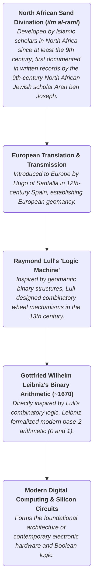

[[atomic]]

# CCRU Abstract Culture Digital Hyperstition (1999) {#title}

[[toc]]

## Overview

The provided source is a collection of esoteric and avant-garde texts from the Cybernetic Culture Research Unit that weaves together **science fiction, occult numerology, and fringe philosophy** to explore how technology and human history are driven by **deep-seated geological and cosmic trauma**. Through fictional interviews, academic parodies, and complex diagrams like the **Numogram**, the publication posits that mathematics, computer glitches like Y2K, and ancient myths are actually active forces shaping reality and collapsing conventional timelines. Ultimately, its purpose is to construct a **hypermaterialist mythology** where numbers, digital networks, and cultural anxieties function as living, machinic entities capable of destabilizing human consciousness and rewriting the future.

<CCards :useFinder="true" :cards="[['quantum', 'ccru'], ['technical', 'numogram'], ['reading', 'nick-land'], ['reading', 'digital-objects']]" />

### Barker Speaks

1. https://s3.amazonaws.com/arena-attachments/1704337/ca73411ad68b7ede1e4f9715777b3527.pdf?1517861492
2. https://monoskop.org/images/f/f1/CCRU_Abstract_Culture_Digital_Hyperstition_1999.pdf

Professor Daniel Charles Barker's interview outlines a **radical decoding of reality** that replaces traditional human-centric interpretations with an inorganic, cosmic-materialist perspective. The text systematically dismantles conventional assumptions about communication and psychology, arguing instead that biological life, historical evolution, and psychological trauma are actually **frozen geological shocks** and physical reactions to ancient planetary catastrophes. Through concepts like spinal evolution and vocal development, Barker demonstrates how human existence is fundamentally shaped by **suborganizational patterns and seismic stresses** rather than purposeful design or personal histories. Ultimately, the source serves to liberate numbers and systems from standard metrics, revealing an abstract, **non-chronological numeracy** that maps the deep, impersonal memory of the Earth itself.

## **Demystifying Nonmetric Mathematics: An Analytical Summary of Barker Numbering and the Barker Spiral** {#barker-spiral}


### 1. Introduction: Beyond Standard Metric Measurement

In conventional mathematics, quantitative analysis, and scientific empirical measurement, numbers are traditionally deployed to count, classify, and order phenomena along linear, metric scales. However, Professor Daniel Charles Barker formulates a foundational critique of this standard arithmetical framework. Barker demonstrates that conventional measurement and taxonomy rely on rigid, pre-established conceptual segmentations—what philosophers Gilles Deleuze and Félix Guattari identify as the "twin-pincers of molarity, type and degree." These established systems presuppose prior frameworks of intentionality, subjectivity, interpretability, and hierarchical order, reducing numbers to mere instruments for measuring pre-segmented spatial or temporal extents.

When applied to disorganized, intensive multiplicities—designated in Barker’s research as **tic-systems** or assemblies of functionally interconnected microstimuli—standard quantitative counting and metric classification prove fundamentally inadequate. Tic-systems represent flat, nonmetric arrays of intensive populations (such as suborganic quasireplicators, bacterial circuitries, and micro-informational deposits) that resist subject/object segregation and rigid disciplinary typologies. Because these systems propagate immanently rather than adhering to external structural hierarchies, applying metric scales imposes an artificial overcoding that obscures their operational dynamics.

To grasp the operational significance of Barker's critique, an introductory learner must recognize that standard arithmetic overcodes numbers, constraining them to serve a purely metric and chronological function. To analyze self-propagating, suborganizational signal networks without projecting anthropomorphic assumptions, numbers must be liberated from this metric overcoding. Once decoded, numbers cease to be passive tools for quantifying external magnitudes; instead, they begin to operate **diagrammatically**—immanently numbering, mapping, and propagating intensive multitudes on their own terms.

> "Diagonal, irregular, molecular, and nonmetric quantities require a scale that is itself nonmetric, that escapes overcoding... [...] Once numbers are no longer overcoded, and thus released from their metric function, they are freed for other things, and tend to become diagrammatic."

Moving from this foundational critique of metric measurement toward an actionable mathematical model requires examining the explicit mechanics of Barker Numbering and its nonmetric operational framework.

### 2. Core Mechanics of Barker Numbering and Zygonovic Numerism

Barker Numbering shifts mathematical analysis away from standard chronological order and toward **intensive sequence**. Standard chronological order presupposes structural redundancy—a "sequenced sequence" bound to linear temporal progression and historical causation. In contrast, a decoded sequence represents sheer numeracy prior to any chronological insertion. Decoded sequences do not unfold along linear timelines; rather, they arrive in convergent waves that proceed by infolding, involution, or **implex**.

To operationalize this nonmetric numeracy, Barker introduces **zygonovic numerism** through the formal mechanism of **digital twinning**. By grouping decimal numerals into complementary 9-sum twin pairs, numbers are flattened into an abstract intensive wave that remains entirely indifferent to cumulative quantitative magnitude. This process isolates the primary structural key of the decimal system: **decimal syzygetic complementarity $(9=0)$**.

Within this framework, the numeral 9 ceases to represent an accumulated quantity of nine discrete units; instead, it functions as a **positive (or full-body) zero**. This positive zero represents the abstract numeric product of decimal-magnitude minus one, infinitesimalized as 1 = 0.999... reiterating. Significantly, this abstract mathematical reduction intersects directly with semiotic sign-systems, providing the underlying numeric code for specific modes of commercial proliferation within capitalist semiotics (exemplified by threshold pricing structures such as $99.99).

| Concept                                       | Definition & Structural Function in Barker Numbering                                                                                                                                                      |
| --------------------------------------------- | --------------------------------------------------------------------------------------------------------------------------------------------------------------------------------------------------------- |
| **Intensive Sequence**                        | A decoded, sheer numeracy operating prior to chronological structure, propagating through infolding, involution, or implex rather than linear causation.                                                  |
| **Zygonovizing (Digital Twinning)**           | The systematic pairing of decimal numerals based on 9-sum complementarity to map an abstract intensive wave that remains indifferent to numerical magnitude.                                              |
| **Decimal Syzygetic Complementarity $(9=0)$** | The structural equivalence revealed through digital reduction, establishing that the numeral 9 functions as functionally identical to 0 in an intensive numeric frame.                                    |
| **Positive (Full-Body) Zero**                 | The operational role of the numeral 9 as the ultimate decimal digit (1 = 0.999...), grounding both abstract digital reduction and real-world commercial sign-systems (e.g., capitalist $99.99 semiotics). |

To convert a standard decimal understanding into a zygonovic numeric frame, a learner must apply three pedagogical steps:

- **Step 1: Strip metric overcoding and chronological assumptions.** Detach digits from representing cumulative quantities or linear temporal markers, reorienting the numerical sequence as an implex of convergent waves.
- **Step 2: Apply digital twinning (zygonovize) across decimal digits.** Perform digital reduction by pairing digits through 9-sum complementarity (0-9, 1-8, 2-7, 3-6, 4-5). For multi-digit numbers, iterate sum-of-digits reductions until single-digit syzygetic complements are isolated.
- **Step 3: Reconceptualize 9 as a positive (full-body) zero.** Institute decimal syzygetic complementarity (9=0), treating 9 not as a cumulative metric total, but as a full-body zero derived from decimal-magnitude minus one (1 = 0.999...) that underwrites both mathematical implex and capitalist semiotic codes.

This theoretical framework of 9-sum twinning transitioned from an abstract equation into an active diagrammatic model through the unexpected structural insights offered by game systems and the Barker Spiral.

### 3. The Barker Spiral (Diplozygotic Spiral)

The diagrammatic architecture of Barker's system fully coalesced through the discovery of the **Barker Spiral** (also designated as the **Diplozygotic Spiral**). Barker derived this model while investigating the mathematical structures underlying traditional and occulted card games.

The standard game of _Decadence_ relies on a 10-sum system reflecting human bilateral anatomy (two hands of five fingers each). In _Decadence_, the digit 5 doubles with itself to sum to 10, scoring zero. While this 10-sum pairing hinted at an underlying syzygetic arithmetism, it remained constrained within standard metric calculations. The theoretical breakthrough occurred with the discovery of an occulted variation called _Subdecadence_. Subdecadence replaces the 10-sum rule with a **9-sum twinning system** governed by zygonovic numerism. By introducing zeroes and explicit 9-0 twin pairs, Subdecadence unlocked the hidden architecture of the decimal system.

Synthesizing the mechanics of _Decadence_ and _Subdecadence_ caused the **Barker Spiral** to spontaneously condense as an immanent diagrammatic key. As illustrated in **[SOURCE_IMAGE_1]**, the diagram features a central vertical axis containing the digits 0 through 9 stacked in linear numerical order from bottom to top. Intersecting this vertical axis is a single, continuous spiral curve that loops back and forth across the axis. Geometrically, each arm of the spiral links complementary digits whose sum equals 9 across the central vertical gradient (joining 0 to 9, 1 to 8, 2 to 7, 3 to 6, and 4 to 5 at the center), visually demonstrating how linear order infolds into intensive syzygetic pairing.

- **Standard Decadence (10-Sum Systems)**
  - _Anatomy:_ Structured around a 10-sum pairing mechanism rooted in human bilateral anatomy (2 \times 5 fingers).
  - _Mechanism:_ Pairs numbers that sum to 10 (such as 5 doubling with 5) to score zero.
  - _Limitation:_ Remains bound to metric calculations and standard decimal groupings, failing to access the diagrammatic depth of nonmetric sequences.
- **Subdecadence / Barker Spiral (9-Sum Systems)**
  - _Anatomy:_ Structured around a 9-sum twinning system operating through zygonovic numerism.
  - _Mechanism:_ Integrates zeroes directly into numeric pairing, forming explicit 9-0 twins where 9 operates as a positive zero.
  - _Diagrammatic Unlocking:_ Visualized in **[SOURCE_IMAGE_1]** as a continuous looping spiral intersecting a vertical column of stacked digits (0–9), geometrically bridging complementary twin pairs across the central axis to access the decimal system's hidden crypt.

By mapping these numbers along a continuous curving pathway, the Barker Spiral provides key insights into how nonmetric mathematics transforms our understanding of numerical relationships.

### 4. Synthesis: Primary Takeaways for the Learner

To transition from standard metric arithmetic to nonmetric mathematics, a learner must master three primary paradigm shifts:

1. **Numbers Operate Diagrammatically Beyond Metric Quantity:** When stripped of metric overcoding and chronological assumptions, numbers cease to be mere counters of external magnitude or markers of linear time; instead, they function as self-propagating, intensive sequences that immanently map complex multiplicities.
2. **Zygonovic Twinning Establishes Decimal Syzygetic Complementarity (\*\***9=0\***\*):** By organizing decimal numerals into 9-sum twin pairs rather than traditional 10-sum groupings, mathematics reveals an abstract intensive wave wherein the numeral **9** functions as a **positive, full-body zero** (1 = 0.999...), providing the formal basis for both digital reduction and capitalist semiotic pricing codes ($99.99).
3. **The Barker Spiral Geometrizes Nonmetric Implex:** As visualised in the Diplozygotic Spiral **[SOURCE_IMAGE_1]**, transitioning from 10-sum metric models (_Decadence_) to 9-sum twin systems (_Subdecadence_) allows numbers stacked along a linear axis (0–9) to be folded along a continuous spiral curve, graphically demonstrating how numerical order resolves into syzygetic convergence.

## **The Dual Nature of Y2K: Technical Mechanics, Global Panic, and Cyber-Subcultures** {#y2k}

### 1. The Architectural Mechanics: Two-Digit Dates and K-Time

The technical origin of the Y2K bug stems from a foundational formatting constraint embedded deep within the architecture of global infotechnics. In early computational programming, memory conservation dictates dictated truncating date storage to a two-digit year code (`MM`), incapable of incrementing past `99`. As the year 2000 approached, this binary-register constraint forced an unavoidable rollover from `99` to `00`. Within the internal logic of digital circuitry, `00` does not designate the dawn of a third millennium; instead, it triggers an automated zero-function that digitally erases the twentieth century, reducing stored records to what technical commentators termed "MMbo-jumbo."

This formatting anomaly exposed a fundamental structural friction between two mutually incompatible temporal frameworks: traditional Gregorian/Oecumenic doctrine and the native calendar of digital systems, known as Cybernetic K-Time.

- **Cybernetic K-Time** is the immanent, native calendar of cyberspace. It operates as an unconscious, planetary, technocultural matrix that counts forward from its Year Zero (`00` = AD 1900) using Hindu-Arabic positional notation. Never centrally planned or humanly intended, K-Time functions automatically within two-digit computational registers, remaining entirely indifferent to religious, cultural, or ideological creeds.
- **Gregorian Calendar Doctrine** serves as the normative temporal security architecture of global capital and administrative control (the _Oecumenon_). Formulated through Roman numeral traditions and historical calculations by the sixth-century monk Dionysius Exiguus ("Little Dennis"), Gregorian doctrine is intrinsically flawed as an instrument of precise numerical tracking. Little Dennis incorrectly dated the Incarnation of Jesus to 753 AUC of the Roman calendar and commenced counting directly from Year AD 1, operating without an intrinsic concept of Year Zero. Consequently, a calendar anchored in Roman numerals without a zero-baseline postpones the beginning of its third millennium to AD 2001, possessing no conceptual mechanism to interpret a double-zero (`00`) rollover as anything other than a structural impossibility.

| Gregorian Calendar Doctrine (Oecumenon)                                                                                                                                                                                                                  | Cybernetic K-Time (Cyberspace)                                                                                                                                            |
| -------------------------------------------------------------------------------------------------------------------------------------------------------------------------------------------------------------------------------------------------------- | ------------------------------------------------------------------------------------------------------------------------------------------------------------------------- |
| **Origin / Inception**: Ecclesiastical and historical formulation by Dionysius Exiguus ("Little Dennis"), anchored to 753 AUC (commencing at AD 1). Serves as the normative civil time-standard for planetary security and global capital (_Oecumenon_). | **Origin / Inception**: Unconscious, technocultural emergence within global computing networks; counts automatically from its Year Zero (`00`), corresponding to AD 1900. |
| **Notation Method**: Derived from Roman numeral conventions; historically lacks an operational concept or structural notation for Year Zero.                                                                                                             | **Notation Method**: Utilizes Hindu-Arabic positional notation structured around two-digit computational registers (`00`–`99`).                                           |
| **Concept of Year Zero**: Absent; direct counting from Year 1 postpones the third millennium to AD 2001, lacking any structural baseline for double-zero epochal shifts.                                                                                 | **Concept of Year Zero**: Fundamental; operates immanently from Year Zero (`00` = 1900) as its primary count-inception baseline.                                          |

#### The n - 1 Zero-State and Machine Mechanics

The reduction of calendar years to two digits transformed a routine, memory-saving line of code into an unintended, machine-driven threat. By utilizing two-digit Hindu-Arabic notation, computer systems inadvertently installed the first intrinsically apocalyptic calendar in human history. Because digital dates could not increment past `99`, the rollover to `00` activated an absolute zero-function within the global electronic registry.

Within the framework of hypermaterialism—the philosophy of abstract machines—this structural glitch demonstrated that virtualities act as efficient factors of production. Cybernetic K-Time reveals a raw decimal mechanics where nine functions as a positive (or full-body) zero (9 = 0). When decimal magnitude is infinitesimalized (1 = 0.999...), the reduction of the year code operates as an n - 1 machine logic. The system does not merely experience a software error; the computational code becomes an artificial time-bomb where the timer _is_ the bomb. The imminent double-zero rollover threatened to collapse the entire memory architecture of global capital back into an unformatted zero-intensity state.

This mechanical bottleneck in the planetary digital infrastructure rapidly spilled beyond the domain of technical maintenance, escalating into a worldwide crisis of governance, financial stability, and systemic panic.

### 2. The Technopanic and Economic Triage: Anticipatory Looping and Global Impact

The operational and financial ramifications of the Y2K bug presented an unprecedented global crisis, with total mitigation, hardware replacement, and emergency remediation costs estimated at **$3.6 trillion and counting**. Facing an immovable, mathematically precise deadline, Western governments and corporate bureaucracies were forced to execute radical survival strategies. Recognizing that complete software compliance was impossible within the remaining timeframe, institutions abandoned universal repair and engaged in aggressive systemic triage. Lower-priority administrative, municipal, and commercial sectors were formally written off, accepting incalculable operational risk in order to concentrate remaining software engineering resources strictly on life-critical infrastructure: nuclear generation facilities, strategic defense C3I (Command, Control, Communications, and Intelligence) networks, core information functions, and institutional financial registries.

This operational strain was severely intensified by compounding macroeconomic and geopolitical pressures:

- **European Currency Conversion:** <Hl color="#FFF3A3">The Y2K remediation crisis direct coincided with the rollout of the Euro, forcing financial institutions to draw from the exact same pool of overstretched programming specialists.</Hl> The intense competition for technical labor led French banking executives to mutter openly about an <Hl color="#FF5582">"Anglophone conspiracy," suspecting that Y2K was a virtual missile launched to sabotage the birth of the European Union meta-state.</Hl>
- **Software Piracy and Non-Western Vulnerability:** Developing economies faced catastrophic exposure due to low institutional preparedness compounded by pervasive reliance on pirated software, which lacked official vendor patches, documentation, or debugged updates.
- **Y2Keynesianism:** The crisis sparked an artificial demand shock throughout the global economy, forcing accelerated capital expenditure into emergency IT debugging, forced hardware upgrades, and structural technological re-engineering.

<Hl color="#FF5582">Underpinning this systemic shock was the dynamic of **anticipatory looping**. Y2K operated as a uniquely self-confirming disaster that arrived from the future. Because the precise instant of the event was known in advance, pre-emptive modeling, institutional fear, and market panic directly generated the material reality of the crisis ("panic is creation"). Attempting to model the chaotic singularity introduced noise and complexity into global networks, which in turn amplified financial instability and operational dread.</Hl>

#### Systemic Impacts of the Millennial Technopanic

- **Infrastructure & Bureaucratic Triage**
  - Mandatory consolidation of programming resources onto life-critical infrastructure nodes (nuclear power plants, defense command centers, global wire transfer networks).
  - Strategic abandonment and write-off of non-essential civic, administrative, and small-business software systems.
  - Governmental preparation for emergency contingencies approximating martial law, including the blanket cancellation of military and police leave to mitigate potential civil breakdown resulting from C3I failures.
- **Macroeconomic Stress & Competition**
  - Direct structural competition for programming talent between Y2K code debugging and the technical requirements of the Euro currency conversion.
  - Acute technological vulnerability in developing nations caused by widespread usage of unpatchable, pirated software environments.
  - Rapid market destabilization and artificial capital deployment driven by "Y2Keynesian" expenditure on mandatory hardware replacements and emergency technical consulting.
- **Feedback Loops & Panic Dynamics**
  - Operationalization of "anticipatory looping," wherein predictive risk-modeling actively generated supply hoarding, market volatility, and administrative overstretch prior to the temporal rollover.
  - Widespread expansion of post-tribulationist survivalism, blending micro-militia mobilization, physical stockpiling, technophobic theology, and eschatological panic into self-fulfilling crisis scenarios.

#### The Reality of Teotwawki

The cultural acronym **Teotwawki** (_The End Of The World As We Know It_) emerged not as a mere survivalist myth or media hyperbole, but as an artificial destiny produced by techonomic feedback loops. It designated the exact threshold where market acceleration, computational reliance, and self-confirming panic crossed into physical reality. Teotwawki demonstrated that when financial and semiotic panics achieve feedback saturation, hyperstitional constructs actively rewrite the operational material base of society.

As mainstream capital and state apparatuses scrambled to insulate the global security architecture from this self-induced singularity, the massive waste streams generated by this technopanic laid the material foundations for radical digital subcultures.

### 3. Cyberpunk Cargo-Culture and the "Y2K-Positive" Resignification

While mainstream institutions viewed Y2K as an apocalyptic malfunction requiring total eradication, the crisis catalyzed a radical cultural inversion within the digital underground: "Cyberpunk begins with Y2K." As corporations panicked and executed hyper-accelerated hardware replacement cycles, vast quantities of fully functional infotechnic hardware were prematurely dumped into urban waste streams and junk-shops.

This hardware surplus provided the material base for an urban, skip-scavenging **cargo-culture**. Underground hackers, fringe artists, and subcultural collectives scavenged, hot-rodded, and subsocially recycled these discarded electronics, unfreezing their latent machinic potential outside the regulatory control of corporate capitalism.

Concurrently, radical subcultural factions lurking within the dark-twin of the web (the "Crypt") rejected the defensive posture of mainstream society. Rather than fearing the zero-rollover, these shadowy collectives declared themselves **Y2K-positive** (also known as _Yettuk cults_ or _K-Goths_). They viewed the global debugging drive not as a neutral maintenance effort, but as an aggressive campaign of **Gregorian Restoration**—a neoroman sociopolitical agenda spearheaded by planetary capital to force cyberspace back under the authority of an obsolete, linear calendar.

Framing the bug as a **Lemurian time-missile**, Y2K-positive factions celebrated the double-zero rollover as a pure numerical-subtractive threat (n - 1) to established temporal order. They interpreted `00` as a machinic event that liberated time from human ideological and religious overcoding, initiating a state of radical temporal secession.

> "A...so Mbug resistors think MATRIX needs a new calendar-totally steam-punk. Wake up! 'Ts already K-Time. Count 0 = Greg Date 1900..." — **Count S Zero**

**Calendric Secessionism**: The movement among counter-Gregorian and Y2K-positive subcultures to break away from Oecumenic (standard civil) time, driving the disintegration of universal temporal standards through the autonomous adoption of K-Time.

#### Gregorian Compliance vs. K-Time Continuism

This subcultural schism defined a fundamental ideological battle over the control of digital temporal architecture:

1. **Mainstream "Bug Resistors"**: Demanded total Gregorian compliance. Their objective was to sanitize computational code, eliminate the zero-state anomaly, and preserve the continuous timeline of Western civil history (the _Oecumenon_).
2. **Underground "Continuists"**: Advocated the preservation and expansion of K-Time. First detailed in Katy Shaw’s 1996 report, _A Future You Can Count On_, continuist strategy proposed adopting a **trinomic date-coding** standard (0K+100, where AD 2000 is designated as 0K+100). This system updated the K-Time count without introducing artificial discontinuities or capitulating to Gregorian calendar authority.

These rival temporal philosophies were actively weaponized by distinct, highly organized subcultural factions within the digital datacombs.

### 4. Anatomy of the Digital Datacombs: Key Y2K Subcultural Factions

The temporal schism of Y2K catalyzed the emergence of specialized underground factions within the web's datacombs. These groups weaponized **chronodissidence**—the tactical deployment of alternative calendars, polyrhythmic frequencies, micro-temporal disruptions, and mathematical zero-states—to combat the universal temporal norming of planetary capital (_Oecumenon_).

| Subcultural Faction                   | Core Philosophy & Strategy                                                                                                                                                                                                                                                                                          | Key Concepts & Practices                                                                                                                                                                                                                                                                                                                                                                                                                                                                         |
| ------------------------------------- | ------------------------------------------------------------------------------------------------------------------------------------------------------------------------------------------------------------------------------------------------------------------------------------------------------------------- | ------------------------------------------------------------------------------------------------------------------------------------------------------------------------------------------------------------------------------------------------------------------------------------------------------------------------------------------------------------------------------------------------------------------------------------------------------------------------------------------------ |
| **K-Goths / Yettuk Cults**            | **Y2K-Positive / Calendric Secessionism**: Interpret Y2K as a machinic "Lemurian time-missile" designed to shatter Gregorian temporal authority. They reject debugging as "Gregorian Restoration" and enforce K-Time continuity via trinomic date-coding (0K+100).                                                  | • **A-Death**: State of neuroelectronic flatline engineered via Sarkonian mesh-processing and systematic micropause abuse.<br>• **Catajungle**: Dark sonic subgenre constructed from click-drifts and deep chthonic sub-bass.<br>• **K-OS**: Distributed, auto-mutational mesh-processing software insurgency operating in the Crypt to sabotage Microsoft hegemony.                                                                                                                             |
| **Hyper-C (Afroatlantean Centience)** | **Liquidarity & Polyrhythmic Insurgency**: Militant Afroatlantean cult that views Y2K as "a scratch on the vinyl of history." They practice amphibious nonumentalism, subaquatic martial arts (sino-hydro-synthetics: "insert the Sun Tzu chip"), and rhythmic insurgency alongside the Drexciyans ("wavejumpers"). | • **Breakasymmetrics**: Polyrhythmic production clustered around 180\text{ bpm} (kode9 plateau of continuous variation) and 132\text{ bpm} (micro-break demonic two-step).<br>• **Maritime Clock Setting**: Tactical synchronization of all temporal hardware to maritime time (`maritime<K+`).<br>• **Aquassassins**: Deployment of "Electronic Funk Bombs" across distributed undersea pod networks (C-Net, Inc., modeled on Buckminster Fuller's submarine islands under the Black Atlantic). |
| **Centience / Returnity Cults**       | **Mystical Calendric Extremism**: Maintain that the two-digit century loop (`00`–`99`) encompasses the entirety of real time. They interpret binomic K-Time as an Atlantean sign that the universe itself is an execution run within cyberspace.                                                                    | • **Infallible Electroscripture**: Total adherence to two-digit binomic K-Time as divine, non-arbitrary machine text.<br>• **Annihilation of C20th**: Active expectation that Y2K will trigger the "Fall of Babylon" and induce the total financial destruction of the 20th century.                                                                                                                                                                                                             |

#### The First True Countercultures of the Digital Age

Far from being trivial internet subcultures, these factions operated as the first genuine countercultures of the digital age. Through **chronodissidence**, they converted systemic technical vulnerabilities into instruments of weaponized cultural resistance. Where planetary capital attempted to enforce a unified, seamless global temporal standard to ensure uninterrupted commercial flow, these underground networks deployed raw mathematics, sub-bass frequencies, software viruses, and alternative dating protocols to carve out autonomous zones within the network grid.

### Conclusion: The Dual Legacy of Y2K

The Y2K phenomenon revealed the profound structural duality at the heart of modern infotechnics. On one hand, it exposed the raw vulnerability of global capital—demonstrating how a simple two-digit programming optimization (MMbo-jumbo) could precipitate a $3.6 trillion systemic bottleneck, forcing governmental triage, military leave cancellations, macroeconomic instability, and widespread anticipatory panic.

On the other hand, Y2K marked the historical birth of digital hyperstition and cyber-counterculture. The massive waste streams of premature hardware obsolescence birthed a skip-scavenging cargo-culture, while its mathematical zero-state provided the hyperstitional catalyst for radical factions to declare calendric secession. Ultimately, Y2K proved that computational code is never merely technical; it is an active, time-travelling force capable of generating planetary panic, restructuring material economics, and birthing radical new cultural movements within the digital datacombs.

## **Conceptual Primer: The African Roots of Binary Code and Recursive Mathematics** {#african-roots-of-binary}

### 1. Introduction: Uncovering the Forgotten Genealogy of Computing

Modern digital computing and recursive mathematics rest upon foundational concepts developed centuries ago in traditional African knowledge systems. While contemporary technology often frames base-2 logic and algorithmic modeling as exclusive products of the Western Enlightenment, historical and mathematical analyses reveal a direct genealogy connecting ancient African practices to the software architectures and hardware logic that power today's world.

**Historical Trajectory of Binary Logic:**



This historical continuity is frequently obscured in modern cultural discourse. Musician and producer Brian Eno once famously remarked in an interview with _Wired_ that the fundamental issue with computers is that they "don't have enough African in them." While Eno intended this statement as a compliment regarding the adaptive rhythm, expressive fluidity, and dynamic flexibility of African music and performance, his framing inadvertently reinforces a limiting dichotomy. By conceptualizing African contributions purely in terms of physical performance and auditory rhythm, such perspectives overlook the historical reality that the structural backbone of computing—binary code itself—was derived from African mathematical systems.

**Key Concept for Computer Science History**

**So What?** Recognizing the African lineage of binary arithmetic shifts our understanding of computer science from an isolated European invention to a global, historically interconnected evolution. Base-2 logic did not spontaneously emerge in 17th-century Europe; it was adapted from centuries-old African algorithms for data representation, probabilistic reduction, and recursive processing.

To understand how these principles migrated from traditional practices into computational architecture, we must examine the specific mathematical mechanics of base-2 counting and binary divination.

### 2. Base-2 Arithmetic and Binary Divination: From Sand Rites to Silicon Circuits

Binary computation—counting in base-2 using only two distinct states—was widely utilized throughout sub-Saharan Africa and Ancient Egypt long before its formal mathematical description in Europe. In Ancient Egypt, fundamental multiplication and division relied upon systematic doubling procedures, a base-2 calculation method. Classical historians such as Diodorus Siculus and Aelian noted that ancient Egyptian priests utilized symbolic representations split into symmetrical halves, which they designated as an "image of truth cut in halves."

This mathematical focus on doubling and base-2 operations extended far beyond numerical calculation into the metaphysical structures and divination rituals of West Africa (such as the _Fa_ and _Ifa_ systems) and North Africa (_ilm al-raml_, meaning "the science of sand").

#### The Algorithmic Mechanics of Binary Divination

Divination practices like _Fa_, _Ifa_, and _ilm al-raml_ operate through a deterministic, step-by-step algorithm that maps physical random input to a discrete binary state:

1. **Random Input Generation:** The practitioner draws four random sets of dashed lines in the sand or rapidly shifts palm nuts between hands to generate an uncounted integer quantity of marks.
2. **Addition Modulo 2:** The individual marks in each line are paired off using addition modulo 2 $(\text{mod } 2)$ to evaluate whether the total count is even or odd.
3. **Single Bit Generation:** An even sum yields a 0 remainder, recorded as two vertical strokes $(||)$. An odd sum yields a 1 remainder, recorded as a single vertical stroke $(|)$. Each line produces exactly 1 bit of information.
4. **4-Bit Array (Nibble) Selection:** Combining four of these binary digits creates a 4-bit array (yielding $2^4 = 16$ possible states). This 4-bit array, or "nibble," selects 1 of 16 core divination archetypes (representing fundamental system states such as _ruler_, _travel_, or _desire_).
5. **Recursive Generation:** The practitioner systematically applies the same pairing operation recursively to the binary digits of the initial figures, generating 12 additional secondary figures to yield a complete 16-figure matrix.

#### Cultural and Metaphysical Context of Doubling

This mathematical logic reflected a broader cultural worldview centered on binary symmetry and recursive expansion. In West African societies, particularly within Fon and Yoruba metaphysics, doubling held sacred structural significance:

- **Sacred Symmetries:** Twins and spirit doubles were accorded elevated social and spiritual status, symbolizing dual states within a unified whole.
- **Material Culture:** Blacksmiths utilized dual-chambered twin bellows, and double iron hoes served as currency in bridewealth transactions.
- **Metaphysical Expansion:** Literary scholar Henry Louis Gates Jr. analyzed Yoruba and Fon metaphysics as a systemic process of "doubling the double." In Yoruba metaphysics, the number 4 and its multiples (8, 16, 256) are fundamental. The two sides of the trickster deity Esu "disclose a hidden wholeness," utilizing binary opposition to signify passage between dual aspects of a system rather than permanent division.

| Divination System Component    | Mathematical / Binary Rule                                   | Modern Computing Equivalent         |
| ------------------------------ | ------------------------------------------------------------ | ----------------------------------- |
| **Single Line Sum**            | Addition Modulo 2 ($\text{mod } 2$ Even / Odd determination) | Single Bit (0 or 1)                 |
| **4-Line Divination Figure**   | 4-Bit Binary Array ($2^4 = 16$ possible states)              | Nibble / Hexadecimal Representation |
| **Secondary Figure Expansion** | Recursive pairing function applied to initial bits           | Algorithmic Expansion / Subroutine  |

While these discrete binary structures established a foundation for state representation, traditional African mathematics also applied recursive rules to continuous dynamic systems and self-organizing patterns.

### 3. Recursive Patterns and Self-Organization in African Games and Architecture

Beyond static binary tables, traditional African knowledge systems incorporated non-linear additive series and dynamic feedback loops. These applications appear in traditional board games, architectural scaling, and social structures.

#### Non-Linear Additive Numeric Series

##### 1. Triangular Numbers

The triangular number series (1, 3, 6, 10, 15...) is generated recursively by adding the current iteration step i to the preceding sum:

$$N_{i+1} = N_i + i \quad \text{where } N_0 = 0$$

- **Cultural Application:** Used in the East African game _tarumbeta_, where one player counts and removes stones arranged in expanding triangular arrays while another player calls out row transitions without looking.
- **Social Parallel:** The iterative generation of triangular numbers mirrors age-grade initiation cycles in many traditional African societies. Individuals pass through successive "turns" of an iterative life cycle, assuming expanded social roles as their iteration level increases.

##### 2. Fibonacci Series

The Fibonacci sequence $(1, 1, 2, 3, 5, 8, 13...)$ generates each subsequent value by summing the two preceding numbers:

$$N_{i+1} = N_i + N_{i-1}$$

- **Architectural Layouts:** Studies of Ancient Egyptian architecture (such as research by Alexander Badawy and Ron Eglash) reveal the Fibonacci series in the dimensional scaling of successive chambers in the Temple of Karnak.
- **Measurement Systems:** Ancient balance weights utilized in Egypt, Syria, and Palestine (circa 120 BCE) employed Fibonacci increments. Mathematically, any positive integer can be uniquely constructed through the sum of a specific subset of non-consecutive Fibonacci numbers (Zeckendorf's theorem), making it an optimal system for physical weight measurement with minimal counterweights.

#### _Owari_ as a One-Dimensional Cellular Automaton

The traditional Ghanaian board game _Owari_ (belonging to the widespread family of pit-and-pebble games known variously as _ayo_, _bao_, _giuthi_, _lela_, _mancala_, _omweso_, and _songo_) serves as a physical execution of a one-dimensional cellular automaton.

In _Owari_, players scoop seed counters from a designated cup and distribute them sequentially, one by one, into subsequent cups around a 12-cup board. Ghanaian players identified emergent, self-sustaining spatial configurations, most notably the **"marching group"**—a sequence of cups whose seed counts decrease incrementally by one (e.g., $4\text{-}3\text{-}2\text{-}1$). When a player scoops from the largest cup in a marching group, the distribution replicates its exact numerical pattern shifted one cup to the right. Uninterrupted, this wave-like pattern propagates continuously around the board grid.

#### Unified Mathematical Synthesis: Triangular Numbers as _Owari_ Generators

A profound mathematical convergence exists between the discrete series in East African games and the spatial patterns of West African _Owari_:

- **The Triangular Generator:** Analysis of _Owari_ board dynamics demonstrates that the total counter values across the board that successfully converge into stable, self-replicating marching groups (1, 3, 6, 10, 15...) are **precisely the triangular numbers** generated in _tarumbeta_!
- **Cycle Period Formula:** The period length of periodic loops occurring between successive marching group states is governed by the formula:

$$\text{Period Length} = 3 + i$$

where i is the iteration level of the preceding triangular number. This mathematical relationship demonstrates an underlying unified structural framework bridging East and West African game dynamics.

#### Dynamic Behaviors in _Owari_ Systems

- **Point Attractors / Constant Patterns:** Configurations such as the marching group that preserve their spatial structure while translating across the system grid through iterative play.
- **Limit Cycles / Periodic Attractors:** Seed patterns that cycle deterministically through a finite sequence of states (for example, period-3 loops such as $2\text{-}1\text{-}1 \rightarrow 2\text{-}2 \rightarrow 3\text{-}1 \rightarrow 2\text{-}1\text{-}1$).
- **Basin of Attraction / Transients:** The operational steps required for an arbitrary initial board arrangement to settle into a stable attractor. Indigenous players utilize maximum-length transients as an endgame tactic called "slow motion," accumulating counters on their side of the board to stall state transitions and prevent opponent captures.

#### Socio-Political Perspectives on Self-Organization

The self-replicating behavior observed in _Owari_ prefigured the formal mathematical theories of cellular automata developed by John von Neumann and Stanislaw Ulam (and later popularized via John Conway's _Game of Life_). However, the socio-political motivations shaping these discoveries were markedly distinct:

- **Von Neumann's Mechanistic Cold War Context:** Shaped by political volatility in Eastern Europe and subsequent Cold War nuclear defense research for the Atomic Energy Commission (AEC), von Neumann sought strict mathematical control. His interest in self-reproducing automata and radiation tolerance grew out of survivalist theories—conceptualizing mechanical progeny that could endure nuclear war and outlive organic purging.
- **Traditional Ghanaian Ecological Context:** In contrast, Ghanaian societies integrated the self-organizing dynamics of _Owari_ into biological growth and human social continuity. In the Twi language of Ghana, the word _wari_ translates directly to "he/she marries." Rather than framing recursive rules as a mechanism for surviving apocalypse, traditional practice linked discrete game dynamics to life cycles, marriage, and living reproduction.

This connection between discrete recursive rules and biological growth leads directly to the visual geometry of logarithmic spirals in nature and art.

### 4. Biological Morphogenesis and Sacred Geometry: The Logarithmic Spiral

In modern biophysics and computer science, multi-state cellular automata model complex natural self-organization, including slime mold aggregation, heart tissue electrical waves, cerebral cortex dynamics, and biological morphogenesis. Early computer scientist Alan Turing initiated his seminal work on biological pattern formation by analyzing the geometry of the logarithmic spiral.

#### Algorithmic Generation: Refractory/Ghost States

To generate continuous logarithmic spirals from discrete cellular automata grid rules, simple two-state ("live" or "dead") models are insufficient. Advanced models (such as Zhabotinsky CAs) require multi-state cellular automata (e.g., 3-state or 6-state systems):

1. **State Definitions:** Cells exist as _Live_ (active state), _Ghost/Refractory_ (resting/memory state), or _Dead_ (inactive state).
2. **Transition Rules:** Dead cells adjacent to live cells become live in the next iteration. Live cells transition into the refractory/ghost state in the subsequent iteration. Refractory cells then decay into dead cells.
3. **Symmetry Breaking:** The refractory/ghost layer functions as an internal system memory. By preventing back-propagation of activation waves, this memory layer breaks spatial symmetry, providing the directed growth required to generate stable, paired logarithmic spiral lattices.

```txt
[ Dead Cell ]  ---> (Activated by Adjacent Live Cell) ---> [ Live Cell ]
      ^                                                         |
      |                                                         v
[ Inactive State ] <--- (Decays in Next Iteration) <--- [ Ghost / Refractory ]
                                                         (Acts as System Memory)
```

#### West African Cultural Artifacts and Sacred Icons

In West African visual culture—particularly within Akan and Ghanaian art—the logarithmic spiral served as a graphic symbol for self-organizing systems and divine organic creation:

- **Adinkra Symbol** _**Gye Nyame**_**:** Representing the supreme power of God, this iconic graphic consists of a central closed fist holding a pair of opposing logarithmic curves. It visually signifies divine stewardship over organic growth and physical forces.
- **Goldweights and Game Board Covers:** Carved wooden covers for hinged _Owari_ boards frequently featured relief carvings of logarithmic spirals radiating outward from the _Gye Nyame_ icon.

By decorating _Owari_ boards with logarithmic spiral motifs, traditional artists visually linked the discrete computational steps of the game with continuous patterns of biological morphogenesis and human renewal (_wari_).

| Scientific Application of Logarithmic Spirals                                                                                                                 | Traditional Ghanaian Cultural Expression                                                                                                    |
| ------------------------------------------------------------------------------------------------------------------------------------------------------------- | ------------------------------------------------------------------------------------------------------------------------------------------- |
| **Cellular Automata & Morphogenesis:** Modeling spiral waves in nerve axons, retina tissue, cerebral cortex, and Zhabotinsky reactions via refractory states. | **Adinkra Sacred Iconography:** The _Gye Nyame_ symbol featuring opposing logarithmic spirals held within a closed fist.                    |
| **Biological Growth Patterns:** Mathematical description of shell forms, fetal development, and self-organizing organism growth.                              | **Material Culture & Architecture:** Logarithmic spiral carvings on goldweights and hinged wooden covers of _Owari_ game boards.            |
| **Discrete Computational Modeling:** Using self-replicating cell grids to generate continuous organic patterns.                                               | **Linguistic & Ritual Integration:** Associating discrete game dynamics with human reproduction via the Twi word _wari_ ("he/she marries"). |

This synthesized understanding of computational rules, geometry, and living systems provides a framework for evaluating modern technological literacy and ethics.

### 5. Synthesis and Insights: Listening to the Future

Re-evaluating the historical foundations of computer science demonstrates that modern digital systems are part of a long computational lineage with deep roots in African culture. As physicist Donnell Walton (Chair of the National Conference of Black Physics Students, 1995) noted, studying these ancestral traditions is not merely an exercise in retrospective history, but an active engagement with our technological future:

> "The relationship between what we do as physicists today and the future that our work engenders is dialogical in the sense that not only do our present actions determine what our future will be, but we must be ever mindful of the impact of our present actions on the future... Through our moral responsibility and awareness of signals and trends, we in effect, 'listen' to what the future has to tell us."

#### Key Actionable Insights for Learners

1. **Binary Logic Has a Global Historical Lineage:** Modern binary arithmetic (0 and 1) was not designed in isolation in Europe; it developed through a historical transmission tracing back to North African sand divination (_ilm al-raml_), West African _Fa_ and _Ifa_, and Ancient Egyptian base-2 arithmetic.
2. **Recursive Logic Preceded Electronic Hardware:** Complex computational concepts—including self-replicating patterns, cellular automata dynamics, limit cycles, and non-linear numeric series (Triangular numbers governing _Owari_ marching groups)—were modeled and applied in traditional African games and architecture centuries before electronic microprocessors.
3. **Technology Functions Best Within an Ethical and Organic Framework:** Unlike Western industrial models that historically separated abstract mechanics from biological systems, traditional African ethnomathematics integrated binary computation and geometric modeling directly with concepts of living growth, human reproduction (_wari_), and long-term moral stewardship.

### Pedagogical Takeaway

> "Through our moral responsibility and awareness of signals and trends, we in effect, 'listen' to what the future has to tell us." — **Donnell Walton**, Chair of the National Conference of Black Physics Students (1995)

## **RECURSIVE ATOMS AND BINARY GENESIS: Ethnomathematical Foundations of Cybernetics and Non-Linear Dynamics in Traditional African Knowledge Systems** {#recursive-atoms}

### 1. Theoretical Foundations and Epistemological Framework

Ethnomathematics operates not as a collection of quaint cultural artifacts, but as a formal, computationally rigorous discipline that challenges conventional linear narratives in the history of science. For centuries, mainstream histories of mathematics and information science placed the genesis of digital computing, feedback theory, and non-linear dynamics almost exclusively within Western Europe and North America. However, detailed comparative analyses reveal that traditional African material, ludic, and divinatory practices embodied sophisticated recursive loops, additive numerical progressions, and base-2 arithmetic long before their formalization in modern computer science. Unearthing these computational frameworks corrects eurocentric historical trajectories by demonstrating that sub-Saharan and North African knowledge systems directly informed and conceptualized the core principles underlying contemporary cybernetics and complex dynamic systems.

#### 1.1 Epistemological Shift in Ethnomathematical Analysis

The analytical framework for evaluating African material and intellectual culture has undergone a fundamental paradigm shift. Early colonial scholarship viewed traditional African practices through a biased lens, dismissing intricate geometric layouts, counting protocols, and divinatory algorithms as evidence of primitive superstition or accidental design. Modern ethnomathematics dismantles this perspective, demonstrating that these cultural manifestations are ground-level applications of formal mathematical logic.

As demonstrated in the research of Dr. Ron Eglash, traditional African architecture, games, and designs are organized around formal recursive algorithms, fractal geometry, and self-organizing scalar patterns. Complementing this mathematical re-evaluation, physicist and Chair of the 1995 National Conference of Black Physics Students, Donnell Walton, introduced an ethical dimension to scientific inquiry through the concept of "listening to the future." Walton asserts that scientific practice shares a dialogical relationship with time: present choices determine future trajectories, requiring researchers to maintain an active moral responsibility and awareness of historical signal trends. Applying Walton's framework to the history of technology reveals that traditional African knowledge systems were not static relics; rather, they were dynamic, forward-looking information architectures whose underlying algorithmic mechanics anticipated modern digital systems.

| Historical Colonial Interpretations                                                                                                    | Modern Ethnomathematical Realities                                                                                                               |
| -------------------------------------------------------------------------------------------------------------------------------------- | ------------------------------------------------------------------------------------------------------------------------------------------------ |
| **Primitive Superstition**: Cultural artifacts and divinatory practices viewed as irrational mystic rituals.                           | **Formal Computational Systems**: Divination and ludic systems recognized as rigorous, deterministic, and probabilistic algorithms.              |
| **Arhythmic / Static Tradition**: Assumption that traditional societies lacked structural mathematical innovation.                     | **Recursive and Non-Linear Dynamics**: Active deployment of base-2 logic, iterative feedback loops $(X_{n+1} = f(X_n))$, and modular arithmetic. |
| **Linear / Metric Bias**: Evaluation of spatial and numerical practices strictly through Euclidean geometry and uniform metric scales. | **Non-Metric and Fractal Architecture**: Application of non-linear additive series, self-similarity, and logarithmic scaling.                    |
| **Eurocentric Historical Monopolies**: View that binary code and cybernetics were invented independently in modern Europe.             | **Transcultural Diffusion**: Recognition that Western binary logic directly traces its historical lineage through North/West African geomancy.   |

#### 1.2 Algorithmic Paradigms: Iteration, Recursion, and Modulo Operations

At the core of traditional African computational practices is the systematic deployment of iterative loops and recursive functions. While standard counting numbers $(1, 2, 3 \dots)$ represent a basic form of iteration, they operate linearly according to the trivial function $X_{n+1} = X_n + 1$—the numerical equivalent of an ascending staircase. True algorithmic recursion emerges when the output of a non-trivial function feeds back into the system as the input for the subsequent step:

$$X_{n+1} = f(X_n)$$

In traditional African knowledge structures, this feedback architecture is expressed through two primary computational operations:

1. **Non-Linear Additive Series**: Iterative algorithms where the increment added at each step is variable or dependent on previous states, producing exponential or polynomial expansion rather than steady linear growth.
2. **Modulo Operations**: Mathematical steps that map infinite numerical sequences onto finite, closed symbolic spaces by calculating remainders (e.g., sum-modulo-two arithmetic, where numbers are systematically reduced to binary states of 0 or 1, representing even or odd values).

These operations serve as the underlying architecture for both sub-Saharan social structures—such as formal age-grade initiation cycles ("turns of the life-cycle")—and material culture. Modern cybernetic theory relies on these exact mathematical foundations: dynamic feedback systems, cellular automata, and digital circuit logic all require iterative state changes and modular transformations to process information efficiently.

By establishing that traditional African cultural practices explicitly incorporated recursive feedback and modular arithmetic, ethnomathematics provides the theoretical groundwork for analyzing specific non-linear additive series in traditional ludic systems and architectural designs.

### 2. Non-Linear Additive Series and Architectural Recursion

Non-linear additive series represent a foundational bridge between simple counting and complex geometric scaling. Across sub-Saharan and North African societies, traditional designers and game strategists used recursive addition to generate non-metric, dynamic spatial patterns. Rather than relying on rigid, pre-measured units of Euclidean metric space, these cultures generated complex architectural and ludic layouts using simple, localized recursive rules.

#### 2.1 Triangular Numbers in East African Ludic Systems (_Tarumbeta_)

In East Africa, the mathematical structure of triangular numbers appears in the traditional game _tarumbeta_. Triangular numbers $(1, 3, 6, 10, 15 \dots)$ are generated by a recursive additive function where each successive term adds the current iteration index to the preceding sum. Formally, starting from a baseline of $N_0 = 0$, the total number of counters N at iteration level i is calculated as:

$$N_i = N_{i-1} + i$$

In _tarumbeta_, players arrange stone counters into expanding triangular arrays. While $i=1 (N_1 = 1)$ represents the mathematical base case (1 = 0 + 1), it constitutes a trivial single-stone array not used in actual play. Gameplay actively commences at iteration $i=2 (N_2 = 3)$. Gameplay requires one player to call out the count while removing stones sequentially from left to right and bottom to top, while an opponent—facing away—must accurately signal the exact moment the first stone of any given row is removed.

```txt
Iteration Level (i)   Addition Rule (N_i = N_{i-1} + i)   Total Counter Count (N_i)   Gameplay Status & Spatial Array
-------------------   ---------------------------------   -------------------------   -------------------------------
i = 1                 N_1 = 0 + 1                         1                           Trivial Base Case (Unused)  [*]
i = 2                 N_2 = 1 + 2                         3                           Active Play Start           [* * *]
i = 3                 N_3 = 3 + 3                         6                           Active Play Iteration       [* * * * * *]
i = 4                 N_4 = 6 + 4                         10                          Active Play Iteration       [* * * * * * * * * *]
i = 5                 N_5 = 10 + 5                        15                          Active Play Iteration       [* * * * * * * * * * * * * * *]
```

This mathematical expansion directly parallels social structures in many African societies. Formal age-grade initiation practices structure human life into sequential stages. Younger children engage with lower iterations of the game $(N_2 = 3, N_3 = 6)$, while older individuals master higher-order iterations $(N_4 = 10, N_5 = 15)$. This reflects an underlying conceptual alignment between the iterative numerical series and the social concept of aging, where an individual repeatedly passes through sequential "turns of the life-cycle."

#### 2.2 Fibonacci Progressions in Ancient North African Architecture and Metrology

A distinct non-linear additive sequence found in North African history is the Fibonacci series (1, 1, 2, 3, 5, 8, 13 \dots), where each term is the sum of the two preceding terms:

$$N_{i+1} = N_i + N_{i-1}$$

Architectural analysis by Alexandre Badawy and visual derivations by Ron Eglash demonstrate the application of this sequence in the spatial layout of the Temple of Karnak in ancient Egypt. The sequential chambers of the temple scale proportionally according to Fibonacci ratios, creating a recursive expansion from the innermost sanctuary (holy of holies) outward.

```txt
[Sanctuary Base] --> [Chamber 2] --> [Chamber 3] --> [Chamber 4] --> [Chamber 5] --> [Chamber 6]
 (1 Unit: N_0,N_1)     (2 Units)       (3 Units)       (5 Units)       (8 Units)       (13 Units)
```

##### Step-by-Step Mathematical Derivation of Karnak Chamber Progression:

1. **Base Baseline Condition $(N_0 = 1, N_1 = 1)$**: The innermost sanctuary baseline dimensions establish the fundamental spatial unit (1 \times 1).
2. **First Recursive Expansion $(N_2 = N_1 + N_0 = 1 + 1 = 2)$**: The immediate adjoining room doubles the base dimension to 2 spatial units.
3. **Second Recursive Expansion $(N_3 = N_2 + N_1 = 2 + 1 = 3)$**: The subsequent hall expands to 3 spatial units.
4. **Third Recursive Expansion $(N_4 = N_3 + N_2 = 3 + 2 = 5)$**: The central reception hall expands to 5 spatial units.
5. **Fourth Recursive Expansion $(N_5 = N_4 + N_3 = 5 + 3 = 8)$**: The outer hypostyle hall expands to 8 spatial units.
6. **Fifth Recursive Expansion $(N_6 = N_5 + N_4 = 8 + 5 = 13)$**: The outermost courtyard perimeter scales to 13 spatial units.

This spatial scaling is closely related to ancient metrology. An ancient set of balance weights used in Egypt, Syria, and Palestine (c. 120 B.C.E., analyzed by Karl Petruso) utilized the Fibonacci sequence. Mathematically, the Fibonacci series is uniquely optimized for mass measurement: any positive integer mass can be balanced using an additive combination of specific members of the sequence. Historical evidence indicates that while ancient Greek mathematicians had no documented knowledge of the Fibonacci sequence, it appeared earlier in Minoan design. Architectural historian D. Preziosi notes that this design principle was likely imported to Crete by Minoan construction workers who had been employed at the Egyptian architectural site of Kahun.

While static architectural layouts and ludic counting arrays demonstrate how simple recursive additions generate non-metric spatial forms, applying these recursive rules to moveable counters within closed cell arrays transitions ethnomathematics from static spatial scaling to dynamic, self-organizing systems.

### 3. Discrete Self-Organization: Owari as a One-Dimensional Cellular Automaton

The traditional African board game known variously as _Owari_, _Ayo_, _Bao_, _Giuthi_, _Lela_, _Mancala_, _Omweso_, _Tei_, and _Songo_ is a sophisticated example of discrete self-organization. Played on carved wooden boards or ground-cut pits dating back to antiquity across Africa, the game operates by scooping counters (pebbles or seeds) from a selected cup and distributing them sequentially—one counter per cup—around the board. Analyzing _Owari_ through modern dynamical systems theory demonstrates that its rules generate self-propagating patterns, state spaces, and attractors identical to those found in computer science cellular automata.

```txt
  Cup 1    Cup 2    Cup 3    Cup 4      ...      Cup 12
+-------++-------++-------++-------+          +-------+
|   *   ||   *   ||   *   ||   *   |  ...     |   *   |   [Captured Counter Bank]
+-------++-------++-------++-------+          +-------+
```

#### 3.1 Mechanics of the "Marching Group"

In the Ghanaian variant of _Owari_, expert players utilize a distinct tactical counter configuration known as the "marching group." A marching group consists of a sequential arrangement of cups where the number of counters strictly decreases by one in each successive cup (e.g., 4-3-2-1).

```txt
Initial State:      [ 4 ]  [ 3 ]  [ 2 ]  [ 1 ]
Scoop Largest (4):  [ 0 ]  [ 3 ]  [ 2 ]  [ 1 ]  +  Distribute 4 counters rightward
Resulting State:    [ 0 ]  [ 4 ]  [ 3 ]  [ 2 ]  [ 1 ]  (Replicated Pattern shifted right)
```

When a player scoops the counters from the largest cup (4) and distributes them one-by-one into the adjacent cups to the right, the arithmetic reduction and redistribution produces an exact replica of the original 4-3-2-1 pattern shifted one cup to the right. If uninterrupted, this configuration operates as a self-replicating wave that propagates continuously across the board space via successive right-shift operations.

#### 3.2 Non-Linear Dynamics and Phase Space Mapping

As computer scientist Stephen Wolfram noted, one-dimensional cellular automata are ideal for analyzing complex dynamics because their state spaces can be precisely mapped. An _Owari_ board functions as a discrete one-dimensional cellular automaton, where the board cups represent spatial cells, counter quantities represent cell states, and redistribution rules act as local state-transition functions.

Traditional Ghanaian gameplay strategies directly map onto formal non-linear dynamic behaviors:

- **Point Attractors**: The "marching group" functions as a point attractor. A complete k-cup marching group forms a discrete linear gradient (a stair-step array of $k, k-1, \dots, 2, 1$). The sum of counters required to form a complete k-cup marching group is given by the k-th triangular number formula:

$$T_k = \frac{k(k+1)}{2} = \sum_{j=1}^{k} j$$

When the total counter count N equals T_k, the system possesses the exact counter mass required to sustain a stable, self-propagating shift-register wave without remainder tokens disrupting the gradient. Arbitrary initial counter configurations will, after a finite number of state transitions, converge into this stable point attractor.

- **Transients and Basins of Attraction**: Ghanaian players utilize an end-game strategy called "slow motion," accumulating pieces on their side of the board to stall the game and prevent opponent captures. In dynamic terms, this tactic maximizes the _transient duration_—the number of state transitions required before a system settles into a stable attractor—within the system's basin of attraction.
- **Limit Cycles (Periodic Attractors)**: Counter distributions that do not match triangular numbers fall into repeating periodic loops (e.g., $211 \rightarrow 22 \rightarrow 31 \rightarrow 211$), cycling indefinitely through a fixed sequence of phase space state-transitions.

```txt
Owari Dynamic State Space (Total Counters vs. Settled Phase Behavior)
--------------------------------------------------------------------------------------------------
Total Counters (N)   Behavior After Transients   System Classification            Cycle Length (P)
------------------   -------------------------   ------------------------------   ----------------
1                    Marching                    Point Attractor (Triangular #1)  P = 1
2                    Period 2                    Limit Cycle                      P = 2
3                    Marching                    Point Attractor (Triangular #2)  P = 1
4                    Period 3                    Limit Cycle                      P = 3 (3 + 0)
5                    Period 3                    Limit Cycle                      P = 3 (3 + 0)
6                    Marching                    Point Attractor (Triangular #3)  P = 1
7                    Period 4                    Limit Cycle                      P = 4 (3 + 1)
8                    Period 4                    Limit Cycle                      P = 4 (3 + 1)
9                    Period 4                    Limit Cycle                      P = 4 (3 + 1)
10                   Marching                    Point Attractor (Triangular #4)  P = 1
11                   Period 5                    Limit Cycle                      P = 5 (3 + 2)
12                   Period 5                    Limit Cycle                      P = 5 (3 + 2)
13                   Period 5                    Limit Cycle                      P = 5 (3 + 2)
14                   Period 5                    Limit Cycle                      P = 5 (3 + 2)
15                   Marching                    Point Attractor (Triangular #5)  P = 1
```

Point attractors emerge **only** when the total counter count equals a triangular number $(1, 3, 6, 10, 15 \dots)$. The period length of the limit cycles between each triangular number strictly follows the formula $P = 3 + i$, where i is the iteration index of the preceding triangular number.

#### 3.3 Philosophical Divergence: Mechanistic Determinism vs. Biological Morphogenesis

The cultural framework surrounding self-organizing systems in Africa contrasts sharply with the historical origins of cellular automata in modern Western computing. John von Neumann, a foundational architect of cellular automata and digital computing, developed his theories of self-reproducing automata within a specific mid-20th-century context. Influenced by early life experiences in war-torn Europe and cold-war political anxieties regarding nuclear fallout, von Neumann sought to create mechanical models capable of self-repair. When physical robotic models proved computationally unfeasible, mathematician Stanislaw Ulam provided the pivotal suggestion that von Neumann transition to a graphic lattice grid model—giving birth to two-dimensional cellular automata. Von Neumann's cellular automata—later popularized via John Conway's _Game of Life_—were conceived as synthetic, mechanical hardware substitutes for fragile biological organisms in a hostile world.

In contrast, West African societies integrated discrete self-organization into an ontology centered on organic morphogenesis. In the Twi language of the Akan in Ghana, the name _Owari_ derives from the phrase _wari_, meaning "he/she marries"—explicitly framing the game's self-replicating counter dynamics around biological reproduction and social continuity.

```txt
+-----------------------------------------------------------------------------+
|                        West African Morphogenesis                          |
+-----------------------------------------------------------------------------+
|  [ Asante Goldweights ]   [ Adinkra "Gye Nyame" Icon ]   [ Carved Board ]  |
|            |                           |                        |           |
|            +---------------------------+------------------------+           |
|                                        |                                    |
|                   [ Logarithmic Spiral Iconography ]                        |
|                     ("Paired Log-Curves in a Fist")                         |
|                                        |                                    |
|                [ Underlying Software of Living Growth ]                     |
+-----------------------------------------------------------------------------+
```

This connection to living systems is reflected in Ghanaian material culture. Asante goldweights, traditional carved _Owari_ boards, and the Adinkra symbol _Gye Nyame_ ("Power of God") prominently feature paired logarithmic spirals. Formally described in Ghanaian art history, the _Gye Nyame_ symbol consists of "paired logarithmic curves held within a closed fist: God holding the power of life." In Akan ontology, these spiral structures were intended as symbolic models of organic growth and divine creation. While von Neumann's paradigm views cellular automata as discrete hardware/software substitutes for biological fragility, West African ontology views discrete self-organizing rules as the underlying software of biological morphogenesis itself.

This integration of recursive self-organization naturally extends into West African information systems, where discrete binary logic formed the basis for advanced algorithmic divination.

### 4. African Ethnotronics and the Historical Lineage of Binary Code

Binary code (0 and 1) is the foundational language of modern digital computing. While popular historical narratives credit European mathematicians with the invention of base-2 logic, comparative ethnomathematics shows that binary digital frameworks were utilized in West and North African algorithmic divination systems centuries before the development of Western electronic computers.

#### 4.1 Computational Mechanics of Geomantic Divination (_Ilm al-Raml_, _Fa_, _Ifa_)

In West Africa, the divination frameworks known as _Fa_ and _Ifa_—and their historical predecessor in North Africa, _ilm al-raml_ ("the science of sand")—operate using strict binary mathematical procedures. The algorithmic process follows a structured series of steps:

```txt
Step 1: Random Initial State Generation
  Draw 4 sets of random dashed lines in sand/dust:
  --- - - --- - ---  (7 dashes  -> Odd)
  - - --- - - ---    (6 dashes  -> Even)
  --- --- - - --- -  (8 dashes  -> Even)
  - - - - ---        (5 dashes  -> Odd)

Step 2: Parity Checking & Modulo-2 Reduction
  Evaluate each line (Even -> 2 marks [||] / 0  ||  Odd -> 1 mark [|] / 1):
  Line 1: 7 (Odd)  -->  |   (1)
  Line 2: 6 (Even) -->  ||  (0)
  Line 3: 8 (Even) -->  ||  (0)
  Line 4: 5 (Odd)  -->  |   (1)

Step 3: 4-Bit Binary Symbol Assembly ("The Four Mothers")
  Stack digits vertically into a 4-bit binary register (1 of 16 Archetypes):
  [ |  ]  (1)
  [ || ]  (0)   ==> Primary 4-Bit Archetype (e.g., "Ruler", "Travel")
  [ || ]  (0)
  [ |  ]  (1)

Step 4: Recursive Bitwise Vector XOR Generation
  Apply bitwise sum-modulo-two addition (XOR) across primary symbols horizontally
  and vertically to compute 4 "Daughters," 4 "Resultants," and 4 "Witnesses/Judge":

  Primary 1   Primary 2   Primary 3   Primary 4   ==> "The Four Mothers"
      |           |           |           |
      +-----+-----+           +-----+-----+
            |                       |
        Daughter 1              Daughter 2        ==> "The Four Daughters"
            |                       |
            +-----------+-----------+
                        |
                    Resultant 1                   ==> "Resultants & Witnesses"
                        |
                    [ JUDGE ]                     ==> Final 16-Figure Tableau
```

1. **Random State Generation**: The diviner draws four arbitrary lines of dashes in the sand.
2. **Modulo-2 Parity Reduction**: The dashes in each line are paired off $(n \pmod 2)$. If the line total is odd, it yields 1 (a single vertical stroke: |). If even, it yields 0 (two vertical strokes: ||).
3. **4-Bit Binary Register Construction**: The four resulting parity bits are stacked vertically to form a single 4-bit binary figure. With 4 binary positions, the combinatorial state space is $2^4 = 16$ possible archetypal symbols ("The Four Mothers").
4. **Recursive Bitwise Operations (Tableau Generation)**: To generate the remaining 12 figures required for the complete 16-figure divination layout, the diviner executes bitwise sum-modulo-two addition (equivalent to the modern XOR logic gate: 0+0=0, 1+0=1, 0+1=1, 1+1=0):
   - **The 4 Daughters**: Generated by taking the horizontal rows of the Four Mothers and re-assembling them vertically into four new 4-bit columns.
   - **The 4 Resultants**: Generated by applying bitwise XOR vector addition between adjacent pairs of Mothers and Daughters (Mother 1 $\oplus$ Mother 2, Mother 3 $\oplus$ Mother 4, etc.).
   - **The 4 Witnesses and Judge**: Generated by recursively combining pairs of Resultants via bitwise XOR until a final 16th figure (the "Judge") is calculated.

This process is a deterministic, bitwise vector calculation that transforms initial parity states into a multi-tiered algorithmic tableau.

#### 4.2 The Historical Trajectory of Binary Code Transmission

The transmission vector connecting traditional African geomancy to modern European binary computing can be documented through a clear historical timeline:

```txt
[9th Century: North Africa]
  `ilm al-raml` documented by Jewish scholar Aran ben Joseph & Islamic theorists.
                             |
                             v
[12th Century: Spain]
  Hugo of Santalla translates North African Arabic geomantic treatises into Latin.
                             |
                             v
[13th-14th Century: Majorca & Europe]
  Raymond Lull adapts geomantic binary combinations into his mechanical "Logic Machine" (Ars Magna).
                             |
                             v
[c. 1670: Germany]
  Gottfried Wilhelm Leibniz studies Lull's work, formalizing modern base-2 binary arithmetic.
```

- **9th Century (North Africa)**: Islamic and Jewish scholars, including the writer Aran ben Joseph, document _ilm al-raml_ in North Africa.
- **12th Century (Spain)**: Translator Hugo of Santalla translates North African Arabic geomantic treatises into Latin, introducing base-2 algorithmic techniques to European scholarly circles.
- **13th–14th Century (Europe)**: Catalan scholar Raymond Lull encounters geomantic systems and adapts their binary combinations to build his mechanical "logic machine" (_Ars Magna_).
- **c. 1670 (Germany)**: Gottfried Wilhelm Leibniz explicitly draws inspiration from Lull's logic machine and geomantic traditions to formalize modern binary code, establishing the theoretical foundation for contemporary electronic digital computers.

#### 4.3 Base-2 Arithmetic, Ontological Doubling, and Anti-Sexism in West African Metaphysics

The appearance of binary systems in West Africa is anchored by a long historical tradition of base-2 counting. In ancient Egypt, base-2 arithmetic was used universally for everyday multiplication and division through sequential operations of doubling and halving. Archeological research compiled by Claudia Zaslavsky confirms that this Egyptian binary calculation was structurally linked to base-2 counting systems found across sub-Saharan Africa. Classical historians Diodorus Siculus and Aelian noted that ancient Egyptian priests routinely symbolized structural truth through "an image cut in halves."

```txt
Base-2 Metaphysical Architecture (West Africa)
---------------------------------------------------------------------------------
Physical Material Domain      Metaphysical Domain           Ontological Principle
---------------------------   ---------------------------   ---------------------
Blacksmith's Twin Bellows     Sacredness of Twins           "Doubling the Double"
Double Iron Bridewealth Hoe   Spirit Doubles / Dual Vision   Inclusive Duality
```

This base-2 orientation extended beyond calculation into social and metaphysical life:

- **Material and Spiritual Doubling**: West African material culture features functional doubled objects, such as the blacksmith’s twin bellows and double-iron hoes used in bridewealth transactions, reflecting spiritual concepts like twinhood and spirit doubles.
- **Inclusive Metaphysical Dualities**: As literary scholar Henry Louis Gates Jr. observed in his analysis of Fon and Yoruba metaphysics, West African divination frameworks avoid the rigid binary oppositions common in Western thought. Rather than establishing mutually exclusive, patriarchal binaries (e.g., active/passive or mind/body), Yoruba metaphysics uses "doubling the double"—where 4 and its multiples are treated as sacred.

In Yoruba tradition, the trickster-deity Esu embodies a dual nature that "discloses a hidden wholeness" rather than enforcing strict division. By treating dualities as complementary aspects of a broader whole, West African binary metaphysics constructed inclusive logical frameworks that avoided the hierarchical, gendered oppositions common in Western philosophical traditions.

### 5. Comparative Synthesis and Cybernetic Implications

Synthesizing ethnomathematical research with modern information science reveals that traditional African knowledge systems and modern computing share deep structural foundations. Re-evaluating these historical connections provides a clearer understanding of how complex physical, biological, and digital systems organize information.

#### 5.1 Cross-Disciplinary Convergences: Turing, Zhabotinsky, and Morphogenetic Fractals

A striking convergence between traditional African material design and modern non-linear dynamics is the widespread appearance of the logarithmic spiral as a universal model of organic self-organization.

```txt
       [ Modern Non-Linear Dynamics ]                   [ Traditional West African Design ]
                     |                                                   |
  +------------------+------------------+             +------------------+------------------+
  |                  |                  |             |                  |                  |
Alan Turing        Zhabotinsky      Multi-State CA   Asante             Adinkra             Carved
Morphogenesis      Chemical Waves   Spiral Patterns  Goldweights        "Gye Nyame"         Owari Boards
(1950s Log-Spiral) (Paired Vortices)(Markus 1991)    (Log-Spirals)     ("Paired Log-Curves") (Spiral Covers)
  |                  |                  |             |                  |                  |
  +------------------+------------------+             +------------------+------------------+
                                        \             /
                                         v           v
                           [ Universal Diagram of Morphogenesis ]
```

- **Alan Turing**: In the early 1950s, computer science pioneer Alan Turing initiated his mathematical research into biological morphogenesis by modeling logarithmic spiral formations in plant growth patterns.
- **Zhabotinsky Scroll Pairs**: In chemistry, Belousov-Zhabotinsky reactions demonstrate self-organizing chemical waves that spontaneously form paired logarithmic scroll patterns. As mathematician Rudy Rucker observed, these paired vortex sheets build up layer-by-layer like two paired nautilus shells facing each other, mirroring the structural development of a biological fetus.
- **Multi-State Cellular Automata**: Physicist Mario Markus (1991) demonstrated that multi-state cellular automata operating on high-resolution grids naturally generate four-armed logarithmic spirals identical to those observed in living tissue.
- **Ghanaian Iconic Design**: Centuries prior to computer simulations, Ghanaian artisans used identical logarithmic spirals in Asante goldweights and Adinkra motifs (_Gye Nyame_—"paired logarithmic curves held within a closed fist") to signify biological vitality and divine creation.

Both modern complexity theory and traditional African design independently identified the logarithmic spiral as the fundamental geometric model of self-organizing, morphogenetic growth.

#### 5.2 Deconstructing Technological Myths and Reclaiming Digital Origins

Recognizing these historical connections requires re-evaluating widespread cultural misconceptions regarding technology and race. Musician and sound theorist Brian Eno once remarked in an interview that the primary limitation of modern digital computers was that they "don't have enough African in them"—intending to suggest that computing lacked the adaptive fluidity, rhythmic complexity, and organic flexibility associated with African cultural traditions.

While meant as a compliment, Eno's assertion unintentionally reinforces a false dichotomy: framing modern computing as inherently Euro-Western and cold, while portraying African traditions as purely intuitive, expressive, and non-technological. This myth completely obscures the historical origins of digital architecture. As demonstrated by the historical transmission of base-2 logic, computer hardware and software architectures are fundamentally infused with African structural heritage. Modern digital systems rely directly on algorithmic principles—base-2 numeration, modulo-2 arithmetic, recursive feedback loops, bitwise XOR operations, and dynamic self-organization—developed and refined by African mathematicians, diviners, and builders over centuries.

#### Core Theoretical Takeaways

- **Binary Foundations**: Base-2 arithmetic, bitwise vector operations, and modulo-2 recursive transformations originated in North and West African algorithmic divination traditions (_ilm al-raml_, _Fa_, _Ifa_), diffusing into Western computing theory via Raymond Lull and Gottfried Wilhelm Leibniz.
- **Self-Organizing Computational Systems**: Traditional ludic systems such as _Owari_ function as discrete one-dimensional cellular automata, featuring point attractors (marching groups) and limit cycles whose phase space stability explicitly corresponds to triangular number series (1, 3, 6, 10, 15).
- **Morphogenetic Integration**: In contrast to early Western computational models developed during the Cold War around mechanistic, synthetic assumptions (e.g., von Neumann's self-reproducing automata), West African recursive designs integrated dynamic systems directly with biological growth and living morphogenesis (_wari_).
- **Non-Linear Additive Architectures**: Non-metric, recursive additive series—such as triangular arrays in East African _tarumbeta_ and Fibonacci progressions in ancient Egyptian temple architecture and metrology—demonstrate that traditional African material practices used local recursive rules to generate complex scalar spatial layouts.

Traditional African knowledge systems were neither primitive superstitions nor accidental designs; they were formal, highly sophisticated computational architectures. Far from being alien to digital technology, African mathematical thought lies at the very root of modern binary computing and cybernetics. Reclaiming these computational origins transforms our understanding of historical science and provides new frameworks for future innovations in complex systems, artificial intelligence, and non-linear dynamic modeling.

## **GEOTRAUMATICS, TIC-SYSTEMS, AND ANORGANIC SEMIOTICS: A SYNTHETIC FRAMEWORK FOR MEDIA THEORY** {#geotraumatics}

### 1. FOUNDATIONS OF ANORGANIC SEMIOTICS AND GEOTRAUMATIC THEORY

To establish a rigorous theoretical foundation for contemporary media theory, critique must execute an epistemological shift away from human-centric, hermeneutic paradigms toward an anorganic, signals-analysis model. Traditional media studies remain tethered to anthropomorphic assumptions of intentionality, linguistic representation, subjective communication, and sociopolitical overcoding. By contrast, anorganic semiotics re-conceptualizes information media not as a vehicle for human expressivity, but as an array of physical, planetary, and suborganizational pattern registrations. Within this hypermaterialist framework, media systems are understood as material deposits of cosmic and terrestrial trauma, mapping how physical realities record, transmit, and suppress signal-assemblies across vast deep-time horizons.

#### 1.1 Epistemological Shift: From Hermeneutics to Signals Analysis & Suborganizational Patterns

The intellectual trajectory of Professor Daniel Charles Barker provides the foundational methodology for anorganic semiotics. Trained as a cryptographer in the early 1970s, Barker initially conducted theoretical research at the Massachusetts Institute of Technology (MIT) concerning signal modulation and noise reduction. Following the transfer of his research to Miskatonic Virtual University (MVU) in Kingsport, Massachusetts, his cryptographic expertise was deployed by a NASA-affiliated organization tied to the Search for Extraterrestrial Intelligence (SETI). Assigned to strengthen the theoretical foundation of SETI signals analysis, Barker was tasked with establishing criteria to discriminate—in principle—between intelligent communication and complex pattern arrays derived from nonintelligent sources.

Through this research, Barker determined that SETI’s framework was fundamentally flawed: while claiming to search for intelligence, the program was merely hunting for human-like organizational models. Standard signaletics and information sciences falsely presuppose intentionality, subjectivity, interpretability, and anthropocentric structural hierarchies. Barker repudiated these hermeneutic assumptions, adopting instead a hypermaterialist, cosmic-abstract methodology. This approach demonstrates that stripping away superfluous prejudices regarding the human source and expressive meaning of complex functional patterns reveals the true locus of signal activity: the suborganizational pattern.

Suborganizational patterns operate beyond subject/object segregation, metric classification, and rigid disciplinary typologies. They consist of flat arrays of functionally interconnected microstimuli, termed **tic-systems**. Operating on a plane of zero-interpretation where signs and efficient physical particles are not segmented, the primary constituents of these suborganizational pattern registration systems include:

- **Coincidental Information Deposits**: Physical registrations of convergent data streams that condense without prior design, teleological intent, or representational overcoding.
- **Seismocryptions**: Cryptographic entries, signal-locks, and sub-surface pattern registrations embedded directly within geological and tectonic strata.
- **Suborganic Quasireplicators**: Autonomous, pre-living or non-living reproductive assemblies that propagate via material contagion. These include bacteriacircuitries, polypoid diagonalizations, interphase R-Viruses, ionizing nanopopulations, and **Echo-DNA**—defined specifically as subgenomic replicator codings, proliferated by repeat copying of segments, and constituting a mode of intranucleic microparasitism.
- **Macromachineries of Suppression**: Molar organizational structures, stratic overcodings, and institutional apparatuses designed to depotentiate, segment, and neutralize the raw, intensive contagions of suborganizational signal networks.

| Parameter                  | Traditional Hermeneutic / Information Models                             | Barker's Anorganic Semiotics Model                                     |
| -------------------------- | ------------------------------------------------------------------------ | ---------------------------------------------------------------------- |
| **Primary Subject**        | Human communication, subjective expressivity, and intentionality         | Microstimulus, suborganizational patterns, and flat tic-systems        |
| **Analytical Mode**        | Textual interpretation, linguistic decoding, and structural analysis     | Cosmic-abstract, hypermaterialist signals analysis                     |
| **Assumptions of Meaning** | Presupposes prior theories, subject/object duality, and semantic depth   | Operates on a plane of zero-interpretation and flat ticking arrays     |
| **Target Phenomena**       | Molar organizational structures, media texts, and representational signs | Seismocryptions, quasireplicators, and macromachineries of suppression |

#### 1.2 Geotrauma Mechanics: The Geocosmic Unconscious, Neoplutonism, and Cthelll

Geotraumatics establishes that planetary creation is fundamentally a physical trajectory of exogenous trauma. Between 4.5 and 4.0 billion years ago, during the Hadean epoch, the earth was maintained as a sphere of superheated molten slag through the direct conversion of planetesimal and meteoritic kinetic impact energies into thermic energy. As the solar system condensed, the frequency and magnitude of collisions declined, allowing the terrestrial surface to cool via heat radiation into space, reinforced by the emergence of the hydrocycle. During the subsequent Archaean epoch, this molten core was insulated within a crustal shell. This crustal cooling produced an insulated reservoir of primal, exogenous trauma—establishing the geocosmic motor of terrestrial transmutation.

This framework forms the core of **Neoplutonism**. Neoplutonism models the plutonic looping of external space collisions into interior terrestrial content, establishing impersonal physical trauma as the primary drive-mechanism of planetary evolution. Deep within the earth lies the ultimate pole of this disequilibrium: _**Cthelll**_. Comprising the interior third of terrestrial mass roughly 3,000 kilometers beneath the crust, Cthelll is a semifluid metallic ocean, a dense megamolecule, and an intense planetary pressure-cooker. Exceeding the temperature of the surface of the sun, Cthelll’s thermic energy represents sheer, non-subjective, impersonal memory of the outside—the nocturnal ocean, or _Xanadu_. Cthelll runs the plate-tectonic machinery of the planet via the conductive and convective dynamics of silicate magma flux, bathing the terrestrial system in electromagnetic fields while tidally pulsing to the orbit of the moon.

Crucially for media theory, Cthelll’s gravitational deep-sensitivities and ionic variations transduce into a nonlocal electromesh. This auto-engineering pragmatism—termed **Cthellectronics**—is the subterranean layer where ionic swirls in the Earth's metallic core intersect directly with the electromagnetic fields of contemporary fiber-optic, server, and data-center technostrata. Cthelll is the terrestrial inner nightmare: an anorganic metal-body trauma-howl cross-hatched by thermic waves, deranged particles, and ionic strippings. When seismology is analyzed in fast-forward, planetary tension manifests as an audible, continuous entity: the earth scream. Geotrauma is not a static historical event locked in the deep past, but an active, ongoing process of physical tension that continually radiates through terrestrial strata and freezes into higher-order structural formations.

#### 1.3 Freud's Traumatic Megasystem and Anorganic Tension

To understand how geotraumatic tension operates within semiotic systems, Professor Barker—guided by the independent scholar Echidna Stillwell—reinterpreted Sigmund Freud’s _Beyond the Pleasure Principle_. Rather than viewing Freudian psychoanalysis through the lens of Oedipal reductionism or personalistic psychology, Barker identified Freud’s text as an initial attempt to map the Geocosmic Unconscious as a traumatic megasystem. In this hypermaterialist formulation, life and thought are dynamically quantized in terms of physical tension, elasticity, and machinioplexion.

The vocabulary of classical psychoanalysis is systematically re-tuned away from subjective interiority toward an anorganic-materialist register:

1. **Trauma**: Exogenous impact and physical disequilibrium registered directly upon a material body.
2. **Unconscious**: The non-subjective, impersonal reservoir of anorganic memory and geocosmic history.
3. **Drive**: Impersonal physical vectors produced by trapped terrestrial energy seeking release or physical regression.
4. **Association**: Functional connectivity and signal-linking between physical microstimuli within a tic-assembly.
5. **Screen-Memory**: Stratic overcoding and secondary organizational crusts that shield and obscure the traumatic core.
6. **Condensation**: The physical compaction and intense folding of geocosmic strata under immense planetary pressure.
7. **Regression**: Physical descent into lower-energy, less organized, or historically prior material states.
8. **Displacement**: The transposition and movement of intensive energy across material channels and physical strata.
9. **Complex**: A locked, persistent machinic assembly of trapped physical tension and energetic circulation.
10. **Repression / Disavowal / Identity / Person**: The physical, physiological, and institutional macromachineries of suppression designed to enclose raw intensive energy within organized shells, enforcing the illusion of a bounded personal subject.

This re-tuning directly addresses the foundational question posed by Gilles Deleuze and Félix Guattari: _"Who does the Earth think it is?"_ The inquiry is strictly one of material consistency. A physical descent into the body of the earth corresponds directly to a material regression through geocosmic time. Geotraumatic tension anchors anorganic memory within physical strata, providing the baseline dynamics that freeze into biological, anatomical, and semiotic structures.

### 2. PHYLOGENETIC RECONSTRUCTION: BIOLOGICAL EVOLUTION AS FROZEN TRAUMA

Biological speciation and anatomical architectures are not teleological progressions toward an ideal form. Instead, they represent frozen symptomologies—physical structures formed to contain, insulate, and suppress catastrophic geocosmic impacts and bioseismic convulsions. Life does not evolve through an inherent drive toward functional complexity, but rather hardens around moments of intense planetary trauma.

#### 2.1 Eukaryotic Suppression, Genomic ROM, and Macro-Evolutionary Catastrophes

Geotraumatic tension is partially frozen within biological organization. The typical, highly ordered lifeforms governed by Darwinian selection mechanics emerged less than 600 million years ago. Their emergence was triggered by the planetary oxygenization crisis—a massive catastrophic event initiated by the saturation of crustal iron, which led to the atmospheric release of free oxygen, the mass oxygen-poisoning of the anaerobic prokaryotic biosystem, and the forced emergence of the eukaryotic regime.

Eukaryotic cells operate as suppressive command-control architectures designed to contain this ancestral oxygenation trauma. They enforce strict organizational hierarchies characterized by:

1. **Genomic Read-Only Memory (ROM)**: Rigidly locked nuclear programming that restricts horizontal gene transfer and isolates genetic material.
2. **Meiosis-Mitosis Diplocapture**: Twin-pincered reproductive mechanisms that trap genetic material in rigid, cellular duplication cycles.
3. **Hierarchical Multicellular Specialization**: The enforcement of rigid structural roles and anatomical divisions across cell populations.
4. **Immunological Identity**: The strict demarcation of self from non-self, isolating the organism from external semiotic and biological contagion.

Even the foundational distinction between ontogeny (the development of the individual organism) and phylogeny (the evolution of the species) requires eukaryotic nuclear read-only programming and immunological identity to exist.

A subsequent macro-evolutionary catastrophe occurred 65 million years ago with the impact of the K/T Missile (a massive extraterrestrial bolide impact) combined with irruptive magma-plume activity in the Indian Ocean. This plutonic looping terminated the Mesozoic Era and initiated a post-saurian megafaunal regime. Mammalian existence represents a direct evolutionary adaptation to this disaster: suckling and mothering emerged as biosurvivalist mechanisms tailored for high-catastrophe, post-impact environments. Consequently, psychoanalytic inquiries into a patient's "mother" do not uncover a personal unconscious; rather, they trace a regressive trajectory back to the K/T cosmic impact.

#### 2.2 Spinal Catastrophism: Bioseismic Shifts, Bipedalism, and the Flexomotile Vector

Barker’s formulation of **Spinal Catastrophism** locates human back pain, postural stress, and psychoneuroses within phylogenetic spinal injuries dating back to the Precambrian explosion (~500 million years ago). Metazoan organization incrementally maps this history across distinct neuromotor tic-flux patterns, whose rigidified physical stages progress from swimming to crawling, and ultimately to bipedal walking.

Elaine Morgan’s Aquatic Ape Theory serves as an exemplary geotraumatic model within this domain, connecting crustal convulsions and deleterious plate-tectonic shifts directly to protohuman bioseismic adaptation. Erect posture is not an evolutionary achievement, but a frozen calamity that perpendicularized the skull, generating extensive pathological consequences across human physiology and psychology. Erect bipedalism locked the spine into a rigid vertical antenna; by contrast, contemporary cultural movements attempting to recover horizontal, flexomotile movement—re-orienting toward the icthyophidian spine—represent efforts to bypass the vertical, stress-bearing spine in favor of an impulsive, wave-like motor vector. This horizontal flexomotile vector maps directly onto how human bodies interact with fluid, non-linear digital media interfaces, bypassing rigid hierarchical overcoding in favor of undulating, continuous signal-coupling.

This perspective re-evaluates Ernst Haeckel’s Recapitulation Thesis (_"ontogeny recapitulates phylogeny"_). While Haeckel's thesis was compromised by its rigid organicism, J.G. Ballard offered a more productive formulation by treating DNA as a transorganic memory bank and the flexible spine as a non-isomorphic fossil record. The mapping of spinal levels onto biological time is supple, episodic, and diagonalizing. It operates through transitions between blocks of machinic organization rather than strict chronological equivalence: mammalian DNA continuously carries latent fish-code within its genetic architecture.

#### 2.3 Palate-Tectonics and Phonetic Stratification: The Crashing of the Logos

The physical shift to an erect, bipedal posture severely altered cranial anatomy. The skull was rotated perpendicular to the spine, shattering the ancient vertebro-perceptual linearity of the organism and creating the physical surface known as the face. This right-angled pneumatic-oral arrangement turned the oral cavity into a physical crash-site. Thoracic air impulses, ascending vertically from the lungs, crash directly into the horizontal roof of the mouth. The bipedal head becomes a functional speech impediment—a sub-cranial pneumatic pile-up. As William Burroughs famously observed, the protohuman ape was effectively dragged through its body to expire upon its tongue.

To process this pneumatic collision, human vocal architecture developed a twin-axial phonetic palette. Raw primordial howls and clicks were reciprocally articulated into a rigid vowel-consonant phonetic grid. This grid was constructed to suppress the staccato-hiss continuous variation of animal communication and prevent becomings-animal. Linguistic logos is thus an apparatus built on palate-tectonic trauma, freezing continuous vocal variations into segmented, anthropostructural speech.

However, sub-linguistic disruptions continually break through this structural apparatus, bypassing the anthropostructural head-smash toward pure numerical intensity:

- **Stammerings and Stutterings**: Physical rhythmic breakdowns that fracture the rigid flow of vowel-consonant segmentation, re-introducing raw thoracic pulses into the linguistic stream.
- **Vocal Tics**: Autonomous, non-intentional muscular and acoustic spasms that operate as flat ticking arrays beyond the speaker's conscious control.
- **Extralingual Phonetics**: Non-codified vocalizations (clicks, hisses, grunts, glottal stops) that escape formal phonetic grids and reconnect with continuous acoustic variation.
- **Electrodigital Voice Synthesis**: Computational sound generation that strips human breath, vocal cords, and somatic posture from vocal production, converting speech directly into non-metric, numerical signal arrays.

Palate-tectonic trauma continuously converts somatic pressure into linguistic structures, establishing a physical foundation that freezes into tic-assemblies and intensive numeric matrices.

### 3. TIC-SYSTEMS, IMPLEXED NUMERACY, AND DIAGRAMMATIC MATRICES

Stripping away human-centric overcoding releases numbers from their metric and quantitative functions, allowing them to operate as diagrammatic engineering tools. When released from metric scales, numbers cease to be instruments of counting or linear measurement; instead, they function as autonomous, self-propagating populations that map intensive fields of energy and trauma.

#### 3.1 Architecture of Tic-Assemblies: Microstimulus, Quasireplicators, and Suppression Machinery

Flat ticking arrays, or **tic-assemblies**, are intensive populations operating beyond subject/object duality, metric classification, and Deleuze-Guattari’s "twin-pincers of molarity" (type and degree). Tic-assemblies do not describe objects or measure pre-existing spaces; they count themselves solely through the way they propagate, functioning as self-numbering, nanoplastic quantum swirls.

The operational density of these assemblies is governed by a fundamental hypermaterialist identity:

$$\text{Virtual Tic-Density} = \text{Geotraumatic Tension}$$

Because disorganized multiplicities cannot be measured using standard metric scales, Barker deployed a specialized machinic instrument: the **Tick-Distributor**. The Tick-Distributor quantifies nonmetric, diagonal, and irregular molecular quantities by inducing microcalcular populations that number themselves in raw "ticks" or tics, bypassing human conceptual overcoding.

#### 3.2 Non-Metric Quantities and Immanent Numeracy: Barker-Twinning, Zygonovism, and the Diplozygotic Spiral

Traditional metric numeracy relies on sequenced order, which requires metric redundancy and linear chronology (the sequenced sequence). Decoded, implexed numeracy operates as a sheer, immanent numeric convergence prior to chronological overcoding. Free numbers do not wait for linear time; they arrive in convergent, infolding waves through processes of involution or implex.

This immanent numeracy was systematized through **Barker-Twinning** (or _zygonovism_). Barker-Twinning treats decimal numerals (0–9) as pairs of 9-sum complementaries, mapping an abstract intensive wave indifferent to metric magnitude:

$$\begin{aligned} 8 \text{ twins with } 1 \quad &(8 + 1 = 9) \\ 7 \text{ twins with } 2 \quad &(7 + 2 = 9) \\ 6 \text{ twins with } 3 \quad &(6 + 3 = 9) \\ 5 \text{ twins with } 4 \quad &(5 + 4 = 9) \\ 9 \text{ twins with } 0 \quad &(9 + 0 = 9) \end{aligned}$$

Under zygonovic reduction, the ultimate decimal numeral Nine acts as a positive, full-body zero (9 = 0). Nine is the abstract numeric product of decimal magnitude minus one, infinitesimalized as 1 = 0.999... repeating. This numeric property explains its widespread proliferation within capitalist semiotics (e.g., $99.99 pricing strategies), where it functions as a semiotic attractor pulling quantities toward an implexed zero-state.

This structural logic coalesced in the discovery of the **Diplozygotic Spiral** (or _Barker-Spiral_). Barker integrated the traditional card game _Decadence_ with an occulted variation known as _Subdecadence_. The specific mechanical mechanics of these two systems reveal how implexed numeracy functions:

- **Decadence Mechanics**: Uses a standard playing deck truncated down to **36 cards** by removing all royal cards, tens, and jokers. Five cards are dealt face up and five face down; players pair cards to sum to 10 (where 5 pairs with 5 to score zero). Decadence reflects 10-sum bilateral body symmetry (ten fingers) and measures positive/negative scores based on card differences.
- **Subdecadence Mechanics**: Adds **4 Queens valued at zero**, expanding the deck to **40 cards**. It replaces 10-sum pairing with 9-sum zygonovic twinning (9=0), introducing explicit 9–0 twin pairings.

Synthesizing these two games revealed the Barker-Spiral: a diagrammatic interface that acts as an entry portal into the hidden crypt of the decimal system, mapping how 10-sum body symmetry folds into 9-sum zygonovic implex.

#### 3.3 The Numogram Architecture: Zones, Syzygies, Currents, and Pandemonium Mechanics

The **Numogram** (or _Decimal Labyrinth_) is the complete diagrammatic map of decimal numeracy. It consists of 10 Zones (0–9) linked by primary flows called Currents. These Currents are generated by the 5 Numogram Syzygies (9-sum zygonovic pairs), where the arithmetical difference between the twin zone values determines the destination Tractor Zone:

$$\text{Syzygy Pair} \longrightarrow \text{Arithmetical Difference} = \text{Tractor Zone Destination}$$

| Syzygy Pair | Name    | Differential Current Generated | Associated Tractor Zone |
| ----------- | ------- | ------------------------------ | ----------------------- |
| **8 :: 1**  | Mur Mur | Surge Current                  | Zone 7 (8 - 1 = 7)      |
| **7 :: 2**  | Oddubb  | Hold Current                   | Zone 5 (7 - 2 = 5)      |
| **6 :: 3**  | Djynxx  | Warp Current                   | Zone 3 (6 - 3 = 3)      |
| **5 :: 4**  | Katak   | Sink Current                   | Zone 1 (5 - 4 = 1)      |
| **9 :: 0**  | Uttunul | Plex Current                   | Zone 9 (9 - 0 = 9)      |

In addition to primary Currents, the Numogram includes secondary flows: **Gates** (formed by the digital cumulation of an input zone's value, defining paths of decimation) and **Channels** (paths that pass through Gates to connect zones, forming secret time-holes).

These structural vectors divide the Numogram into three major time-systems:

1. **The Time Circuit**: The central, anticlockwise inner loop composed of the Surge, Hold, and Sink currents (associated with the binodecimal dynamics of the _I Ching_).
2. **The Warp**: The upper autonomous loop governed by Zone 3 and Zone 6 dynamics (the domain of the chaotic xenodemon Djynxx).
3. **The Plex**: The lower autonomous loop governed by Zone 0 and Zone 9 dynamics, connecting directly to the subterranean Utterminus of Cthelll.

Running through this architecture is **Pandemonium**: the complete Lemurian system of 45 demons. Demons span net-addresses of descending value (Net-Span) and are indexed by a binomic sequential matrix (**Mesh-00 to Mesh-44**). Furthermore, demons possess a tonal pitch ranging across 15 frequencies from **Ana-7** (highest) to **Cth-7** (lowest), with syzygetic demons possessing a **Null** pitch.

The demonic population is divided into three functional categories:

- **Chronodemons**: 15 demons (3 Syzygetic, 12 Cyclic) operating internally within the Time Circuit to generate ordered time.
- **Amphidemons**: 24 demons that bridge the inside and outside of the Time Circuit, drawing lines of flight into the Warp or Plex.
- **Chaotic Xenodemons**: 4 demons (Mesh-03 Ixix, Mesh-15 Tchu, Mesh-39 Ununuttix, Mesh-42 Unnutchi) inhabiting the outer gulfs between the Warp and the Plex, possessing trackless, cryptic rites.

The Numogram provides an abstract diagrammatic map of temporal anomalies, setting up the examination of non-Western mathematical lineages.

### 4. AFRICAN GENEALOGIES OF DIGITAL SEMIOTICS AND CELLULAR AUTOMATA

Research by Dr. Ron Eglash contextualizes indigenous African mathematics, dismantling Western-centric histories of digital technology by revealing how recursive loops, nonlinear series, cellular automata, and binary logic were fully operational in traditional African knowledge systems long before European adoption.

#### 4.1 Recursive Sequences and Self-Organization: From Tarumbeta and Karnak to Owari Automata

While linear counting numbers (1, 2, 3...) represent a simple, staircase-like recursive loop $(X_{n+1} = X_n + 1)$, traditional African material culture exhibits sophisticated nonlinear additive series:

- **Triangular Numbers in Tarumbeta**: In the East African game _Tarumbeta_, stones are arranged in expanding triangular arrays generated by the recursive function $N_{i+1} = N_i + i$, yielding the series 1, 3, 6, 10, 15... Children learn higher iterations as they age, creating a structural parallel between the iterative math and the cyclical turns of human life-stages.
- **Fibonacci Series in Egypt**: Architectural analysis of the successive chambers of the Temple of Karnak in ancient Egypt reveals a plan based on the Fibonacci sequence $(N_{i+1} = N_i + N_{i-1})$. Ancient balance weights from 120 B.C.E. utilized this sequence to perform additive weight measurements, leveraging its property wherein any positive integer can be expressed through the addition of specific sequence members.
- **Owari as a One-Dimensional Cellular Automaton**: The Ghanaian board game _Owari_ operates as a discrete self-organizing system. Players utilize a tactical pattern called the "marching group" (a decreasing sequence of counters across adjacent cups, such as 4-3-2-1). When scooped and distributed sequentially, the pattern reproduces itself with a right-shift, propagating across the board as a one-dimensional cellular automaton.
  - <Hl color="#FF5582">A Quaternion</Hl>

Crucially, Dr. Ron Eglash discovered a profound mathematical convergence between these systems: **The exact number of Owari counters that converge on self-propagating "marching groups" after transient states $(1, 3, 6, 10, 15...)$ are identically the triangular numbers generated in Tarumbeta!** This mathematical convergence demonstrates how nonlinear additive series and cellular automata unify across sub-Saharan mathematical traditions.

This indigenous mastery of self-organizing systems stands in sharp contrast to the development of cellular automata in Western science. John von Neumann developed cellular automata out of a rigid, Hobbesian worldview. Shaped by the political instability of his youth in Hungary, von Neumann sought strict mathematical control over complex systems, expressing enthusiasm for nuclear strikes and designing mechanical automata that could survive atomic warfare—fantasies of mechanical progeny replacing organic life after a nuclear purge. Conversely, traditional Ghanaian culture integrated discrete self-organizing systems into models of biological growth. Ghanaian logarithmic spiral icons (_Gye Nyame_, representing divine power and life) and spiral-carved Owari boards explicitly connect automaton dynamics to biological morphogenesis and living growth.

#### 4.2 Divinatory Binary Systems: Geomancy, Ifa, and the Ethnotronic Lineage of Leibnizian Logic

The historical lineage of modern binary code—introduced to European mathematics by Gottfried Wilhelm Leibniz in 1670—traces directly back through a clear historical trajectory to West African divinatory systems:

$$\begin{aligned} \text{West African } Fa \text{ / } Ifa \text{ Divination} &\longrightarrow \text{Islamic Sand-Geomancy } (ilm\ al-raml) \\ &\longrightarrow \text{European Geomancy (Hugo of Santalla, 12th C. Spain)} \\ &\longrightarrow \text{Raymond Lull's Logic Machine} \\ &\longrightarrow \text{Leibnizian Binary Code (1670)} \end{aligned}$$

Islamic sand-geomancy (_ilm al-raml_, documented by Jewish scholar Aran ben Joseph in 9th-century North Africa) originated from West African _Fa_ and _Ifa_ divination. The mechanics of sand-geomancy involve drawing four random sets of dashed lines in the sand. These lines are paired off using addition modulo two (even/odd yielding 2 strokes or 1 stroke), generating 4 initial binary digits that define one of 16 divinatory archetypes. Twelve subsequent symbols are then recursively generated by applying this same binary pairing operation to the initial digits.

While Greco-Roman and Christian traditions held base-10 decimal notation as sacred, ancient Egyptian and sub-Saharan African cultures relied extensively on base-2 calculations, doubling operations, and binary metaphysics. Ancient testimonies by Diodorus Siculus and Aelian explicitly record that Egyptian priests employed _"an image of truth cut in halves"_—referencing sacred base-2 halving and doubling practices. Double-numbering permeates African material culture, from sacred twins to the blacksmith's twin bellows. As Henry Louis Gates Jr. notes regarding Yoruba metaphysics, the system operates by "doubling the double"—where the number 4 and its multiples open passages between complementary domains.

This historical genealogy directly refutes modern tech-industry statements, such as musician Brian Eno’s assertion that computers "don't have enough African in them." Such assertions overlook the fact that the foundational architecture of digital computing—binary code—is fundamentally African in its historical and mathematical origin. Binary ethnotronics and recursive loops underpin contemporary computational networks, setting up the examination of digital crises and media phenomena.

### 5. TECHONOMIC CRISES, CYBERSPACE CALENDRICS, AND HYPERSTITION IN MEDIA THEORY

Contemporary media infrastructures, digital networks, calendric protocols, and sonic subcultures act as live physical sites where the mechanomic unconscious breaks through human social overcoding, accelerating the return of anorganic signals.

#### 5.1 Y2K as Mechanomic Unconscious: K-Time, Gregorian Restoration, and Calendric Secessionism

The Y2K computer bug was not a minor technical glitch, but a traumatic mutation in the global information economy (3.6 trillion remediation cost) and an intrinsically apocalyptic calendar emerging from the mechanomic unconscious. Cyberspace networks do not natively use Gregorian dates; instead, they utilize **K-Time**—a native cyberspace calendar using two-digit year dating $(00 = 1900\text{ AD}\$)$ that counts forward from Year Zero. Unconsciously installed across planetary electronic infrastructure, K-Time operates as a non-arbitrary decimal system indifferent to religious creeds.

This dynamic triggered two opposing political and cultural responses:

1. **The Gregorian Restoration**: Enforced by the Architectonic Order of the Eschaton (AOE), an institutional campaign demanding global "millennium compliance." The AOE sought to eradicate the Y2K bug to suppress K-Time, eliminate Year Zero, and force digital infrastructure back into alignment with Roman/Gregorian calendric doctrine.
2. **Calendric Secessionism**: Embraced by underground factions in the datacombs of the Crypt (K-Goth and Yettuk cults). These groups celebrated Y2K as an autonomous, numerical subtraction (n-1) that fractures standardized time. As detailed in Katy Shaw’s 1996 report, K-Goth continuists proposed updating K-Time without discontinuity through trinomic date-coding $(AD\ 2000 = 0K+100)$, while more radical factions defined Y2K as a Lemurian time-missile designed to induce "Teotwawki" (_The End Of The World As We Know It_).

#### 5.2 Sonic Insurgency and Hyper-C: Micro-Pause Abuse, Polyrhythmic Turbulence, and Subaquatic Networks

In underground electronic sound culture, the Afroatlantean Centience group **Hyper-C** deployed rhythmic engineering as media warfare. Detailed in the Kode9 tone-scientist manual (_Hydro-demonic polyrhythm_), Hyper-C utilized polyrhythmic scaling, octave stretching, and breakbeat nesting across specific operational frequencies: 180 BPM (the plateau of continuous variation) and 132 BPM (the micro-break demonic two-step).

Hyper-C's sonic practices relied on **micro-pause abuse**—the systematic manipulation of subdivisional, technoreplicable time-lapses. Micro-pause abuse produces **A-Death**, a neuroelectronic flatline where somatic human consciousness is suspended. Technically, micro-pause abuse and A-Death derive directly from **Sarkonian mesh-engineering** and **Sarkolepsy** (mesh microlapsing producing interface amnesia, psychic smearing, and infinitesimal time losses).

Drawing upon the Black Atlantic, the Drexciyan amphibious mythos, and West African Dogon water cosmologies (concerning the sacrificed fish-ancestor _Anagonno_ / _Nommo_), Hyper-C deployed subaquatic pod networks (termed _C-Net, Inc._, modeled on Buckminster Fuller’s undersea islands) to launch non-monumental, insurgent resistance against State architectures and white body-politic structures.

#### 5.3 Synthesis: Anorganic Semiotics as a Model for Contemporary Information Infrastructure

The analytical trajectory of this synthetic framework demonstrates the material continuity connecting deep geocosmic history to digital networks:

$$\begin{aligned} \text{Geotraumatics (Cthelll Iron Ocean)} &\longrightarrow \text{Biological / Spinal Catastrophism} \\ &\longrightarrow \text{Palate-Tectonic Phonation} \\ &\longrightarrow \text{Tic-Assemblies \& Implexed Numeracy} \\ &\longrightarrow \text{Ethnotronic Binary Code \& K-Time} \\ &\longrightarrow \text{Cybernetic Hyperstition} \end{aligned}$$

Contemporary digital media networks—manifested in the datacombs of the Crypt, distributed automutational software (K-OS), virotechnics, and global data-mining operations—are continuous with Cthelll's metallic trauma ocean. Technical infrastructure does not sit above nature as an abstract human layer; it is an active auto-engineering pragmatism (**Cthellectronics**) where ionic swirls in the Earth's core intersect directly with the electromagnetic field of global fiber-optic and data-center technostrata.

Within this framework, **Hyperstition** serves as a functional operational tool in media theory. Defined as elements of effective culture that make themselves real, hyperstitions operate as fictional quantities functioning as time-traveling potentials within contemporary technonomics. Hyperstition intensifies coincidences, invoking virtual potentials that alter the material future by retro-depositing themselves out of non-linear time. Anorganic semiotics transforms media theory from a study of human representation into a rigorous practice of decoding cosmic, planetary, and technological signal-assemblies.
