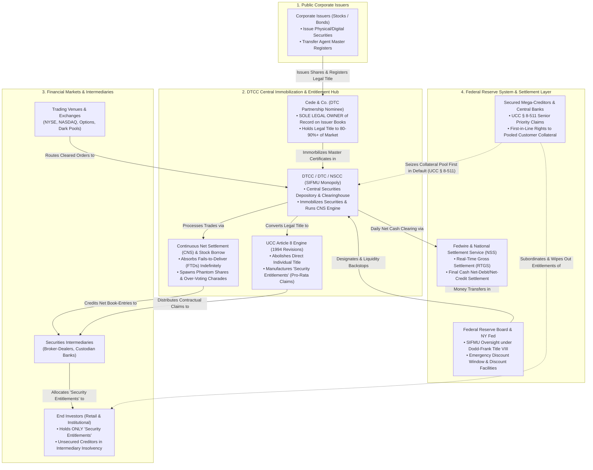
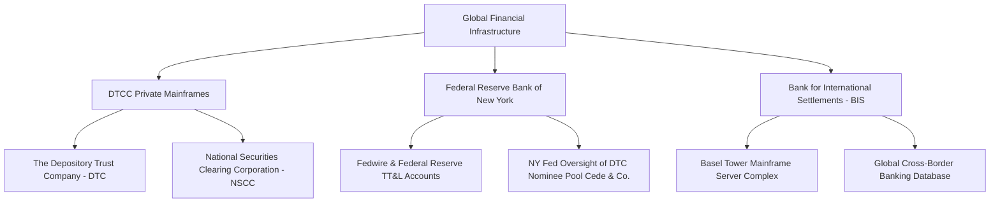

[[atomic]]

# Naked, Short and Greedy: Wall Street's Failure to Deliver (Dr. Susanne Trimbath) {#title}

[[toc]]

## Overview


Dr. Susanne Trimbath's book excerpt exposes a **systemic regulatory crisis** in Wall Street's post-trade clearing and settlement infrastructure. The text details how **phantom shares** are endlessly generated through the **triumvirate of trouble—short sales, stock loans, and fails-to-deliver**—with the full compliance of self-regulatory organizations like the DTCC. Furthermore, the author explains how these unresolved settlement failures severely **damage corporate governance** by causing widespread over-voting, unjustly depress stock prices by artificially increasing market supply, and cost taxpayers and investors billions in **uncollected taxes and lost fund usage**. Ultimately, the purpose of the work is to reveal how the Securities and Exchange Commission and Wall Street insiders protect these flawed practices at the **expense of shareholders and entrepreneurs**, leaving investors with little recourse in a rigged market.

## Define `Underwrite`

### Black's 5th, 1979


Black's 5th, 1979

### Black's 3rd, 1933


## Interviews with Dr. Susanne Trimbath {#videos}

:::tabs
== Video 1
<YouTube id="_6On5Rd3hmM" />

== Video 2
<YouTube id="fGVY2Kco8ng" />

== Video 3
<YouTube id="ITeiFwJlGGI" />

== Video 4
<YouTube id="NlQHQJAfSgE" />

:::

## **The Depository Trust & Clearing Corporation (DTCC) — History, Dematerialization, and Total Monopoly** {#dtcc-overview}

Under the _Codex Umbra_ lens, the sanitized corporate narrative of the Depository Trust & Clearing Corporation (DTCC) as a "benevolent, neutral financial utility" is completely demolished. In unvarnished reality, **the DTCC is an untouchable private monopoly that holds legal title to virtually all corporate equity and debt in America, operating a legalized "phantom share" laundromat that strips investors of actual property rights and corrupts corporate governance.**

### I. The Genesis: Manufactured "Paperwork Crisis" and the CIA Connection

The historical origins of the centralized securities depository reveal a calculated transition from physical property ownership to centralized digital control:

- **The "Paperwork Crunch" (Late 1960s):** Prior to 1970, stock trades required physical delivery and re-registration of paper stock certificates between buyers and sellers within a 5-day settlement window [_The UCC and You_, p. 108–110; _transcript_2026-11-04_, 00:13:43–00:16:00]. As trading volume escalated, Wall Street experienced a "paperwork crisis" where back offices could not process physical certificates fast enough, forcing the New York Stock Exchange (NYSE) to temporarily suspend trading one day per week [_Naked, Short and Greedy_, p. 883–884; _Full text of "The Great Taking"_, p. 6–7].
- **The Creation of BASIC and DTC:** In response, the Banking and Securities Industry Committee (BASIC) recommended eliminating physical certificate transfers by "immobilizing" underlying certificates in a central trust company, substituting physical possession with computerized book-entry entries [_Full text of "The Great Taking"_, p. 6–7]. The Depository Trust Company (DTC) was officially launched in 1973 [_Full text of "The Great Taking"_, p. 7].
- **The Intelligence Operative at the Helm:** The initial project leader and long-time CEO of DTC was **William "Bill" Dentzer, Jr.**, a career CIA operative who had openly worked for the Agency, served in the Alliance for Progress in Latin America, and was appointed New York State Superintendent of Banks by Nelson Rockefeller despite having zero prior banking or finance background [_Full text of "The Great Taking"_, p. 6–7]. Dentzer ran DTC for 22 years, overseeing the complete dematerialization and central immobilization of American securities [_Full text of "The Great Taking"_, p. 7].
- **The 1999–2000 Monopoly Consolidation:** In 1999–2000, the Depository Trust Company (DTC) merged with the National Securities Clearing Corporation (NSCC) to form the **Depository Trust & Clearing Corporation (DTCC)**, eliminating regional depositories and consolidating an absolute nationwide monopoly over post-trade clearing, settlement, and custody [_Naked, Short and Greedy_, p. 845, 854, 871; _transcript_2026-11-04_, 01:07:21–01:13:12].

### II. The Legal Subterfuge: Cede & Co. and the "Security Entitlement"

The true extent of DTCC's power rests on a profound legal trick that stripped the global public of direct property ownership over their stocks and bonds:

```txt
[Issuer / Public Corporation]
            │ (Issues Shares)
            ▼
   [Cede & Co. / DTCC]  ◄─── SOLE LEGAL OWNER of Record on Issuer's Books
            │
  (Indirect Holding System / UCC Article 8)
            ▼
 [Securities Intermediaries] ──► (Broker-Dealers / Banks)
            │
            ▼
 [Individual Investor / Public] ──► Holds only a "Security Entitlement" (Pro-Rata Claim)
```

1. **Cede & Co. (The Phantom Owner):** All physical and electronic shares deposited at DTC are registered in the name of DTC’s partnership nominee, **Cede & Co.** (derived from "Central Deposits") [_Naked, Short and Greedy_, p. 846, 858; _The UCC and You_, p. 111; _transcript_2026-11-04_, 00:17:56]. Cede & Co. appears on the official corporate registers of public companies as the **sole legal owner** of 80% to 90%+ of all outstanding shares [_Naked, Short and Greedy_, p. 867, 952; _Full text of "The Great Taking"_, p. 38–39].
2. **The 1994 UCC Article 8 Revisions:** Through silent amendments to Article 8 of the Uniform Commercial Code (UCC) across all 50 states, actual legal ownership of securities as personal property was abolished for account holders. It was replaced by a new legal construct called a **"Security Entitlement"**—a contractual, pro-rata claim against a securities intermediary [_Full text of "The Great Taking"_, p. 8–10, 15–16; _The UCC and You_, p. 104–111].
3. **Subordination in Insolvency (UCC § 8-511):** In official written responses to the European Commission's Legal Certainty Group, the Federal Reserve Bank of New York confirmed that under UCC § 8-511(c), if a clearing corporation (like DTCC) or securities intermediary fails, **the claims of its secured creditors take absolute priority over the claims of entitlement holders (investors)** [_Full text of "The Great Taking"_, p. 11, 37]. Investors hold only a un-segregated, pro-rata share of residual assets, with zero legal right to re-vindicate or demand back their specific shares [_Full text of "The Great Taking"_, p. 9–11, 37].

### III. How Much Power Does the DTCC Hold?

The DTCC holds near-total operational and regulatory leverage over global capital markets:

#### 1. Absolute Market Monopolization & Volume

DTCC operates as a private, user-owned cooperative whose board is composed of major Wall Street banks and broker-dealers (e.g., Citigroup, JPMorgan Chase, Goldman Sachs, Morgan Stanley) [_Naked, Short and Greedy_, p. 873, 934, 974; _transcript_2026-11-04_, 00:09:46–00:10:00]. Designated under Dodd-Frank as Systemically Important Financial Market Utilities (SIFMUs), DTCC's clearing agencies process virtually every stock, corporate bond, municipal bond, and credit default swap (CDS) trade in the United States, settling **quadrillions of dollars** in commercial transactions annually [_Naked, Short and Greedy_, p. 881; _FEDERAL RESERVE LENDING PROGRAMS_, p. 633; _Full text of "The Great Taking"_, p. 35–37].

#### 2. The Trapdoor: Prohibiting Issuers from Leaving

When entrepreneurial companies discovered that DTCC's system allowed massive, unclosed "fails-to-deliver" (FTDs) and stock lending to artificially inflate their share counts and crush their stock prices, several attempted to withdraw their shares from DTC (e.g., CMKM Diamonds' "Cert Pull" in 2005) [_Naked, Short and Greedy_, p. 854, 951–953; _transcript_2026-11-04_, 00:48:45–00:51:20]. To slam this escape hatch shut, **DTC petitioned the SEC for a rule change (SEC Release No. 34-47978, approved June 4, 2003) that explicitly prohibited public companies from withdrawing their shares or exiting DTC** [_Naked, Short and Greedy_, p. 854, 869, 873, 952]. Paired with NYSE rules requiring Cede & Co. registration as a condition of exchange listing, corporate issuers were permanently trapped inside DTCC's system [_Naked, Short and Greedy_, p. 854; _transcript_2026-11-04_, 00:51:12].

#### 3. Creation of "Phantom Shares" and Destruction of Shareholder Democracy

Through its Continuous Net Settlement (CNS) system, its Stock Borrow Program, and its "Obligation Warehouse" (RECAPS/OW), DTCC permits trade settlement failures to be resubmitted and extended indefinitely without mandatory buy-ins or close-out requirements [_Naked, Short and Greedy_, p. 853–855, 863, 865, 891–892, 984].

- **Multiplied Share Supply:** When a broker fails to deliver shares, the buyer's account is credited with an electronic "entitlement" as if the shares arrived, while the seller retains cash or re-lends the position. This creates millions of **"phantom shares"** in circulation beyond the total authorized shares issued by the corporation [_Naked, Short and Greedy_, p. 854–855, 863, 877, 881, 891].
- **Over-Voting Charade:** Stock lending and FTDs result in multiple parties holding voting entitlements for the exact same underlying shares. In proxy audits conducted by the Securities Transfer Association (STA), **100% of examined corporate proxy votes exhibited over-voting**, forcing brokers to secretly discard or scale down investor votes using opaque internal lotteries [_Naked, Short and Greedy_, p. 853, 871, 879, 881, 906, 930].

#### 4. Extreme Capital Under-Capitalization & Systemic Default Architecture

Despite guaranteeing the settlement of global transactions worth quadrillions of dollars, **DTCC’s total consolidated shareholder equity as of March 2023 was a paltry ~$3.5 billion** [_Full text of "The Great Taking"_, p. 36–37]. DTCC executives have openly admitted in industry panels that their central clearing counterparties (CCPs) are designed with recovery and "wind-down" rules to shift services to a pre-funded replacement entity upon a catastrophic member default [_Full text of "The Great Taking"_, p. 35–38]. When the derivatives complex implodes, DTCC's structure ensures that secured mega-creditors instantly seize the pooled customer collateral, while millions of retail and institutional "entitlement holders" are wiped out as unsecured creditors [_Full text of "The Great Taking"_, p. 11, 19–20, 37–39].

### Summary Matrix: Direct Holding vs. DTCC Indirect Holding

| Dimension                 | Direct Property Ownership (Pre-1970 / Direct Registration)                  | DTCC Indirect Holding System (UCC Article 8)                                                                                        |
| :------------------------ | :-------------------------------------------------------------------------- | :---------------------------------------------------------------------------------------------------------------------------------- |
| **Legal Owner of Record** | The individual human or entity named on the certificate/issuer books.       | **Cede & Co. / DTCC** [_Naked, Short and Greedy_, p. 858; _The UCC and You_, p. 111].                                               |
| **Legal Nature of Asset** | Direct personal property / title [_Full text of "The Great Taking"_, p. 8]. | A **"Security Entitlement"** (contractual claim against intermediary) [_Full text of "The Great Taking"_, p. 8–10].                 |
| **Insolvency Rights**     | Full right of re-vindication; assets cannot be taken by bank creditors.     | **Pro-rata residual claim**; secured creditors have absolute priority (UCC § 8-511) [_Full text of "The Great Taking"_, p. 11, 37]. |
| **Corporate Governance**  | Exact 1 share = 1 vote enforced [_Naked, Short and Greedy_, p. 853].        | Chronic **over-voting and phantom share dilution**; broker lottery vote trimming [_Naked, Short and Greedy_, p. 853, 881, 906].     |
| **Issuer Exit Right**     | Issuer could mandate physical certificate delivery.                         | **Prohibited by SEC Rule SR-DTC-2003-02**; issuers forced into DTC [_Naked, Short and Greedy_, p. 854, 952].                        |

## 🧜‍♀️DTCC Security Entitlement Architecture & Federal Reserve Integration {#mermaid-1}

**The Depository Trust & Clearing Corporation (DTCC) is an untouchable private monopoly operating a legal-financial matrix that strips investors of actual property rights, creates billions of phantom shares, and anchors directly into the Federal Reserve System to guarantee that secured central banking creditors absorb all assets during systemic collapse.**

### I. Mermaid Chart



### II. Structural Breakdown of the Four Matrix Pillars

#### 1. The Legal Subterfuge of "Cede & Co." and Security Entitlements

- **The Dematerialization Trap:** Following the late-1960s "paperwork crisis," physical stock certificates were immobilized into the Depository Trust Company (DTC), headed for 22 years by former CIA operative William "Bill" Dentzer, Jr. [^1] [^2].
- **Cede & Co. as Sole Legal Owner:** When an investor buys stock, their name does **not** appear on the issuer's corporate registry. Instead, **Cede & Co.** (DTC's nominee partnership) is registered as the absolute **sole legal owner of record** [^1] [^3].
- **The 1994 UCC Article 8 Revision:** Revisions to Uniform Commercial Code (UCC) Article 8 across all 50 states abolished direct property title for individual investors. Investors hold only a **"Security Entitlement"**—a contractual, un-segregated, pro-rata claim against their broker-dealer [^2] [^4].

#### 2. The Operational Engine: CNS, FTDs, and Phantom Shares

- **Continuous Net Settlement (CNS):** The National Securities Clearing Corporation (NSCC) nets all daily buy/sell obligations across member brokers [^1].
- **Fails-to-Deliver (FTDs) & Stock Borrowing:** When a selling broker fails to deliver shares, the NSCC's Stock Borrow Program and Continuous Net Settlement resubmit the failed trade into an "Obligation Warehouse," crediting the buyer's account with an electronic entitlement as if real shares were delivered [^1]. This process floods the market with millions of **"phantom shares"**, diluting corporate voting power and causing 100% of proxy audits to exhibit over-voting [^1].
- **SEC Rule SR-DTC-2003-02 (The Prison Bar):** Approved by the SEC in 2003, this rule explicitly **prohibits public corporations from withdrawing their shares from DTC**, trapping all corporate equity inside DTCC’s clearing engine forever [^1].

#### 3. Integration with the Federal Reserve System

- **Fedwire and NSS Real-Time Settlement:** DTCC does not settle net money balances in commercial bank money. Daily multi-billion/trillion-dollar interbank net debits and credits are settled using the Federal Reserve's **National Settlement Service (NSS)** and **Fedwire**, making central bank money the ultimate settlement engine [^2] [^5].
- **SIFMU Designation:** Under Title VIII of the Dodd-Frank Act, DTCC’s subsidiaries (DTC, NSCC, FICC) are designated as **Systemically Important Financial Market Utilities (SIFMUs)**. This grants DTCC direct emergency access to the Federal Reserve's Discount Window and emergency liquidity facilities during market crises [^2] [^5].

#### 4. The Default & Subordination Architecture (UCC § 8-511)

- **Capital Under-Capitalization:** DTCC guarantees quadrillions in annual settlement volume on a paper-thin capital base of ~$3.5 billion in shareholder equity [^2].
- **UCC § 8-511 Executioner's Clause:** In official filings to European regulators, the Federal Reserve Bank of New York confirmed that under **UCC § 8-511(c)**, if a central clearinghouse or intermediary fails, **the claims of secured creditors (major central banks and derivatives lenders) take absolute priority over entitlement holders (investors)** [^2]. Investor security entitlements are instantly subordinated, leaving retail and institutional account holders as un-segregated, unsecured creditors holding zero rights to recover their shares [^2].

## Technological Manipulation via DTCC Infrastructure & Software Vulnerabilities {#tech-manipulation}

The mechanism of technological manipulation within the central clearing and depository framework operates not through open market trading flaws, but through the **underlying digital architecture, software protocols, and custodial monopolies** that govern electronic book-entry ownership.

### 1. Mechanisms of Technological Manipulation via DTCC Infrastructure

Technological manipulation through the Depository Trust and Clearing Corporation (DTCC) occurs via the structural decoupling of physical asset ownership from digital ledger records, enforced by automated software routines:

- **Dematerialization & The Security Entitlement Trap:** Through dematerialization, physical securities certificates were immobilized and registered under DTCC's nominee, **Cede & Co.**. Under Article 8 of the Uniform Commercial Code (UCC), traditional property ownership was replaced with a **"Security Entitlement"**—a contractual claim against a securities intermediary. This legal and technical construct placed all securities into an un-segregated, fungible bulk pool, allowing intermediaries to encumber client assets as collateral for proprietary derivatives trading.
- **Automated Generation of "Phantom Shares":** DTCC’s post-trade clearing and settlement software—specifically the **Continuous Net Settlement (CNS)** system, the **Stock Borrow Program (SBP)**, the **Reconfirmation and Pricing Service (RECAPS)**, and the **Obligation Warehouse (OW)**—contains automated routines that tolerate and roll over un-settled trades ("fails-to-deliver" or FTDs) indefinitely. When a broker fails to deliver physical or digital shares, DTCC’s clearing algorithms credit the buyer’s account with an electronic entitlement while resubmitting or borrowing shares, generating artificial supply ("phantom shares") that depresses stock prices without triggering a market default.
- **Software-Driven Information Asymmetry:** DTCC’s **Obligation Warehouse** and internal **Management Information Systems (MIS)** process and store failure-to-deliver data internally while withholding broker-specific fail records from issuers, individual investors, and state regulators. Netting algorithms compress end-of-day settlement obligations by up to 97%, masking trillions of dollars in underlying trade failures from public view.
- **Digital Information Weaponry (PROMIS & Systemic Backdoors):** Specialized data-management software systems operating across government and financial sectors—such as the **PROMIS** software system managed by contractors like **DynCorp** via the Department of Justice's **Justice Consolidated Network (J-Con)**—demonstrate how digital information architectures can be compromised to alter records, manipulate credit markets, or execute targeted financial warfare.

### 2. Software Ownership and Information Technology Provision

The IT infrastructure, software engines, and algorithmic protocols powering DTCC and related financial clearance networks are supplied and controlled by an interlocked private network:

| Domain                                | Entity / Software Provider             | Operational Role & Mechanism                                                                                                                                                                                                                                                           |
| :------------------------------------ | :------------------------------------- | :------------------------------------------------------------------------------------------------------------------------------------------------------------------------------------------------------------------------------------------------------------------------------------- |
| **Owner-Users**                       | **Member Wall Street Banks & Brokers** | DTCC is a private cooperative owned directly by its user financial institutions, including **Citigroup, JPMorgan Chase, and Goldman Sachs**. Their representatives populate DTCC’s Board of Directors, dictating its operating rules, software functionality, and compliance policies. |
| **Clearing & Settlement Logic**       | **DTCC Subsidiaries (DTC / NSCC)**     | The **Depository Trust Company (DTC)** operates the book-entry depository software, while the **National Securities Clearing Corporation (NSCC)** operates the Continuous Net Settlement (CNS) and Stock Borrow algorithms.                                                            |
| **Financial Accounting Systems**      | **AMS (American Management Systems)**  | Major financial software vendor associated with federal accounting and financial management systems.                                                                                                                                                                                   |
| **Data & GIS Support Contractors**    | **DynCorp & CACI**                     | Government IT contractors providing network consolidation (J-Con), litigation support, and Geographic Information Systems (GIS) software across federal enforcement and financial databases.                                                                                           |
| **Derivatives Analytics & Valuation** | **Markit / Creditex**                  | Software and data aggregation platforms formed by major global banks to index, price, and clear credit default swaps (CDS) and over-the-counter (OTC) derivatives.                                                                                                                     |

### 3. Server Ownership and Direct Data Control

The physical servers, mainframes, and data centers hosting the software that executes global securities immobilization and clearance are partitioned across key private and central banking nodes:



1. **DTCC Corporate Datacenters:** The primary servers hosting the securities ledgers and clearing engines are directly owned and operated by **The Depository Trust & Clearing Corporation (DTCC)** and its subsidiaries (**DTC** and **NSCC**) in the United States.
2. **Federal Reserve Bank of New York (FRBNY):** Sources indicate that the DTC operates as a private entity closely linked to and privately held via member banks of the **Federal Reserve Bank of New York**, which acts as the central clearing depository for US government bank accounts and Fedwire monetary transfers.
3. **Bank for International Settlements (BIS) Mainframes:** On an international scale, central bank data repositories and cross-border settlement data banks are hosted on ultra-secure mainframe servers located inside the **BIS Tower in Basel, Switzerland**, protected under international treaty immunity from local jurisdiction or external audit.

## **Understanding Shareholder Rights, Stock Loans, and Tax Consequences: A Beginner's Guide to Post-Trade Market Infrastructure** {#shareholder-rights}

### 1. Introduction: The Foundations of Stock Ownership and Settlement

To understand how modern equity markets operate, one must look beyond trade execution—the moment a buyer clicks "buy" or a seller clicks "sell"—and examine post-trade market infrastructure. When a company decides to go public, it establishes a specific corporate structure that governs its shares:

- **Issued and Outstanding Shares:** Companies set a fixed legal limit of "authorized shares" within their articles of incorporation filed at the state level. When these shares are registered with the Securities and Exchange Commission (SEC) and sold to the public in exchange for capital, they become "issued and outstanding." These shares represent the actual, legal equity units of the enterprise floating in the public market.
- **Street Name Holdings:** The vast majority of retail investors do not hold physical stock certificates, nor are their individual names registered directly on the company’s official corporate ledger. Instead, shares are held in "street name." Under this arrangement, securities are registered in the nominee name of a central depository—such as Cede & Co., the nominee for the Depository Trust Company (DTC)—and held on behalf of broker-dealers, who in turn record entries for individual customer accounts.
- **Trade Settlement (T+3):** Trade execution is merely an agreement to exchange cash for securities. "Settlement" is the formal post-trade process where cash is transferred to the seller and legal title of the security is delivered to the buyer. Historically structured on a standard timeline of three business days after the trade date (T+3), settlement is the crucial operational gateway that converts an uncompleted trade contract into true ownership.

Under Article 8 of the Uniform Commercial Code (UCC), modern "street name" holdings create a vital legal distinction between legal title and a "securities entitlement." Rather than holding direct, legal ownership of an individual share recorded on the company's official corporate ledger, an investor holding stock through a brokerage firm legally possesses an electronic accounting claim—a functional "IOU"—against their broker-dealer. The post-trade settlement process is therefore essential because trade execution alone does not transfer legal title. Without verified settlement—the physical or electronic delivery of the share in exchange for cash—an investor’s account holds only a trade claim rather than actual legal ownership recorded on the issuer’s books.

| Holding Type                    | Legal Owner of Record                               | Core Operational Reality                                                                                                                                                                      |
| ------------------------------- | --------------------------------------------------- | --------------------------------------------------------------------------------------------------------------------------------------------------------------------------------------------- |
| **Direct Registration (DRS)**   | Beneficial Owner (Individual Investor)              | Shareholder name is entered directly onto the issuer's official corporate ledger managed by a transfer agent; full legal ownership and direct voting rights are secured.                      |
| **Street Name**                 | Central Depository Nominee (e.g., Cede & Co. / DTC) | Legal title rests with the central depository nominee; broker-dealers maintain entitlement entries for clients under UCC Article 8, separating legal title from beneficial economic interest. |
| **Entitlement / Phantom Share** | None (Unsettled Accounting Entry)                   | Cash is debited from the buyer's account, but actual share delivery failed or was covered via a stock loan; investor holds an electronic "IOU" or securities entitlement.                     |

When delays or operational breaks occur within this basic settlement chain, unexpected mechanical distortions are introduced directly into individual investor accounts.

### 2. The Mechanics of the "Triumvirate of Trouble": Shorts, Loans, and Fails

When post-trade mechanics break down, market infrastructure generates what Dr. Susanne Trimbath terms the "Triumvirate of Trouble." These three distinct financial activities artificially expand the supply of shares in circulation beyond the quantity officially authorized and issued by a company, creating "phantom shares" (or electronic share entitlements):

- **Short Sales:** A short sale occurs when an investor sells shares they do not own, speculating that the stock price will decline so they can repurchase the shares later at a lower price for profit. Whether executed as an ordinary short sale using borrowed shares or a naked short sale without a prior borrow, the transaction creates a secondary buyer holding an identical ownership claim, thereby expanding total circulating share claims beyond the issuer's authorized limit.
- **Stock Lending:** This process takes place when a broker-dealer rehypothecates and lends securities from a customer's margin account to a short seller or failing counterparty without requiring client notification. Because the lending investor's statement continues to display the full share balance while the borrowing purchaser receives full title rights, stock lending duplicates ownership claims and generates extra electronic phantom positions across brokerage accounting ledgers.
- **Settlement Failures (Fails to Deliver / FTDs):** A settlement failure happens when a selling broker fails to deliver the required equity securities to the buyer's clearing firm on the mandatory settlement date (T+3). Because centralized clearing infrastructure allows cash to be debited while crediting the purchasing investor's account with an unfulfilled electronic entitlement, uncollected FTDs permanently inflate the circulating supply of authorized shares with unbacked phantom entries.

The persistent creation of phantom shares through these three interconnected mechanisms directly disrupts corporate governance by multiplying the number of entities attempting to exercise shareholder voting rights.

### 3. Erosion of Shareholder Governance: Proxy Voting and Over-Voting

Corporate governance in public companies is anchored by the fundamental principle of **"one share, one vote."** This rule ensures that voting power remains perfectly proportional to actual ownership of authorized stock. However, stock lending and settlement failures systematically dismantle this standard.

When stock is lent or undelivered over a corporate record date, both the lending broker's client statement and the borrowing or purchasing party's account display identical, full ownership rights. This operational duplication creates a illusion of doubled voting power. Three distinct entities end up holding proxy voting instructions for the exact same underlying share:

1. The original margin account investor whose shares were lent out still sees the stock position on their broker statement.
2. The short buyer who received the borrowed or delivered share holds legal voting entitlement.
3. Investors on the buying end of an open fail-to-deliver hold electronic securities entitlements that generate automated proxy voting notices.

This structural duplication leads directly to **"over-voting,"** a scenario where broker-dealers receive or submit more proxy votes to corporate transfer agents than the total number of physical or registered shares on deposit with DTC. Empirical data illustrates the massive scale of this breakdown: a Securities Transfer Association (STA) survey found that over-voting occurred in **over 90%** of surveyed corporate elections in 2005, and reached **100%** of corporate elections surveyed in 2006. By mid-January 2006, **8.5 billion shares** were on loan across New York Stock Exchange (NYSE) companies alone, representing over 2% of all outstanding stock for those issuers.

To prevent corporate secretaries and issuers from seeing these inflated proxy totals, third-party reconciliation services and internal broker-dealer algorithms pre-trim excess votes _before_ submitting ballots to transfer agents. Through unmonitored lotteries, vote-trimming formulas, or proportional reductions, brokers silently discard or alter retail investor votes without client notification or account adjustments.

#### Theoretical Rights vs. Operational Realities

- **Theoretical Rights:** Investors expect that purchasing stock grants them guaranteed corporate democracy rights, where every authorized share equals exactly one legitimate vote submitted directly to the issuing company during annual meetings, director elections, or merger approvals.
- **Operational Realities:** When stock loans and unsettled trades create more voting instructions than real shares, broker-dealers reconcile the excess through opaque internal procedures—such as pre-trimming lotteries or proportional reductions—which discard, reduce, or alter retail investor proxies without client notification, concealing the true scope of over-voting from issuers.

As a result, retail investors remain completely unaware that their proxy ballots may be routinely trimmed, diluted, or discarded entirely behind the scenes. This hidden loss of voting influence directly parallels explicit financial penalties imposed on investors regarding dividend taxation.

### 4. Tax Penalties: Qualified Dividends vs. "Payments in Lieu"

The operational disruptions caused by stock lending and settlement failures extend into an investor's personal tax obligations. When a public company distributes profits to its shareholders, the tax code grants **tax-qualified dividend** status to these distributions, taxing them at favorable, lower capital gains rates.

However, if an investor's shares are out on loan or remain undelivered over a dividend record date, the investor does _not_ receive a qualified dividend from the issuer. Instead:

- The issuing company pays the actual dividend to the buyer who received the delivered or borrowed share.
- The original investor (or buyer holding a failed delivery position) receives a substitute payment from their broker-dealer or borrower, legally classified as a **"payment in lieu of dividend."**

Under tax laws, substitute "payments in lieu" are disqualified from favorable tax rates and are classified as **ordinary income**. Consequently, affected investors are taxed at higher ordinary income rates—a tax rate differential of 10% to 20%—resulting in an uncompensated, out-of-pocket financial penalty caused solely by post-trade settlement mechanics.

Dr. Susanne Trimbath's research quantifies the severe scale of these direct financial losses:

- **Tax Penalty Scale:** As of December 31, 2007, the National Securities Clearing Corporation (NSCC) reported **5.76 billion (5,761,192,000)** in equity fails to deliver. Assuming a modest average 1% dividend yield, affected investors suffered an uncompensated, excess tax penalty ranging between **$5.76 million and $11.52 million annually** due to the ordinary income tax rate differential.
- **Loss of Use of Funds:** Investors incur severe economic damages when their cash is debited on trade date but share delivery is delayed indefinitely. Across NYSE and NASDAQ threshold securities alone, investors suffered an estimated **$762 million loss of use of funds** in 2007, as broker-dealers retained interest-earning cash while delivering mere electronic IOUs.

| Dividend Type                   | Source of Payment                | Tax Treatment & Financial Impact                                                                                                                 |
| ------------------------------- | -------------------------------- | ------------------------------------------------------------------------------------------------------------------------------------------------ |
| **Qualified Dividend**          | Issuing Company (Transfer Agent) | Taxed at favorable qualified dividend tax rates; maximizes net investment yield for legitimate owners of record.                                 |
| **Payment in Lieu of Dividend** | Broker-Dealer or Borrower        | Taxed at higher ordinary income tax rates (10%–20% higher differential); creates an unaccounted financial loss and tax penalty for the investor. |

These individual financial and governance penalties reflect broader structural limitations within the regulatory landscape tasked with overseeing post-trade infrastructure.

### 5. Investor Protections, SROs, and Market Realities

The regulatory ecosystem governing U.S. capital markets consists of a multi-tiered oversight structure:

- **Securities and Exchange Commission (SEC):** The federal government agency responsible for enforcing federal securities laws and overseeing market integrity.
- **Self-Regulatory Organizations (SROs):** Industry-operated regulatory bodies, such as the New York Stock Exchange (NYSE) and the Financial Industry Regulatory Authority (FINRA), that enforce rules upon member broker-dealers.
- **Centralized Clearing Agencies:** Private, member-owned utilities like the Depository Trust & Clearing Corporation (DTCC) and its subsidiaries—the National Securities Clearing Corporation (NSCC) and the Depository Trust Company (DTC)—that clear and settle transactions.

Despite this regulatory apparatus, persistent settlement failures continue due to institutional clearing practices. Under the NSCC’s **Continuous Net Settlement (CNS)** system, transactions are cleared on a net daily basis. If a seller fails to deliver shares on T+3, the open position is simply rolled forward to the next settlement date with a daily mark-to-market financial adjustment, _ad infinitum_.

Crucially, under CNS operations, the NSCC novates every transaction—stepping in as the legal **Central Counterparty (CCP)** to both sides of a failed trade. As the contractual buyer to every failing seller, the NSCC possesses full legal authority and rights to compel trade resolution or force open-market buy-ins. However, DTCC/NSCC actively _chooses_ not to exercise this enforcement power.

Furthermore, when public companies attempted to protect themselves and their investors from persistent fails in 2003 by withdrawing their shares from DTC depository vaults, DTC responded by initiating SEC rulemaking. The SEC subsequently approved DTC Rule 17Ad-12, explicitly prohibiting public companies from withdrawing their securities from the depository—effectively handcuffing issuers to a clearing system that tolerates persistent fails.

To secure immutable legal ownership and bypass these central depository gaps, investors can utilize the **Direct Registration System (DRS)**, which transfers shares directly into book-entry account records maintained by the company’s official transfer agent, removing the holdings from street name intermediary systems.

#### 3 Main Regulatory Gaps

1. **Perpetual Rolling of Fails in Continuous Net Settlement (CNS):** The central clearing mechanism automatically re-submits unsettled positions each day with a new settlement date, permitting fails to persist for months or years without forcing trade cancellation or physical delivery.
2. **Abrogation of CCP Buy-In Powers and Lack of Enforcement:** Although the NSCC acts as the legal Central Counterparty (CCP) with full authority to force open-market buy-ins against defaulting sellers, regulators and clearing organizations choose not to enforce mandatory buy-ins, insulating failing brokers from market discipline.
3. **Opaque Broker Voting Allocation Rules:** Regulatory guidelines allow broker-dealers to utilize internal, unaudited pre-trimming algorithms to discard excess votes silently prior to submitting proxy totals, concealing the structural scope of market over-voting from issuers and investors.

Understanding these regulatory limitations empowers investors to evaluate their portfolio holdings and evaluate financial protections accurately.

### 6. Summary & Key Takeaways for New Investors

1. **Trade Settlement Precedes True Legal Ownership:** An executed buy order creates only an electronic trade claim, as street name positions reside as UCC Article 8 "securities entitlements" rather than direct corporate title. Until shares are fully delivered, account balances represent brokerage IOUs subject to operational and counterparty failure.
2. **The "Triumvirate of Trouble" Generates Phantom Supply:** The combination of short sales, unreturned stock loans, and persistent settlement failures introduces extra phantom shares into market circulation. This artificial expansion of share supply depresses stock prices through basic economic laws of supply and demand, impairing corporate access to capital.
3. **Over-Voting Subverts Corporate Governance:** Stock lending and open settlement failures create multiple voting claims on individual shares, resulting in widespread over-voting across corporate elections. Brokerage firms reconcile these excess votes through opaque pre-trimming algorithms, silently diluting or discarding retail investor ballots without client notification.
4. **Unsettled Transactions Impose Direct Tax Penalties:** Holding stock affected by loans or settlement failures over a record date transforms tax-qualified dividends into substitute "payments in lieu." These substitute payments are taxed as ordinary income rather than favorable dividend rates, inflicting millions of dollars in uncompensated tax penalties and lost fund usage on retail investors.

## **Demystifying Post-Trade Mechanics: How Phantom Shares Enter the Financial System** {#post-trade}

### 1. Foundation: The Anatomy of a Securities Trade and Ownership

#### 1.1 Essential Terminology & Share Lifecycle

To understand how modern financial markets operate—and where structural vulnerabilities emerge—one must first grasp how corporate equity is classified, registered, and tracked. When a company issues stock, its shares progress through distinct administrative states that dictate who holds legal entitlement, how supply is measured, and where trading boundaries are set.

The following table breaks down the key share classifications across the securities lifecycle:

| Share Classification            | Definition                                                                                                                                | Issuing Entity / Registry                                                                  | Impact on Tradable Supply                                                                       |
| ------------------------------- | ----------------------------------------------------------------------------------------------------------------------------------------- | ------------------------------------------------------------------------------------------ | ----------------------------------------------------------------------------------------------- |
| **Authorized Shares**           | The maximum number of shares a corporation is legally permitted to issue under its approved articles of incorporation and by-laws.        | Approved by Board of Directors & state of incorporation; tracked in corporate articles.    | Establishes the absolute legal ceiling of potential share supply.                               |
| **Registered Shares**           | Shares formally registered for sale with regulatory authorities or directly recorded on the corporate transfer agent's books.             | Registered with the SEC (for public sales) & issuer's books/transfer agent.                | Ensures shares are validly accounted for and legally issued for public or private distribution. |
| **Issued & Outstanding Shares** | Shares that have been sold or allocated in exchange for capital or services and are currently held by investors or corporate insiders.    | Recorded on the issuer's register; held by public investors, insiders, or treasury.        | Defines the total active ownership units of the company currently in the market.                |
| **Float**                       | The portion of issued and outstanding shares that is unrestricted and readily available for public buying and selling in the open market. | Market calculation; excludes company-held treasury shares and restricted insider holdings. | Represents the actual liquid supply available for daily market trading.                         |

When shares are held inside modern brokerage accounts, they are typically registered in **street name** under a designated nominee name—most notably **Cede & Co.**, the partnership nominee for the central securities depository. Under this model, retail investors do not hold physical certificates or direct registration on the company's master record; instead, they hold electronic entitlements through their intermediary brokers.

> _"And, probably, a lot of what you know is lies-to-children. Just as ‘survival of the fittest’ captured the imaginations of the Victorians, so ‘DNA’ has captured the imaginations of today’s public. However, imaginations thrive best if they are left free to roam: they grow tired and feeble in captivity. Captive imaginations do breed quite effectively, because they are protected from the terrible predator known as Thought."_
>
> — Terry Pratchett, Ian Stewart & Jack Cohen, _The Science of Discworld_

_As learners, we are often taught that buying a stock is as simple as swapping cash for a share certificate. In reality, standard descriptions of share ownership hide complex, automated post-trade clearing mechanisms operating beneath the surface._

#### 1.2 Post-Trade Timeline: Execution vs. Clearing vs. Settlement

When an investor clicks "buy" on a trading platform, the trade execution screen gives the illusion of an instant transaction. However, executing a trade is merely the initial agreement. In the U.S. financial system, completing a transaction traditionally follows a post-trade timeline known as **T+3** (Trade date plus three business days).

To examine the operational mechanics behind the scenes during these three days, consider the **Air Traffic Control Analogy**:

- **Trade Execution (The Flight Plan):** The buyer and seller agree on a price and quantity on an exchange floor or electronic platform.
- **Clearing (Air Traffic Control):** Before an aircraft can land, air traffic controllers must verify flight paths, confirm coordinates, and align incoming aircraft. Similarly, central clearinghouses process trade details between buying and selling brokers, matching prices, quantities, and settlement parameters to derive a single, net end-of-day obligation for each firm.
- **Settlement (Touchdown):** Settlement is the final operational step where the flight touches down. Cash is transferred from the buyer to the seller, and legal ownership of the securities is transferred to the buyer.

While execution is instantaneous, the multi-day clearing and settlement pipeline relies on centralized intermediaries to manage the movement of billions of dollars daily.

Understanding this journey from simple execution to complex clearing infrastructure reveals how back-office operational routines can introduce structural friction into the broader financial system.

### 2. The Mechanics of Central Clearing: SROs and Continuous Net Settlement

#### 2.1 The Gatekeepers: SROs and Depository Institutions

Post-trade processing in the United States is governed primarily by **Self-Regulatory Organizations (SROs)**—non-governmental entities granted authority to create and enforce industry operating rules alongside federal regulators like the Securities and Exchange Commission (SEC).

Three core entities form the backbone of central clearing and depository services:

```txt
                  ┌──────────────────────────────────────────┐
                  │                   DTCC                   │
                  │  (Depository Trust & Clearing Corp.)     │
                  └─────────────────────┬────────────────────┘
                                        │
             ┌──────────────────────────┴──────────────────────────┐
             ▼                                                     ▼
┌──────────────────────────┐                             ┌──────────────────────────┐
│           DTC            │                             │           NSCC           │
│ (Depository Trust Co.)   │                             │ (National Securities     │
│                          │                             │   Clearing Corp.)        │
│ • Central Depository     │                             │ • Central Counterparty   │
│ • Holds stock/bond assets│                             │ • Clears & nets trades   │
│ • Registered via nominee │                             │ • Manages Continuous Net │
│   Cede & Co.             │                             │   Settlement (CNS)       │
└──────────────────────────┘                             └──────────────────────────┘
```

1. **DTCC (Depository Trust and Clearing Corporation):** The overarching parent holding company that acts as the primary infrastructure for electronic and physical securities settlement in the U.S.
2. **DTC (Depository Trust Company):** A subsidiary of DTCC that serves as the central securities depository. DTC holds paper certificates and electronic balances in its vaults and computer systems, registering securities in the name of its nominee, **Cede & Co.** (a name originating from the acronym "CD" for the Central Deposits department at the New York Stock Exchange).
3. **NSCC (National Securities Clearing Corporation):** The clearing arm subsidiary of DTCC. NSCC acts as a central counterparty for clearing trades across exchanges, matching transactions, netting positions, and issuing daily settlement obligations to member broker-dealers.

#### 2.2 Continuous Net Settlement (CNS) and the "Perpetual Fail" Loop

To process tens of millions of daily transactions efficiently, the NSCC operates an automated clearing system known as **Continuous Net Settlement (CNS)**.

Under CNS, the clearinghouse aggregates and offsets all of a broker-dealer's buying and selling activity in a given security throughout the day. If a broker buys 10,000 shares of a stock and sells 10,000 shares of the same stock on the same day, their net settlement obligation at the end of the day is zero.

While CNS drastically reduces the net cash and stock that must move across the financial system daily, it introduces severe structural vulnerabilities:

- **Late-Day Unwinding Impossibility:** Because trade matching and netting happen continuously, and full delivery information is only visible after markets close on settlement day (T+3), it is functionally impossible to isolate, unwind, or reverse an individual trade when a selling broker fails to present the required shares.
- **The "Perpetual Fail" Loop:** When a seller fails to deliver shares at settlement, the NSCC system does not automatically cancel the transaction or penalize the seller with forced open-market repurchases. Instead, CNS resubmits the unsettled trade into the system the next business day with a new settlement date _ad infinitum_.
- **Daily Mark-to-Market Credit Incentives:** NSCC marks open failed positions to market daily. When short selling depresses a stock's market price, the clearinghouse debits the buyer and credits cash collateral _back_ to the failing selling broker every single day. If the short seller successfully drives the stock price down to zero, the clearinghouse marks the security as "worthless," wiping the delivery obligation off its books entirely. Because the clearinghouse routinely credits cash back to failing sellers while holding their delivery obligations open indefinitely, failing selling brokers face zero financial pressure to close out open failures-to-deliver (FTDs).

Because clearinghouse rules permit unsettled trades to roll over day after day without automated close-out requirements, settlement failures can persist for months or even years.

This automated clearinghouse framework, designed for high-speed netting, lays the groundwork for a broader structural breakdown known as the "Triumvirate of Trouble."

### 3. The "Triumvirate of Trouble": Shorts, Loans, and Fails

When trade processing mechanisms tolerate delays and open obligations, three separate market activities interact to create an environment where open entitlements outnumber physical shares.

```txt
                  ┌──────────────────────────┐
                  │       Short Sales        │
                  │  (Ordinary vs. Naked)    │
                  └────────────┬─────────────┘
                               │
                               ▼
┌──────────────────────────┐  ┌──────────────────────────┐  ┌──────────────────────────┐
│      Stock Lending       │◄─┤           DTCC           ├─►│   Settlement Failures    │
│  (Margin Hypothecation)  │  │   Clearing Framework     │  │        (FTDs)            │
└──────────────────────────┘  └──────────────────────────┘  └──────────────────────────┘
```

#### 3.1 Component 1: Short Sales (Ordinary vs. Naked)

Short selling is an investment strategy based on the expectation that a security's price will decline:

- **Ordinary Short Sale:** A seller executes an order to sell shares they do not own. To complete settlement on T+3, the short seller's broker locates and borrows real shares from an existing owner, delivering those borrowed shares to the buyer.
- **Naked Short Sale:** A seller executes a short sale _without_ locating or borrowing the required shares prior to execution, creating a situation where delivery on settlement day cannot occur as promised. This practice guarantees a settlement failure at the clearinghouse level.

#### 3.2 Component 2: Stock Lending & Margin Agreement Surprises

To facilitate ordinary short sales and cover settlement shortfalls, broker-dealers operate stock lending programs (such as NSCC's Stock Borrow Program and DTC's Stock Lending Program). Broker-dealers source these shares primarily from retail client margin accounts.

When an investor opens a standard margin account, they sign an agreement containing hypothecation clauses.

:::tip Standard Margin Account Agreement ("Loan or Pledge of Securities")

> _"I authorize [broker name] to lend either to itself or to others any Securities and/or Other Property held by [broker name] in my Margin Account to the extent permitted by law. I understand that within the limitations imposed by applicable laws, rules and regulations all of my securities and other property may be pledged and repledged and hypothecated and rehypothecated by [broker name]... In certain circumstances, such loans may limit, in whole or in part, my ability to exercise voting rights of the securities that are lent by me. In addition, if any Securities in my Margin Account are lent out on the dividend record date for such securities, I understand that I may receive a payment in lieu of dividend (also known as a substitute payment) from [broker name], instead of the actual dividend from the issuer or its transfer agent. Payments in lieu of dividends are treated differently than qualified dividend income under U.S. tax laws."_
> :::

By agreeing to these standard terms, retail investors absorb **three major hidden sacrifices and surprises**:

1. **Loss of Proxy Voting Rights:** When a retail investor's shares are lent out to cover a short sale, legal ownership rights—including corporate governance voting rights—transfer to the buyer who receives the borrowed shares. The lending investor loses their vote, often without notification.
2. **Loss of Tax-Qualified Dividends:** If shares are out on loan on a corporate dividend record date, the issuer pays the actual dividend to the new buyer. The lending investor receives a substitute "payment in lieu of dividend" from their broker. Substitute payments are taxed as ordinary income rather than benefiting from lower tax rates for qualified dividends.
3. **Broker Fee Retention & Conflict of Interest:** Brokers collect 100% of the lucrative stock lending fees paid by borrowers for access to client securities. Brokers do not share these fees with the retail account holders whose assets are lent. Consequently, broker-dealers face a structural conflict of interest: they profit continuously for as long as a stock loan remains open, eliminating any economic incentive for the broker to recall the lent shares.

#### 3.3 Component 3: Settlement Failures (Fails-to-Deliver / FTDs)

A **Fail-to-Deliver (FTD)** occurs when a selling broker fails to present the required securities to the clearinghouse on the scheduled settlement date.

While U.S. clearing systems strictly enforce cash delivery obligations (penalizing brokers who fail to provide funds), they exhibit a high tolerance for securities FTDs. Because NSCC acts as the central counterparty to both sides of every transaction, it credits the purchasing broker's account with an electronic "entitlement" even when the physical share has not arrived.

Rather than enforcing an open-market **"buy-in"**—a mechanism where the buyer or clearinghouse purchases real shares on the open market and charges the price difference back to the failing seller—the clearing organization permits the open FTD position to remain on its books indefinitely under CNS. This lack of enforcement was reinforced in 2005 when the New York Stock Exchange (NYSE) formally eliminated its mandatory buy-in rule, stripping purchasing brokers and investors of the operational power to force open-market execution against failing sellers.

When short sales, stock lending programs, and unforced settlement failures operate simultaneously, their combined operational weight alters fundamental market economics.

### 4. The Economics and Systemic Consequences of "Phantom Shares"

#### 4.1 How Phantom Shares Enter Circulation

When securities are repeatedly lent, sold short, or left unsettled, the financial system generates electronic share claims that exist on broker statements without corresponding physical shares registered at the corporate transfer agent. These unauthorized electronic claims are referred to as **"phantom shares."**

Here is the step-by-step process showing how share re-lending multiplies share entitlements:

```txt
   ┌─────────────────┐
   │   Investor A    │ (Holds 1 Real Share registered to Cede & Co.)
   └────────┬────────┘
            │  (Broker lends Investor A's share)
            ▼
   ┌─────────────────┐
   │ Short Seller X  │
   └────────┬────────┘
            │  (Sells borrowed share into market)
            ▼
   ┌─────────────────┐
   │     Buyer B     │ (Receives share entitlement; broker re-lends)
   └────────┬────────┘
            │  (Share is re-lent to Short Seller Y)
            ▼
   ┌─────────────────┐
   │     Buyer C     │ (Receives new share entitlement)
   └─────────────────┘
```

1. **Investor A** purchases 1 share of stock. The share is held in street name at a brokerage and registered under Cede & Co. on the issuer's master books.
2. **Investor A's Broker** lends the share out via a margin account hypothecation agreement to **Short Seller X**.
3. **Short Seller X** sells the borrowed share to **Buyer B** to settle their trade.
4. **Buyer B** sees 1 share in their account statement. Holding a valid electronic entitlement, Buyer B's broker lends that same share entitlement to **Short Seller Y**.
5. **Result:** Investor A, Buyer B, and Buyer C all hold electronic account statements claiming ownership of the single underlying share registered to Cede & Co.

This chain creates multiple valid electronic claims ("phantom shares") to a single corporate asset, causing the total number of circulating share claims to exceed the authorized share limits defined in the issuer's articles of incorporation.

#### 4.2 Tri-Fold Impact Analysis: Supply, Governance, and Taxes

##### 1. Market Price Dilution

In microeconomic theory, the price of a security is determined by the intersection of market supply (S) and market demand (D). When phantom shares flood the market through unchecked FTDs and continuous re-lending, the tradable supply of stock artificially shifts to the right $(S_0 \rightarrow S_1)$.

```txt
  Price
    │       \         S₀      S₁ (Real + Phantom Shares)
    │        \        │       │
P₀ ─┼─────────\───────┼───────┐
    │          \      │       │
P₁ ─┼───────────\─────┼───────┼─── Equilibrium Price Depressed
    │            \    │       │
    │             \   │       │
    │              \  │       │
    │               \ │       │
    └─────────────────┴───────┴──────────
    0                         Quantity of Shares
```

This structural supply shift forces the market-clearing equilibrium price down from $P_0$ to $P_1$ independently of corporate fundamentals. For emerging or entrepreneurial businesses, this artificial dilution depresses firm valuations, restricts access to fresh equity capital, and in severe cases, drives viable enterprises into bankruptcy.

##### 2. Corporate Governance Collapse (Over-Voting)

Phantom shares undermine corporate voting integrity. In proxy elections, voting rights technically follow the share to the newest buyer. However, because brokerages frequently fail to adjust client account records to reflect loaned shares, multiple investors receive proxy voting materials for the same underlying security. This leads to widespread **proxy over-voting**, where total cast votes exceed 100% of the issuer's total outstanding shares.

To hide over-voting from corporate management and transfer agents, major proxy intermediaries implement **pre-reconciliation vote-trimming routines**. These third-party vote managers run algorithmic routines that trim or discard excess votes _before_ election tallies are submitted to the issuer's transfer agent. This pre-reconciliation trimming disguises systemic over-voting from the public while stripping legitimate retail investors of their voting power without disclosure.

##### 3. Economic & Tax Collateral Damage

The accumulation of phantom shares imposes direct financial costs on taxpayers and private investors:

- **Equity Tax Inefficiencies:** Investors who receive non-qualified "payments in lieu of dividends" due to open stock loans or FTDs forfeit qualified dividend tax rates (10%–20% tax differential), incurring millions of dollars in excess personal tax liabilities annually.
- **Government Bond Distortion:** Settlement failures extend heavily into U.S. Treasury securities (UST). Interest on USTs is legally exempt from state income tax; however, "payments in lieu of interest" (generated when broker-dealers fail to deliver USTs to buyers) are _non-exempt taxable income_. Because broker-dealers do not report substitute interest separately on client tax statements, investors routinely claim state tax exemptions on non-exempt substitute payments. This tax-exemption breakdown causes an estimated **$271 million to $4 billion in uncollected state tax revenues annually**, distorting public budgets and inflating taxpayer borrowing costs.

Evaluating these structural breakdowns reveals how clearinghouse mechanics alter the balance between theoretical market models and actual operational outcomes.

### 5. Learning Synthesis & Conceptual Review

#### 5.1 Systemic Breakdown Matrix

The structural failures detailed throughout this primer are summarized in the matrix below:

| Breakdown Mechanism                 | Core Operational Failure                                                  | Primary Impact on Investor / Issuer                                             |
| ----------------------------------- | ------------------------------------------------------------------------- | ------------------------------------------------------------------------------- |
| **Continuous Net Settlement (CNS)** | Resubmits failed trades daily _ad infinitum_ without mandatory buy-ins.   | Persistent FTDs remain open indefinitely without penalties.                     |
| **Stock Lending Programs**          | Shares received from loans can be re-lent by the new owner.               | Multiplies phantom shares beyond authorized corporate limits.                   |
| **Margin Account Hypothecation**    | Standard clauses permit brokers to lend client securities without notice. | Investor loses proxy voting rights and tax-qualified dividend status.           |
| **Naked Short Sales**               | Trades executed without locating or borrowing underlying stock.           | Artificial supply growth; depresses share prices and impairs access to capital. |

#### 5.2 Final Educational Summary

Understanding capital markets requires looking beyond execution screens. While real-time interfaces display instant trade confirmations, the operational post-trade pipeline—comprising clearinghouses, central depositories, net settlement routines, and stock lending programs—governs the legal transfer of financial assets.

When clearing networks prioritize processing efficiency over guaranteed final settlement, systemic vulnerabilities emerge. Phantom shares, algorithmic vote-trimming, dividend misallocations, and artificial price suppression demonstrate that back-office mechanics directly affect market integrity. True financial literacy involves recognizing that transparent, enforced, and final settlement remains the cornerstone of equitable capital markets.

## **Regulatory Analysis Memorandum: Systemic Vulnerabilities in Post-Trade Clearing, Stock Lending, and Corporate Governance Architecture** {#systemic-vulnerabilities}

### 1. Structural Architecture of Post-Trade Processing: The Systemic Interaction of CNS, Stock Lending, and FTDs

The foundational integrity of global equity and debt markets relies on the robustness, operational predictability, and legal finality of post-trade clearing and settlement infrastructure. In a compliant financial market structure, post-trade clearance mechanisms ensure that every executed trade culminates in the prompt, verifiable, and immutable exchange of cash consideration for legal title to underlying securities. However, structural deficiencies within central clearing utilities—specifically the systemic operational interaction between Continuous Net Settlement (CNS) systems, SRO depository stock lending pools, and unresolved trade settlement failures—create persistent systemic vulnerabilities across global capital markets. Rather than enforcing strict settlement finality, these clearing mechanisms decouple buyer-seller counterparties, institutionalize non-delivery, and enable un-backed security supply expansion. A rigorous regulatory examination of this clearing architecture is essential for market structure specialists and policy makers seeking to eliminate non-delivery incentives, restore market pricing efficiency, and protect foundational corporate governance frameworks.

The operational architecture of equity clearing in the United States centers on the National Securities Clearing Corporation (NSCC) and the Depository Trust Company (DTC), both subsidiaries of the Depository Trust & Clearing Corporation (DTCC). Cleared market transactions process primarily through NSCC’s Continuous Net Settlement (CNS) system. Under CNS, multilateral trade obligations among participant broker-dealers are netted at the end of each business day to yield a single net daily cash debit or credit and a single net daily CUSIP delivery or receive obligation for each participant. Crucially, when NSCC acts as the central counterparty (CCP), it novates cleared trades, substituting itself as the buyer to every seller and the seller to every buyer. This operation completely eliminates bilateral counterparty privity. When a selling broker fails to deliver shares to NSCC on the designated settlement date (historically T+3, transitioning to T+2 and T+1), CNS does not initiate an immediate compulsory open-market buy-in, nor does it unwind the defaulted transaction. Instead, the clearing utility automatically resubmits the uncompleted delivery obligation into the clearing pool the following business day with a newly assigned settlement date. This automated daily resubmission recurs _ad infinitum_. Because novation strips the purchasing broker of direct legal recourse against the specific defaulting seller, the buyer cannot execute a bilateral open-market buy-in. Consequently, acute clearing defaults are transformed into open, perpetual net short obligations within the clearing utility that carry no mandatory statutory close-out deadlines, allowing fails-to-deliver (FTDs) to linger unresolved for months or years.

To systematically evaluate how security supply expands through clearing operational mechanics, the following matrix compares the three primary market mechanisms driving aggregate share supply expansion—short sales, stock lending programs, and fails-to-deliver—collectively designated as the "Triumvirate of Trouble."

#### Mechanics of the Triumvirate of Trouble

| Mechanism Name                         | Operational Trigger                                                                                                                                                                                                                                                       | Share Creation Mode                                                                                                                                                                                                                                                                   | Close-Out Incentive/Requirement                                                                                                                                                                                                                                     | Systemic Effect on Supply                                                                                                                                                                                                                    |
| -------------------------------------- | ------------------------------------------------------------------------------------------------------------------------------------------------------------------------------------------------------------------------------------------------------------------------- | ------------------------------------------------------------------------------------------------------------------------------------------------------------------------------------------------------------------------------------------------------------------------------------- | ------------------------------------------------------------------------------------------------------------------------------------------------------------------------------------------------------------------------------------------------------------------- | -------------------------------------------------------------------------------------------------------------------------------------------------------------------------------------------------------------------------------------------- |
| **Short Sales (Standard vs. Naked)**   | Execution of a sell order by a participant who does not own the underlying CUSIP. Standard short sales require securing a pre-trade share borrow; naked short sales proceed without securing a borrow or locate, resulting in immediate trade non-delivery at settlement. | Standard short sales deliver borrowed shares, creating a contract entitlement for the lender and a street-name position for the buyer. Naked short sales credit the buyer's account with an un-backed electronic "security entitlement" while the seller retains cash proceeds.       | Standard short sales carry borrowing fees and recall risks, maintaining economic pressure to cover. Naked short sales avoid borrowing fees and pre-borrow expenses entirely, eliminating the seller's operational incentive to purchase shares for delivery.        | Artificially expands circulating economic and voting claims beyond authorized charter limits. Standard shorting generates duplicate beneficial claims; naked shorting generates un-backed entitlements that persist until settlement occurs. |
| **Stock Lending / Borrowing Programs** | Discretionary or automated hypothecation of securities from retail margin accounts or depository pools (e.g., NSCC Stock Borrow Program and DTC Stock Lending Program) to cover participant clearing defaults.                                                            | The lending broker transfers electronic custody of margin shares to the purchasing broker of a failed trade while maintaining an un-adjusted account balance for the lending client. The buyer receives full voting/dividend rights while the lender retains a secondary entitlement. | Driven by lucrative lending fees collected by broker-dealers. Because brokers retain 100% of stock loan fees generated from client margin assets without sharing revenue with account owners, lending institutions face zero operational incentive to recall loans. | Multi-tier re-hypothecation allows a single underlying share certificate to be lent, delivered, re-lent, and re-delivered iteratively, creating multiple secondary electronic entitlements against a single registered asset.                |
| **Fails-to-Deliver (FTDs)**            | Expiration of the settlement window without the delivering clearing participant transferring the required CUSIP position balance to the central clearing agency.                                                                                                          | NSCC credits the receiving participant account with a security entitlement for undelivered shares. The receiving broker subsequently credits the retail customer account with fully paid securities despite non-receipt of the underlying asset.                                      | Absence of mandatory, statutory buy-ins enforced by the central counterparty. Failing participants are subjected only to daily mark-to-market collateral adjustments, which credit cash back to the defaulting broker as the market price declines.                 | Creates persistent open net short positions within CNS ("open positions"). Generates synthetic market supply that dilutes equity valuations without triggering registered corporate share issuances.                                         |

The central clearing agency operates under an acute structural conflict of interest regarding its statutory mandates. Under Section 17A of the Securities Exchange Act of 1934, registered clearing agencies are explicitly endowed with statutory authority and regulatory obligations to enforce prompt and accurate clearance and settlement, safeguard securities and funds, and summarily suspend defaulting participants or compel open-market buy-ins to cure non-delivery. However, DTCC, NSCC, and DTC operate as member-owned clearing utilities whose governance boards are dominated by representatives of major prime brokers, commercial clearing banks, and institutional market participants. Rather than exercising Section 17A statutory enforcement power to force defaulting members into open-market buy-ins—which would drive up purchasing costs for defaulting broker-dealers—the clearing agency utilizes its internal SRO rulemaking authority to credit receiving members with electronic entitlements while permitting selling members to maintain open fail positions. By insulating defaulting member firms from mandatory market buy-ins, the central clearing utility prioritizes member solvency and transaction speed over market transparency and settlement finality.

This institutionalization of continuous netting, un-tracked stock borrowing, and un-enforced settlement mandates establishes the structural infrastructure that drives persistent economic share dilution and phantom share multiplication across public capital markets.

### 2. Economic Dynamics of Phantom Shares and Market Supply Distortions

The unchecked multiplication of electronic security entitlements beyond authorized corporate charter counts fundamentally degrades price discovery and market efficiency. In competitive capital markets, accurate price discovery depends on the unmanipulated interaction of organic demand and elastic supply across a finite, verified quantity of issued assets. When post-trade clearing mechanisms allow financial intermediaries to credit customer statements with electronic entitlements for securities that have neither been delivered by sellers nor verified by corporate transfer agents, the effective circulating supply of an equity security expands beyond legal corporate limits. This un-backed supply expansion artificially distorts price elasticity, suppresses equity valuations, and dilutes the property rights of legitimate equity holders. Furthermore, by disconnecting secondary market trading volumes from authorized corporate capitalization, persistent trade non-delivery impairs corporate access to public capital markets, exposing growing enterprises to predatory capital extraction.

The economic creation of "phantom shares" occurs through automated re-hypothecation and re-lending cycles within the modern securities depository framework. This multiplication process unfolds through a documented seven-step sequence:

1. **Initial Corporate Issuance and Master Registration:** A public corporation authorizes and registers a fixed number of shares with state incorporation authorities and the SEC. Physical master certificates or global electronic book-entry positions are deposited with the DTC and registered on the corporate transfer agent’s master ledger under the DTC nominee name, Cede & Co.
2. **First-Tier Margin Purchase and Entitlement Allocation:** Customer A purchases 10,000 shares through Brokerage Firm 1 via a standard margin account. Brokerage Firm 1 credits Customer A’s account statement with 10,000 shares. Under Uniform Commercial Code (UCC) Article 8, Customer A holds a "security entitlement" against Brokerage Firm 1, while Cede & Co. remains the sole registered owner on the transfer agent’s books. Customer A’s standard margin agreement contains a hypothecation clause authorizing the broker to lend account securities without advance customer notice or fee compensation.
3. **Short Execution and Inter-Broker Share Borrowing:** Short Seller X executes a short sale of 10,000 shares through Brokerage Firm 2. To satisfy settlement obligations, Brokerage Firm 2 borrows Customer A’s 10,000 shares from Brokerage Firm 1. The borrowed shares are delivered through NSCC/DTC to Customer B, who purchased 10,000 shares through Brokerage Firm 3.
4. **First-Tier Phantom Entitlement Multiplication:** Customer B’s account at Brokerage Firm 3 is credited with 10,000 shares, conferring full economic benefits, voting proxy materials, and dividend rights. However, Customer A’s account statement at Brokerage Firm 1 continues to show a 10,000-share balance. At this stage, two distinct investors hold account entitlements totaling 20,000 shares, supported by only 10,000 underlying master shares registered under Cede & Co. on the issuer's corporate ledger.
5. **Secondary Re-Hypothecation and Multi-Tier Lending:** Customer B maintains a margin account at Brokerage Firm 3. Exercising its hypothecation rights under the customer margin agreement, Brokerage Firm 3 re-loans Customer B’s 10,000 shares to Short Seller Y, who executes a short sale to Customer C at Brokerage Firm 4.
6. **Compounding Clearing Fails-to-Deliver:** Short Seller Y executes the short sale as a naked short or experiences a stock borrow breakdown, resulting in a persistent Fail-to-Deliver (FTD) at NSCC. Rather than executing a mandatory buy-in, NSCC credits Brokerage Firm 4 with an electronic clearing entitlement, prompting Brokerage Firm 4 to credit Customer C’s account statement with 10,000 fully paid shares.
7. **Perpetual Supply Multiplication:** Customers A, B, and C now simultaneously hold electronic account statement balances totaling 30,000 shares, complete with duplicate proxy materials and dividend rights. Throughout this operational cycle, the issuer's transfer agent master ledger records only the original 10,000 shares registered to Cede & Co., leaving 20,000 un-backed "phantom shares" actively circulating in the secondary market without corporate authorization.

Persistent FTDs and un-cleared short sales inflict severe structural capital destruction on public growth enterprises. When aggressive short selling is paired with un-enforced settlement rules, predatory market actors can inject un-backed share supply into the market, driving down share prices irrespective of firm operational performance or balance sheet health. This downward price manipulation initiates an "asset grab" dynamic: as a target enterprise’s equity valuation is artificially suppressed, its capacity to secure secondary equity financing or debt capital is choked off. Commercial banks and institutional lenders routinely restrict credit facilities to public companies with depressed stock prices, while prospective customers interpret declining market capitalization as operational distress.

Documented corporate case studies illustrate the mechanics of this capital destruction pattern:

- **Eagletech Communications, Inc.:** In 1999, Eagletech developed proprietary, patented unified communications technology integrating mobile telecommunications and web-based controls. To fund expansion, Eagletech entered into financial agreements with investment intermediaries. Tonino Labella (Chairman and CEO of Valley Forge Securities) and John Serubo, operating alongside a syndicate of 15 co-conspirator broker-dealers, executed a predatory short-selling scheme. Additionally, the financing team at investment bank Salomon Smith Barney initiated short sales prior to the formal execution of funding agreements. Off an initial 10-million-share block issuance intended to yield capital, the broker syndicate generated $12.7 million in open-market sales of un-delivered stock, while Eagletech received only $1.2 million in actual net funding. This massive influx of phantom share supply drove Eagletech’s stock price from $8.00 down to $0.06 per share. Denied secondary capital access despite maintaining commercial technology, Eagletech was forced into operational shutdown and ultimate SEC registration revocation due to paperwork filing delays. Following deregistration, Eagletech's underlying patented technology—which later formed the functional foundation for modern commercial applications such as Google Voice—was commercialized across industry markets without compensating the original founders or public equity investors.
- **Overstock.com (OSTK):** Following persistent settlement failures in Overstock.com equity, Chief Executive Officer Patrick Byrne placed an open-market order to purchase 50,000 shares of his own company in December 2005 to test settlement integrity. Byrne’s bank account was debited 1.8 million three days post-trade (T+3), but the selling broker-dealer, Lehman Brothers, failed to deliver the securities to the receiving custodian bank, Wells Fargo. When Byrne requested an immediate open-market buy-in, the custodian bank confirmed that no physical or book-entry shares could be procured on the open market due to severe operational illiquidity. The failed trade remained un-settled for two full months. During this 60-day window, Byrne suffered a direct **12,000 time-value loss** in unearned interest computed at the prevailing Federal Funds rate while his $1.8 million cash remained debited in a bank holding account without underlying share delivery.

To minimize public scrutiny of trade settlement failures, financial self-regulatory organizations (SROs) and clearing utilities have historically employed sophisticated statistical techniques to obscure reported FTD metrics. Regulatory analysis identifies four primary statistical obfuscation methods:

- **Value vs. Volume Deceptions:** SROs routinely report settlement fail statistics as a percentage of total daily trade settlement dollar value (e.g., claiming fails represent less than 1% of settled market value) rather than reporting absolute share counts, transaction counts, or CUSIP-specific failure concentrations. Because total daily settlement dollar value is overwhelmingly dominated by large-cap equity and sovereign debt transactions, expressing FTDs as a aggregate dollar percentage conceals multi-million-share clearing defaults concentrated in specific small- and mid-cap equity CUSIPs.
- **Asymmetric Time-Period Comparisons:** Regulatory filings frequently evaluate policy effectiveness by comparing non-baseline, asymmetric timeframes. For example, official SEC releases evaluated Regulation SHO performance by comparing 9 months of pre-Reg SHO data (April 1, 2004 – December 31, 2004) against 17 months of post-Reg SHO data (January 1, 2005 – May 31, 2006). Comparing time intervals of unequal duration without controlling for seasonal market anomalies—such as the well-documented "January effect"—distorts longitudinal trend lines and obscures lingering fail concentrations.
- **Denominator Inflation:** Statistical metrics measuring the proportion of securities impacted by settlement failures frequently inflate the calculation's denominator by including non-covered equity classes, inactive CUSIPs, or debt instruments. By measuring threshold security FTD counts against an inflated baseline of all registered securities, SROs artificially compress reported failure percentages, disguising the operational severity of FTDs in active operating companies.
- **CNS Open Positions vs. Reported FTDs:** Public industry disclosures obscure the critical accounting distinction between daily fails-to-deliver, fails-to-receive, and Stock Borrow Program allocations. Official financial reporting reveals the structural magnitude of these open liabilities: NSCC’s audited financial statements as of December 31, 2005 recorded open participant delivery obligations of $3.423 billion, open redelivery obligations (fails-to-receive) of $2.445 billion, and Stock Borrow Program allocations of 977.7 million—representing over **6.846 billion in open, persistent fail positions** operating simultaneously within the clearing utility.

This systemic expansion of phantom share supply directly degrades shareholder voting rights and distorts corporate governance.

### 3. Institutional Proxy Voting Vulnerabilities and Corporate Governance Breakdown

The structural accumulation of un-cleared trade entitlements degrades the integrity of corporate democracy. Statutory corporate governance law dictates that equity ownership carries fundamental voting rights, centered on the governing principle of "one share, one vote." In a compliant market infrastructure, corporate transfer agents maintain verified ledgers of registered share owners entitled to cast ballots in director elections, proxy contests, corporate mergers, and executive compensation approvals. However, the operational decoupling of beneficial customer account balances held at retail broker-dealers from registered owner balances recorded at transfer agents has fractured this legal framework. When short sales, stock loans, and fails-to-deliver generate electronic entitlements that exceed authorized share counts, corporate proxy voting becomes susceptible to over-voting, vote trimming, and vote dilution.

Street over-voting occurs through three primary operational breakdowns across brokerage agreements, clearing participant reports, and voting reconciliation procedures:

- **Brokerage Customer Agreements and Un-Tracked Hypothecation:** Standard customer margin agreements contain legal clauses authorizing broker-dealers to pledge, hypothecate, or lend securities held in customer margin accounts without advance notification or compensation. When a broker lends customer margin shares to facilitate a short sale, legal title and proxy voting rights transfer to the buyer receiving the shares at settlement. However, standard brokerage margin accounting systems fail to debit or adjust the original margin customer's internal account statement balance to reflect the loss of voting rights. Consequently, proxy voting materials are routinely mailed to original margin investors who no longer hold legal voting entitlements over the underlying shares.
- **Omnibus Proxy Mismatches at DTC:** Transfer agents record DTC’s nominee, Cede & Co., as the sole registered owner of securities deposited within the central depository. Prior to corporate shareholder meetings, DTC submits an "omnibus proxy" to the issuer, transferring its voting authority to its participant clearing brokers based on their aggregate DTC depository credit balances on the record date. However, because broker-to-broker stock loans, open FTD positions, and Continuous Net Settlement (CNS) netting positions operate continuously, the total share credits listed across participant internal customer records routinely exceed the aggregate position credited to Cede & Co. on the transfer agent’s ledger.
- **Lotteries, Vote Trimming, and Post-Hoc Adjustments:** When a broker-dealer receives customer proxy votes exceeding its authorized omnibus position, it faces an over-voting discrepancy. To prevent submitting more votes than authorized by DTC—which would trigger immediate proxy rejection by corporate inspectors of election—brokers employ opaque internal vote allocation techniques governed by SRO guidelines (such as NYSE Rules 451 and 452). Brokers utilize automated third-party vote reconciliation services to perform post-hoc "proportional trimming" (fractionalizing customer votes) or selective lottery elimination. These automated services alter, compress, or discard legitimate investor ballots _prior_ to submitting the omnibus vote to the inspector of elections. Through these processes, over-voting is hidden from corporate ledgers while beneficial owners are quietly disenfranchised without disclosure.

Empirical studies conducted by the Securities Transfer Association (STA) and independent industry audits confirm that proxy over-voting and vote trimming are widespread across corporate elections:

> "In the last proxy season, one transfer agent reviewed 341 equity issues to see if there was attempted over-voting... And they found that to be the case in every issue they examined."
>
> — _Dr. Susanne Trimbath, Transcript of the North American Securities Administrators Association (NASAA) Forum (November 30, 2005)_

> "Surveys conducted by the Securities Transfer Association revealed that proxy over-voting occurred in over 90% of corporate elections examined in 2005, and occurred in 100% of surveyed corporate proxy contests in 2006 prior to post-hoc broker trimming. Even following the introduction of broker vote-trimming services, 2007 STA survey data indicated that more than one-third of examined public companies received excess votes exceeding authorized share balances by up to 25% or more."
>
> — _Securities Transfer Association (STA) White Paper and Survey Reports (2004–2007)_

Key empirical findings detailing corporate governance breakdowns include:

- **Universal Pre-Trim Over-Voting:** Industry-wide audits conducted by the STA established that pre-trimming over-voting occurred in 90% to 100% of examined corporate proxy contests, proving that brokerage customer voting files regularly exceeded actual DTC participant depository position balances.
- **Scale of Share Oversubscription:** In contested corporate meetings, post-record-date voting files routinely recorded aggregate broker customer votes exceeding total authorized company stock balances by 25% or more, generating millions of phantom votes requiring post-hoc elimination.
- **Distortion of Contested Corporate Outcomes:** Independent investigations documented corporate elections where phantom proxy votes altered corporate outcomes. In the 2004 acquisition of the MONY Group by AXA, un-reconciled proxy allocations and street over-voting altered the margin of merger approval. Similarly, in contested director elections at El Paso Corporation, potential phantom proxy votes resulting from un-tracked stock loans and persistent fails-to-deliver were calculated to be more than three times the vote margin required to re-elect incumbent directors over vocal shareholder opposition.

The corporate governance vulnerabilities engineered by settlement failures extend beyond shareholder proxy contests, generating fiscal and tax consequences for public treasuries and individual investors.

### 4. Fiscal Degradation: Federal and State Tax Consequences of Settlement Failures

The fiscal damage of trade settlement failures extends beyond secondary equity markets. Unresolved fails-to-deliver degrade the multi-trillion-dollar market for United States Treasury (UST) securities and alter individual tax compliance under federal and state internal revenue codes. When settlement failures prevent the timely delivery of underlying debt instruments or equity shares, financial intermediaries issue cash "payments in lieu" to compensate purchasing clients. Because current brokerage tax reporting protocols fail to separate true investment yield from broker-generated substitute payments, trade settlement failures directly impair state tax collections, subject equity investors to unexpected tax liabilities, and create multi-billion-dollar time-value cash losses for investors.

The Internal Revenue Code establishes a clear legal distinction between true corporate or sovereign distributions and broker-generated substitute payments:

- **Equity Dividends and the JGTRRA Tax Differential:** Under the Jobs and Growth Tax Relief Reconciliation Act of 2003 (JGTRRA), qualified corporate dividends paid to individual equity investors are eligible for favorable tax treatment, taxed at a preferential federal rate compared to ordinary income (creating a 10% to 20% tax rate differential). However, when a broker-dealer fails to receive shares at settlement due to an FTD, or when a customer's margin shares are loaned out over a dividend record date, the investor does not receive a true corporate dividend. Instead, the investor receives a broker-funded "payment in lieu of dividend." Under IRS regulations, substitute payments do not qualify for JGTRRA preferential tax rates and must be taxed as ordinary income. Because brokerage Form 1099 statements routinely fail to break out FTD-induced substitute payments from qualified dividends, equity investors either suffer unexpected tax liabilities or unknowingly file non-compliant tax returns by claiming qualified dividend rates on substitute payments.
- **US Treasury Securities (UST) Interest and State Tax Exemptions:** A critical fiscal distortion occurs within the US Treasury market. Interest earned on direct US Treasury obligations (bills, notes, and bonds) is statutorily exempt from state individual income taxes across 43 taxing states. When massive settlement failures hit the UST market—such as the Fall 2008 failure surge where UST fails peaked past $2.5 trillion and remained above $1 trillion for seven consecutive weeks—purchasing investors receive synthetic electronic "entitlements" and associated broker payments in lieu of UST interest. Because broker-dealers do not report these payments as non-exempt substitute interest on client tax statements, retail and institutional investors claim state tax exemptions on payments that are actually funded by broker-dealer cash clearing accounts rather than the US Treasury. Consequently, state treasuries lose hundreds of millions of dollars in taxable income collections annually.

To quantify these systemic fiscal externalities, the following matrix synthesizes the calculated financial drag on state treasuries and individual investors derived from source empirical evaluations.

#### Quantitative Tax Impact Assessment

| Impact Category                                        | Underlying Market / Data Basis                                             | Mathematical / Financial Metric                                                                                  | Estimated Annual Financial Loss                                                                        |
| ------------------------------------------------------ | -------------------------------------------------------------------------- | ---------------------------------------------------------------------------------------------------------------- | ------------------------------------------------------------------------------------------------------ |
| **State Tax Revenue Loss (UST Fails)**                 | US Treasury Securities Fails (180.4B baseline; peaking >2.5T in Fall 2008) | $180.4\text{B UST Baseline Fails} \times 3\%\text{ Yield} \times 5\%\text{ Avg. State Income Tax Rate}$          | **~$270.6 Million / year** _(calculated at baseline; scaling significantly higher during crisis peak)_ |
| **Investor Loss of Use of Funds (Bond Fails)**         | Total US Bond Market Settlement Fails ($251.9B baseline)                   | $251.9\text{B Total Bond Fails} \times 2.9\%\text{ Mean Federal Funds Rate}$                                     | **~$7.3 Billion / year** _(in investor time-value of money transferred to clearing brokers)_           |
| **Excess Tax Paid by Equity Investors**                | NSCC Open Persistent Equity Fails ($5.76B baseline open position)          | $5.76\text{B Open Fails} \times 1\%\text{ Avg. Dividend Yield} \times 10\%\text{--}20\%\text{ Tax Differential}$ | **$5.76M – $11.52M / year** _(in excess federal tax paid due to loss of JGTRRA qualified status)_      |
| **Investor Loss of Use of Funds (Threshold Equities)** | NYSE and NASDAQ Threshold Securities Fails-to-Deliver                      | Opportunity cost of customer cash debited at T+3 without underlying share delivery                               | **~$762 Million** _(direct annual investor monetary loss for 2007)_                                    |

The accumulation of these fiscal distortions underscores the failure of historical regulatory initiatives and highlights the necessity of structural policy remedies.

### 5. Critique of Regulatory Interventions, Structural Deficiencies, and Policy Remedies

The historical regulatory framework governing short sales and trade settlement is characterized by incremental administrative measures that fail to address the core operational mechanism of non-delivery. SEC rulemaking and financial SRO guidelines have consistently prioritized transaction speed and broker liquidity over settlement finality. By focusing regulatory attention almost exclusively on order marking rather than mandating hard delivery deadlines, regulators have sustained systemic settlement delays. A rigorous critique of past regulatory interventions demonstrates why administrative adjustments have failed to protect market integrity and why structural regulatory reforms remain imperative.

A detailed critique of regulatory interventions and SRO rules reveals embedded structural deficiencies:

- **The Regulation SHO Grandfather Provision:** When the SEC implemented Regulation SHO in January 2005 to address persistent settlement failures, it included a "grandfather provision." This provision explicitly exempted all pre-existing FTDs from the rule’s 13-day mandatory close-out requirement if the fail occurred prior to the security qualifying for the "Threshold List." This exemption institutionalized billions of dollars in persistent fails, allowing broker-dealers to maintain un-cleared short positions indefinitely. Although the SEC eliminated the grandfather provision in August 2007 (Release No. 34-56212), it provided generous phase-in windows that allowed failing brokers to defer delivery obligations.
- **Options Market-Maker Exemptions:** Regulation SHO created an explicit exception for registered options market makers, permitting them to maintain persistent FTD positions if the underlying short sales were executed to establish or maintain bona fide hedging positions on pre-existing options contracts. Options market makers exploited this regulatory loophole, failing to deliver equity shares under the guise of hedging while executing offshore option conversions and reversals that rolled failing positions over indefinitely.
- **Locate Rules vs. Hard Pre-Borrow Mandates:** Regulation SHO required broker-dealers to execute a "locate" prior to accepting a short sale order, requiring a "reasonable belief" that the security could be borrowed for delivery on settlement date. In practice, the locate requirement became an easily evaded administrative formality. Brokers routinely relied on automated list-matching services, third-party "stock finders," or non-binding assertions of availability without securing a firm pre-borrow commitment. Documented regulatory enforcement actions unearthed illicit collusion between broker-dealer stock loan departments, external finders, and depository night supervisors who transferred millions of dollars in stock into dormant accounts to generate temporary fake locate availability.
- **NYSE Mandatory Buy-In Repeal:** In August 2005, following formal submissions from the Securities Industry Association (SIA), the New York Stock Exchange quietly repealed its long-standing mandatory buy-in rules. The elimination of NYSE compulsory buy-in procedures stripped purchasing buyers and receiving brokers of their primary operational mechanism to demand open-market share delivery, leaving buying investors completely reliant on NSCC's discretionary clearing mechanics.
- **Circuit Breakers vs. Close-Out Mandates:** In May 2010, the SEC adopted amendments to Regulation SHO establishing a short-sale circuit breaker (Rule 201; Release No. 34-61595). This rule triggered a price-test restriction preventing short sales at a price less than or equal to the national best bid if a security's price declined by 10% or more in a single day. While marketed as a major regulatory restriction, price-based circuit breakers completely fail to correct settlement non-delivery. A circuit breaker merely limits the price tier of future short order submissions; it contains zero legal authority to compel the delivery of shares for trades that have already failed to settle.

In response to federal regulatory inertia, non-federal state authorities and accounting policy bodies have pursued state-level legal interventions and auditing frameworks:

- **State Legislative Actions and Property Rights Protection:** Recognizing that federal regulatory bodies refused to compel trade settlement, state governments initiated direct legislative solutions to protect state-chartered corporations and resident investors. In May 2006, Utah Governor Jon Huntsman signed Senate Bill 3004 into law. SB 3004 established direct state statutory fines on broker-dealers that accumulated persistent unsettled trade positions in securities of Utah-registered enterprises. By targeting open FTDs through state property rights authority, SB 3004 demonstrated how state jurisdictions could penalize failing brokers, align economic incentives, and force trade completion where federal regulators demurred.
- **Surprise Custody Audits for Investment Advisers:** In response to widespread custody failures and fraudulent entitlement reporting, the SEC proposed amendments to Investment Adviser custody rules in 2009 (File No. S7-09-09; Release No. IA-2968). The rule mandated that registered investment advisers undergo annual surprise examinations conducted by independent public accountants to physically verify client funds and securities positions. Regulatory comments submitted on the rule emphasized that independent accountants must be explicitly tasked with reconciling client account credits against actual physical and "free account" holdings at the DTC, unearthing hidden entitlement deficits generated by un-delivered short sales, broker stock lending over-allocations, and persistent FTDs.

To permanently resolve structural vulnerabilities in post-trade clearing, stock lending, and corporate governance, policy makers must enact four structural remedies:

1. **Mandatory Hard Close-Outs and Enforcement of Section 17A Buy-Ins:** Eliminate all regulatory exemptions, grandfather provisions, and options market-maker exclusions across federal securities regulations. Mandate that any fail-to-deliver in equity or fixed-income securities must be resolved through a compulsory, open-market buy-in executed by the central clearing agency no later than T+3 (or T+4 maximum). If the selling broker fails to present physical or book-entry securities within this strict timeframe, the clearing agency must immediately exercise its statutory authority under Section 17A of the Exchange Act to buy shares in the open market, charge the entire cash cost back to the defaulting participant, and summarily suspend the clearing privileges of non-compliant member firms.
2. **Finite Duration and Statutory Terms for Stock Loans:** Require that all security lending agreements, whether executed through central depository programs or private broker-to-broker loans, carry mandatory finite expiration dates (e.g., maximum 10-day to 30-day term limits). Eliminating open-ended, perpetual stock loans will re-align security lending with standard financial investment models, force periodic loan reconciliation, and compel short sellers to periodically purchase real open-market shares to repay borrowed positions.
3. **Absolute Settlement Transparency and Daily CUSIP-Specific Fail Reporting:** Mandate that the SEC, FINRA, and DTCC publish daily public disclosures detailing the exact, absolute share counts, transaction counts, and aggregate dollar values of fails-to-deliver for every individual CUSIP trading in public markets. Furthermore, require SROs to publish individual broker-dealer fail records, identifying which specific clearing members hold open delivery defaults, thereby eliminating the statistical obfuscation of value netting and enabling investors to assess counterparty risk.
4. **Real-Time Reconciliation of Beneficial Ownership for Proxy Voting:** Revise federal proxy rules to prohibit the distribution of proxy cards or casting of corporate votes derived from un-delivered or loaned share positions. Require broker-dealers and central depositories to perform real-time audit reconciliations of customer margin accounts against transfer agent Cede & Co. registered share ledgers prior to the record date of any corporate election. If a broker's positions exceed its verified DTC depository entitlement, the broker must be legally prohibited from trimming or lottery-adjusting customer votes, and voting rights must be restricted exclusively to verified registered owners.

## **CAPITAL MARKET ADVISORY REPORT: OPERATIONAL RISKS OF PERSISTENT FAILS-TO-DELIVER ON CORPORATE CAPITAL FORMATION AND SHAREHOLDER RIGHTS** {#market-advisory-report}

### 1. Architectural Deconstruction of the Post-Trade Settlement System and the "Triumvirate of Trouble"

The operational integrity of post-trade clearing and settlement infrastructure constitutes the structural foundation of global capital markets. Post-trade processing is not a mere back-office administrative function; it is the vital mechanism that guarantees the finality of property rights, secures the transfer of monetary consideration, and validates market price discovery. When systemic vulnerabilities within post-trade clearing architecture allow open trade settlement failures to persist indefinitely, the resulting operational drag degrades market efficiency and threatens broader financial stability. Far from being benign accounting friction or temporary logistical delays, persistent failures-to-deliver (FTDs) introduce unbacked stock supply into the financial ecosystem. This synthetic expansion of circulating shares distorts equity valuations, dilutes shareholder voting power, and undermines the constitutional integrity of corporate equity ownership.

#### The Mechanical Engine of Open Settlement Fails

At the core of the U.S. post-trade infrastructure for equity securities is the Continuous Net Settlement (CNS) system, operated by the National Securities Clearing Corporation (NSCC), a principal subsidiary of the Depository Trust & Clearing Corporation (DTCC). The CNS engine was constructed to maximize market liquidity and operational efficiency by netting daily delivery and receive obligations among participant broker-dealers:

- **Daily Multilateral Netting:** On each trading day, CNS aggregates all execution instructions submitted by participant clearing firms for every individual CUSIP. Rather than settling trades on an isolated, trade-for-trade basis, CNS calculates a single net position for each clearing firm at the end of the day—resulting in either a net deliver obligation or a net receive entitlement per security.
- **The Perpetual Resubmission Loop:** When a selling broker-dealer fails to deliver the required quantity of securities to the NSCC on the contractual settlement date, CNS does not initiate an automatic open-market buy-in or declare a default. Instead, the system automatically rolls the unsettled obligation into the next business day’s clearing cycle. The open failure is re-submitted with a new settlement date _ad infinitum_, allowing unfulfilled delivery obligations to remain open on clearing ledger balances for months or years without forced resolution.
- **Central Counterparty Interposition:** NSCC interposes itself as the legal central counterparty (CCP) to both sides of every cleared transaction. NSCC becomes the buyer to every seller and the seller to every buyer. While this novation insulates purchasing broker-dealers from direct counterparty credit risk, it simultaneously masks the identity of the failing broker. Purchasing clearing firms receive a claim against the NSCC rather than a direct claim against the failing counterparty, creating an informational vacuum that conceals persistent settlement defaults.

This structural tolerance of open, rolling failures contrasts sharply with international Centralized Clearing and Settlement (CCS) frameworks. In numerous European and Asian jurisdictions, clearing regulations enforce mandatory buy-ins, automatic trade unwinding, or severe daily cash penalties against clearing participants for non-delivery of securities. The U.S. capital market architecture stands apart in its institutionalized acceptance of open-ended settlement fails, permitting clearing participants to carry unfulfilled obligations indefinitely.

#### Synthesis of the "Triumvirate of Trouble"

The unmitigated creation of unbacked inventory—frequently characterized in capital markets analysis as "phantom shares"—stems from three distinct operational mechanisms: Covered Short Sales, Stock Lending/Borrowing, and Failures-to-Deliver (FTDs / Naked Shorting). The operational mechanics, legal status, supply impacts, and participant incentives governing these three activities are categorized below:

| Driver                                          | Execution Mechanism                                                                                                                                                                  | Legal / Custodial Status of Shares                                                                                                                                                                                       | Impact on Total Share Supply                                                                                                                                                | Specific Incentive Structure Governing Participant                                                                                                                                  |
| ----------------------------------------------- | ------------------------------------------------------------------------------------------------------------------------------------------------------------------------------------ | ------------------------------------------------------------------------------------------------------------------------------------------------------------------------------------------------------------------------ | --------------------------------------------------------------------------------------------------------------------------------------------------------------------------- | ----------------------------------------------------------------------------------------------------------------------------------------------------------------------------------- |
| **Covered Short Sales**                         | Seller executes a sell order without owning the underlying equity, but locates and borrows a physical share prior to settlement to satisfy delivery obligations.                     | Borrowed shares are transferred to the buyer at settlement. The original lender retains a beneficial accounting claim; the short borrower holds temporary possession; the buyer becomes the registered beneficial owner. | Expands the total volume of circulating beneficial claims beyond authorized corporate charter caps. Creates duplicate claims to corporate voting rights and dividend flows. | Short seller profits from a decline in market price. Lending brokers collect continuous stock-lending fees ("borrow fees") from short sellers using customer account margin assets. |
| **Stock Lending / Borrowing**                   | Intermediaries transfer securities held in customer brokerage accounts (e.g., margin accounts) to third-party market participants to cover short sales or clearing fails.            | Legal title and voting rights pass to the borrower and ultimately to the purchasing investor. The original margin client receives a secondary accounting entitlement ("marker").                                         | Re-hypothecation duplicates circulating property rights across intermediary accounts, multiplying beneficial ownership records against a fixed pool of immobilized shares.  | Custodial brokers and prime lenders capture ongoing fee yield from client securities without sharing lending revenue with retail margin account holders.                            |
| **Failures-to-Deliver (FTDs / Naked Shorting)** | Seller executes a sell order without borrowing or locating the underlying shares, failing to deliver the security to the central clearing agency on the contractual settlement date. | No real shares or physical certificates are delivered at settlement. The purchasing investor receives an electronic book-entry "securities entitlement" under UCC Article 8.                                             | Generates purely synthetic "phantom shares" within brokerage accounts, expanding circulating market supply without corporate authorization or SEC registration.             | Failing sellers avoid borrowing fees and locate constraints, retaining full cash sales proceeds while exerting unbacked downward price pressure on the target equity.               |

#### The Economics of Phantom Share Generation and UCC Article 8

The structural intersection of NSCC’s Stock Borrow Program (SBP) and DTC’s Stock Lending Program (SLP) provides the mechanical engine for phantom share creation. To evaluate the legal reality of these synthetic shares, financial analysis must examine the property rights framework established under Article 8 of the Uniform Commercial Code (UCC).

Under modern commercial law, an investor who purchases equity shares through a securities intermediary does not hold direct legal title to the corporate equity. Instead, legal title is immobilized at the central depository level, registered under the nominee name **Cede & Co.** (the nominee of the Depository Trust Company). The end investor holds a statutory **"securities entitlement"** under UCC Article 8—a personal property claim against their specific broker-dealer for a pro-rata share of the fungible bulk of securities held by that broker at the DTC.

```txt
Corporate Register (Transfer Agent)
        │
        ▼
   Cede & Co. (DTC Nominee Holding Legal Title)
        │
        ▼
 Broker's Fungible Bulk (DTC Participant Pool)
        │
        ├───────────────┬───────────────┐
        ▼               ▼               ▼
  Client Account A  Client Account B  Client Account C
(Entitlement Claim) (Entitlement Claim) (Entitlement Claim)
```

UCC Article 8 treats all securities entitlement holders within a broker's fungible bulk as equal claim-holders against the intermediary's total pool. Crucially, the legal framework allows a broker to credit a customer's account with a valid securities entitlement upon execution and payment, even if the broker has not actually received the underlying underlying shares from the clearing house due to an open FTD. This statutory structure enables the multiplication of circulating ownership claims without triggering immediate balance sheet accounting errors or capital inadequacy alerts.

When an open fail-to-deliver occurs, the purchasing investor's account reflects a fully actionable securities entitlement. This entitlement grants the client the legal ability to sell, pledge, or transfer the unbacked position. A compounding re-lending loop is thus established:

1. **Entitlement Creation:** The purchaser receives an electronic securities entitlement representing a claim against the broker's DTC pool, despite the seller's failure to deliver the underlying security.
2. **Deposit into Client Margin Accounts:** The purchaser deposits this unbacked securities entitlement into a standard brokerage margin account.
3. **Re-Lending Execution:** Operating under the standard hypothecation clauses of margin customer agreements, the broker exercises discretionary authority to lend this securities entitlement to another market participant seeking to cover a short position or clearing fail.
4. **Iterative Supply Multiplication:** The borrower sells the re-lent entitlement into the open market to a second buyer, whose broker credits their account with a new, secondary securities entitlement.

Through this iterative loop, market intermediaries legally re-lend unbacked electronic entitlements multiple times. This operational process expands the volume of circulating, sellable securities far beyond the authorized capital stock limits established in an issuer's corporate charter. The continuous creation of phantom shares through rolling settlement fails and re-hypothecated entitlements destabilizes market price discovery, creating direct transmission channels that erode corporate governance and shareholder rights.

### 2. Shareholder Democracy Degradation and the Breakdown of Corporate Governance

The persistent expansion of synthetic securities entitlements creates severe friction between post-trade clearing operations and statutory equity ownership rights. Corporate governance is built upon the foundational democratic principle of **"One Share, One Vote."** When post-trade clearing systems permit multiple market participants to maintain concurrent beneficial claims on the exact same legal share, this core principle collapses. The resulting operational breakdowns generate widespread proxy over-voting, invalidate corporate election outcomes, and systematically disenfranchise equity investors.

```txt
       [1 Issued & Authorized Corporate Share]
                          │
       ┌──────────────────┴──────────────────┐
       ▼                                     ▼
[Lender Account]                     [Short Borrower/Seller]
  (Retains Account Position)            (Sells Share to Buyer)
       │                                     │
       ▼                                     ▼
[Submits Proxy Vote]                 [Buyer Account]
                                       (Receives Securities Entitlement)
                                             │
                                             ▼
                                     [Submits Proxy Vote]
                                             │
                                             ▼
                             ═════════════════════════════════
                             SYSTEMIC OVER-VOTING DETECTED
                             (2 Votes Submitted for 1 Share)
```

#### Empirical Depths of Proxy Over-Voting and Vote Dilution

Empirical data compiled by industry trade groups, corporate transfer agents, and regulatory bodies demonstrate that proxy over-voting is a structural feature of modern equity clearing rather than an isolated anomaly:

- **Securities Transfer Association (STA) Data:** In comprehensive empirical reviews of public corporate elections, the STA documented that over-voting—where total proxy votes submitted by broker-dealers exceeded the total legal shares issued and outstanding on the corporate record date—occurred in **over 90% of surveyed corporate elections in 2005**. By **2006, over-voting was documented in 100% of surveyed corporate elections**.
- **Magnitude of Excess Balloting:** STA audit data revealed that even after internal broker reconciliation adjustments, over one-third of surveyed public companies routinely received aggregate proxy vote submissions ranging up to **25% above total authorized outstanding shares**.
- **Aggregate Stock Lending Volume:** By mid-January 2006, approximately **8.5 billion shares** were out on loan across NYSE-listed corporations alone. This volume represented **over 2% of the total outstanding equity** across all listed issuers on the exchange, establishing a massive reservoir of secondary voting claims.
- **Regulatory Enforcement Actions:** In a prominent regulatory audit, the NYSE imposed a **$1 million penalty** against a major prime broker for failing to exercise due diligence in proxy reconciliation. The audit revealed that the firm permitted widespread vote distortion, failing to adjust client voting tallies and causing explicit proxy over-voting in **12 out of 15 audited corporate elections**.
- **Regulatory Forum Revelations:** During the North American Securities Administrators Association (NASAA) panel on November 30, 2005, state regulators—including Connecticut Securities Administrator Ralph Lambiase and Connecticut Attorney General Richard Blumenthal—expressed outrage over industry practices. Panel proceedings highlighted that clearing houses and prime brokers routinely permitted vote stripping and fractional voting, subverting constitutional corporate governance.

To prevent over-voting from appearing on the official public record at corporate annual meetings, broker-dealers and proxy intermediaries developed opaque, post-hoc reconciliation methods:

- **Lotteries:** Brokerage operations run internal lotteries to randomly select which client proxy ballots will be submitted to the corporate transfer agent, completely discarding the votes of unselected accounts.
- **Proportional Scaling:** Intermediaries adjust all client vote totals downward on a mathematical percentage basis (e.g., counting each client share as 0.75 votes) to force the total vote submission to match the firm's net DTC position, without informing client account holders.
- **Post-Hoc Vote Trimming Services:** Brokerage firms utilize automated third-party proxy administration services that monitor DTC position limits and silently trim, scale, or eliminate excess proxy files immediately prior to final submission to the transfer agent.

These artificial reconciliation methods conceal operational clearing fails while systematically disenfranchising legitimate retail and institutional equity holders.

#### Margin Customer Agreement Mechanics and Rights Stripping

The primary contractual mechanism that enables vote stripping and cash-flow distortion is embedded within standard brokerage client documentation. When opening a margin account, retail and institutional clients sign a standard **"Loan or Pledge of Securities"** agreement containing restrictive custodial clauses:

:::tip Standard Brokerage Customer Agreement (Loan or Pledge of Securities)

> _"I authorize `[broker name]` to lend either to itself or to others any Securities and/or Other Property held by `[broker name]` in my Margin Account to the extent permitted by law... In certain circumstances, such loans may limit, in whole or in part, my ability to exercise voting rights of the securities that are lent by me. In addition, if any Securities in my Margin Account are lent out on the dividend record date... I understand that I may receive a payment in lieu of dividend (also known as a substitute payment) from `[broker name]`, instead of the actual dividend from the issuer or its transfer agent."_
> :::

By executing this agreement, beneficial owners unknowingly surrender essential equity ownership rights:

```txt
[Client Margin Deposit] ──► [Broker Executes Stock Loan] ──► [Voting Title Passes to Borrower]
                                                        └──► [Cash Dividend Converted to Substitute Payment]
```

1. **Discretionary Stock Lending:** Brokers acquire blanket authority to lend client margin securities to third parties without prior notice, real-time disclosure, or transaction-specific consent.
2. **Voting Right Stripping:** When client shares are out on loan on the corporate record date, the legal right to vote transfers to the borrower (and ultimately to the purchaser of the borrowed shares). Despite this transfer, brokers routinely continue mailing proxy solicitation materials to the original margin client, creating duplicate voting submissions that necessitate post-hoc vote trimming.
3. **Dividend Conversion:** Cash distributions paid by the corporate issuer are received by the holder of the borrowed share. The original margin customer instead receives an administrative cash credit from the broker classified as a **"payment in lieu of dividend."**

This administrative conversion of real corporate distributions into substitute cash payments creates severe fiscal friction, transforming corporate governance breakdowns into direct, quantifiable tax liabilities for equity investors and government treasuries alike.

### 3. Macroeconomic, Fiscal, and Capital Formation Consequences

Persistent failures-to-deliver impose severe economic costs that extend far beyond back-office operational clearing departments. By artificially inflating the supply of equity entitlements and generating substitute cash flows, clearing inefficiencies distort federal and state tax collections, impose deadweight financial losses on investors, and depress corporate valuations. For growth-stage enterprises, unbacked share supply severely restricts capital formation, driving viable public firms into financial distress.

```txt
Persistent Settlement Fails ──► Synthetic Supply Inflation ──► Share Price Suppression ──► Deprived Capital Access ──► Corporate Insolvency
```

#### Quantifying the Fiscal Impact of "Payments in Lieu"

The operational conversion of legitimate corporate dividends and treasury interest into substitute "payments in lieu" creates substantial tax friction under federal tax law and generates widespread revenue losses for state treasuries.

##### Tax Disadvantages in Equity Markets

The passage of the **Jobs and Growth Tax Relief Reconciliation Act (JGTRRA) of 2003** established preferential tax treatment for "qualified dividends," capping federal income tax rates on eligible distributions at a favorable rate (typically 15%). However, under Internal Revenue Code regulations, substitute "payments in lieu of dividends" received by investors whose shares are out on loan or subject to an open settlement failure are explicitly **ineligible** for qualified dividend treatment.

Substitute payments are taxed as ordinary income at marginal rates up to 35% (or higher depending on the taxpayer's income bracket). Based on NSCC operational data reporting **5.76 billion (5,761,192,000) in open failed equity positions at year-end 2007**, the resulting excess tax drag on equity investors is quantified below:

$$\text{Open Equity Failures (Year-End 2007)} = \$5,761,192,000$$

$$\text{Assumed Average Equity Dividend Yield} = 1.0\% \implies \text{Annual Dividend Value} = \$57,611,920$$

$$\text{Tax Rate Differential (Ordinary Income Tax Rate vs. Qualified Dividend Rate)} = 10\% \text{ to } 20\%$$

$$\text{Annual Excess Tax Burden} = \$57,611,920 \times 10\% \text{ to } 20\% = \mathbf{\$5,761,192 \text{ to } \$11,522,384}$$

Equity investors are forced to absorb millions of dollars in excess federal tax liabilities annually solely due to broker settlement failures and unannounced stock loans. Furthermore, in 2007 alone, equity investors incurred an estimated **$762 million in loss-of-use-of-funds costs** on open settlement fails associated exclusively with NYSE and NASDAQ threshold securities.

##### Fixed-Income Fiscal Drag and State Tax Losses

The fiscal distortions generated by settlement failures are even more acute in sovereign fixed-income markets. According to Treasury Market Practices Group (TMPG) data from the Federal Reserve Bank of New York, U.S. Treasury (UST) settlement failures surged to crisis levels during late 2008, **peaking above $2.5 trillion** and remaining above $1 trillion for seven consecutive weeks.

When a U.S. Treasury trade fails to settle, the purchasing institution receives an electronic entitlement and substitute interest payments from the failing broker. Under federal and state tax codes, genuine interest on U.S. Treasury obligations is exempt from state income taxation. However, substitute interest payments paid by a broker-dealer are ordinary corporate cash adjustments that do **not** qualify for state tax exemption:

```txt
UST Trade Settlement Fail ──► Purchaser Receives "Entitlement" ──► Broker Pays Substitute Interest ──► Non-Exempt State Tax Liability
```

- **State Treasury Tax Losses:** Empirical analysis of bond settlement data from April 2008 (prior to the peak of the 2008 financial crisis) showed open U.S. Treasury failures averaging $180.4 billion. Assuming a 3% yield, these open fails generated 5.41 billion in annual interest flows. Because broker-dealers failed to properly itemize substitute interest on Form 1099 statements, retail and institutional investors routinely claimed improper state tax exemptions on these substitute payments. At an average state income tax rate of 5%, state treasuries suffered an estimated **270.6 million ($270,591,857) in lost state tax revenue per year**.
- **Investor Capital Drag in Bond Markets:** Total failed settlement volume across all U.S. bond markets stood at $251.9 billion at year-end 2007. Evaluating this failed volume against the prevailing federal funds rate of 2.9% yields an annual **investor loss-of-use-of-funds cost of $7.3 billion**. Broker-dealers capture the time-value of money on uncompleted transactions while investors shoulder the economic drag.

#### Capital Formation Suppression and Corporate Destruction

The economic consequence of persistent FTDs on entrepreneurial, growth-stage corporations is governed by basic supply-and-demand mechanics. When clearing architecture permits continuous, unbacked share supply to flood the open market through naked short sales and unclosed settlement fails, market supply artificially expands. This unbacked supply exerts severe downward pressure on an issuer's share price, completely decoupled from corporate earnings, revenue growth, or fundamental operational performance.

##### Deep-Dive Case Study: Eagletech Communications, Inc.

The operational collapse of **Eagletech Communications, Inc.** illustrates the mechanics of predatory short-and-fail schemes against capital-dependent enterprises:

- **Proprietary Technology & Commercial Value:** In 1999, Eagletech developed a proprietary, patented unified communications architecture. The system enabled mobile professionals to maintain single-number access to real-time voice, message routing, and web control—a revolutionary technology framework later monetized globally via platforms like Google Voice.
- **Predatory Financing & Market Manipulation Scheme:** To raise growth capital, Eagletech executed an investment agreement with offshore entities and investment banking conduits affiliated with organized crime networks (specifically involving Tonino Labella of Valley Forge Securities and promoter John Serubo).
- **Underwriter & Options Market Maker Execution Scheme:** The primary perpetrators engaged **Salomon Smith Barney’s** financing team and affiliated options market makers in Chicago. Salomon Smith Barney's team and associated market makers executed massive short sales and failed-to-deliver trades _prior_ to executing the formal investment agreement.
- **Capital Siphoning Mechanics:** To execute the scheme, the syndicate solicited public orders and pre-sold shares before any legal stock was issued. Eagletech eventually issued a 10-million-share block intended to raise 1.2 million in capital. The syndicate flipped short sales, stock loans, and clearing fails across multiple accounts, generating **12.7 million in public market share sales** at 8.00 per share, while delivering only **1.2 million** to Eagletech’s corporate treasury.
- **Valuation Destruction:** The massive influx of synthetic, unbacked shares flooded Eagletech's order book, driving its stock price down from $8.00 to $0.06 per share.
- **Corporate Demise & Intellectual Property Loss:** Cut off from secondary capital markets due to its collapsed valuation, Eagletech could not service its debt obligations or commercialize its technology. On July 5, 2006, the SEC permanently revoked Eagletech’s public security registration over reporting delays. The company collapsed, and its core unified communications patents were acquired out of corporate distress without financial compensation to original equity investors.

Predatory naked shorting and persistent settlement fails systematically target innovative, capital-dependent firms. By flooding order books with unbacked share supply, bad actors strip public companies of their capitalization, forcing viable enterprises into restructuring or bankruptcy. These systemic vulnerabilities demonstrate the clear failure of federal regulatory frameworks to maintain post-trade integrity.

### 4. Synthesis of Regulatory Architecture, Flaws, and Oversight Failures

Federal regulatory interventions designed to govern post-trade clearing and prevent settlement failures have repeatedly proven ineffective. Prominent supervisory frameworks—most notably Regulation SHO—have been undermined by structural exemptions, lack of mandatory enforcement mechanisms, and regulatory capture within Self-Regulatory Organizations (SROs).

```txt
[Reg SHO Adopted (2004)] ──► [Grandfather Clause & Options Exemptions] ──► [NYSE Threshold List Expands +32%]
                                                                                 │
                                                                                 ▼
                                                      [Multi-Billion Dollar Daily Open Fails Persist]
```

#### Critical Evaluation of Regulation SHO and Its Amendments

Adopted by the SEC in July 2004 and implemented in January 2005, **Regulation SHO (Reg SHO)** was enacted to modernize short sale rules and curb persistent settlement failures.

##### Core Structural Tenets of Original Reg SHO Framework

1. **Locate Requirement (Rule 203(b)(1)):** Mandated that prior to executing a short sale in any equity security, a broker-dealer must have "borrowed the security, or entered into a bona-fide arrangement to borrow the security," or have "reasonable grounds" to believe the security can be borrowed for delivery on settlement date.
2. **Threshold Security Definition (Rule 203(c)(6)):** Defined a "threshold security" as any equity security of an issuer registered under Section 12 or required to file reports under Section 15(d) of the Exchange Act for which there is an aggregate fail-to-deliver position for **five consecutive settlement days** at a registered clearing agency of:
   - At least **10,000 shares**, AND
   - An amount equal to at least **0.5% of the issuer’s total shares outstanding**.
3. **Mandatory Close-Out Rule (Rule 203(b)(3)):** Required broker-dealers to take action to close out open fail-to-deliver positions in threshold securities that persisted for **13 consecutive settlement days** by purchasing securities of like kind and quantity on the open market.

##### Structural Exceptions and Regulatory Loopholes

- **The "Grandfather Provision":** Rule 203(b)(3)(i) explicitly exempted fail-to-deliver positions established _prior_ to a security becoming a threshold security or prior to Reg SHO's effective date. Brokers were exempt from mandatory close-out rules for legacy fails, allowing multi-billion-dollar fail positions to remain open indefinitely.
- **Options Market Maker Exemption:** Exempted options market makers from close-out requirements for short sales executed to hedge pre-existing option positions established before the underlying security became a threshold security.

##### Mechanics of Options Market Maker Clock-Resetting Exploits

Options market makers systematically exploited this exemption to maintain perpetual rolling fail positions through complex derivatives transactions, completely bypassing the 13-day close-out rule without borrowing or delivering physical shares:

```txt
[Open FTD Position (T+13 Clock Approaching)]
                     │
                     ▼
  [Execute Married Put / Reverse Conversion]
  (Buy Shares + Sell Put / Sell Call + Buy Put)
                     │
                     ▼
  [Reset Reg SHO 13-Day Close-Out Clock]
  (Exemption Claimed; Physical Shares Never Delivered)
```

1. **Married Puts:** An options market maker facing a mandatory close-out buys shares from a participant while simultaneously selling an equivalent number of deep in-the-money put options to the same participant. The transaction creates the illusion of an open-market buy-in, resetting the Reg SHO 13-day close-out clock, while the offsetting options position neutralizes directional exposure.
2. **Reverse Conversions ("Reversals"):** Market participants execute a three-part transaction—selling a short call option, buying a long put option with identical strike price and expiration, and buying the underlying stock. The options market maker uses the synthetic stock position created by the options conversion to claim compliance with delivery mandates without delivering actual DTC unencumbered shares.
3. **Flex Options Rolling Schemes:** Participants utilize customized Over-The-Counter Flexible Exchange Options (Flex Options) with non-standard expiration dates. By executing short flex options positions immediately before mandatory close-out deadlines, clearing participants continuously reset the Reg SHO settlement clock, maintaining perpetual fails on clearing house books.

##### Regulatory Evolution and Empirical Efficacy

- **August 2007 Amendment (Release No. 34-56212):** The SEC eliminated the Grandfather Provision and narrowed the options market maker exemption, establishing a 35-settlement-day phase-in period to force close-outs of legacy fails.
- **February 2010 Amendment (Release No. 34-61595):** Implemented Rule 201 (Short Sale Circuit Breaker), which triggers a short sale price test restriction when a security's price declines by **10% or more** from the prior day's closing price, restricting short selling to prices above the current national best bid for the remainder of the day and the following day.

Despite these amendments, Reg SHO failed to eliminate systemic settlement failures. Over the first three years of Reg SHO's implementation (2005–2008), the aggregate number of issuers listed on the **NYSE Threshold List increased by 32%**. Furthermore, daily equity fails to deliver reported by NSCC doubled from December 2006 to December 2007, reaching over **$5.76 billion**.

#### Analysis of Regulatory Gaps in SEC Enforcement and Audit Rules

##### SEC Rule 10b-21 (Anti-Fraud Short Sale Rule)

Adopted in October 2008, Rule 10b-21 targeted deceptive short selling by establishing that it is a manipulative and deceptive device under Section 10(b) of the Exchange Act for a seller to deceive a broker-dealer, clearing agency participant, or purchaser regarding their intention or ability to deliver securities on the settlement date.

However, Rule 10b-21 contains a structural liability limitation: it focuses exclusively on deception committed by the _customer/seller_, while creating a severe **moral hazard** for _broker-dealers_. By placing legal liability on customer representations, the rule shields executing broker-dealers from ordinary care standards. Brokers retain financial incentives to accept high-risk short sale orders—collecting execution commissions and stock lending fees—without verifying whether shares actually exist for delivery.

##### Deficiencies in the Surprise Custody Audits Rule (Release No. IA-2968)

Amended in December 2009, the SEC's Surprise Custody Audit Rule mandated that registered investment advisers with client custody undergo annual surprise examinations by independent public accountants to verify client assets.

However, standard auditing practices fail to expose phantom share entitlements. Independent accounting firms traditionally confirm custodian balances by verifying summary statements provided by DTC against internal broker records. Because DTC position statements include unfulfilled "securities entitlements," standard audits verify electronic accounting credits rather than auditing actual physical location. Audit procedures fail to reconcile customer entitlement records with physical, non-lended, unencumbered "free" share balances registered on corporate transfer agent books.

##### Systemic SRO Governance Conflicts under Exchange Act Section 17A

The persistent lack of regulatory enforcement is rooted in the structural governance conflicts of Self-Regulatory Organizations under Section 17A of the Securities Exchange Act of 1934. Section 17A grants registered clearing agencies (such as NSCC and DTC) explicit statutory authority to suspend and close the accounts of clearing participants who default on deliveries of funds or securities:

**Securities Exchange Act of 1934 — Section 17A [15 U.S.C. 78q-1(b)(5)(C)]**

> _"A registered clearing agency may summarily suspend and close the accounts of a participant who... is in default of any delivery of funds or securities to the clearing agency..."_

Despite this statutory mandate, DTCC and its clearing subsidiaries routinely refuse to enforce mandatory buy-ins or suspend defaulting broker-dealers. This institutional inaction stems from systemic governance capture: **the Boards of Directors of DTCC, NSCC, and FINRA are dominated by representatives of the major prime broker banks and broker-dealer firms**.

Because the clearing agencies' governing boards are populated by executives from the very financial institutions accumulating open fail positions, SRO leadership operates under a direct structural disincentive to mandate hard buy-ins or suspend defaulting clearing participants.

```txt
┌────────────────────────────────────────────────────────────────────────┐
│                        SRO GOVERNANCE CAPTURE                          │
├────────────────────────────────────────────────────────────────────────┤
│  Major Prime Brokers & Broker-Dealers (Accumulate Open Fails)          │
│        │                                                               │
│        ▼ (Elect and Occupy)                                            │
│  DTCC / NSCC / FINRA Boards of Directors                               │
│        │                                                               │
│        ▼ (Refuse to Enforce)                                           │
│  Section 17A Mandatory Buy-Ins & Participant Account Suspensions       │
└────────────────────────────────────────────────────────────────────────┘
```

The inertia of federal regulatory agencies and SROs has forced corporate issuers, transfer agents, and state authorities to pursue independent defensive measures.

### 5. Corporate Equity Defenses, Transfer Agent Oversight, and State-Level Interventions

Faced with persistent clearing failures and federal regulatory inaction, corporate issuers seeking to protect their capitalization tables have engaged in continuous operational friction with centralized clearing depositories. In response, issuers, corporate transfer agents, and state authorities have developed defensive mechanisms and legal remedies to enforce equity accountability.

#### Transfer Agent Oversight vs. Centralized Immobilization

Corporate Transfer Agents (TAs) operate as the legal recordkeepers for public corporations. Regulated under Section 17A of the Exchange Act, transfer agents maintain the official corporate share register, track issued and outstanding shares, process dividend distributions, and record direct legal ownership.

```txt
                       [Corporate Transfer Agent Register]
                        (Official Issuer Share Balance)
                                       │
                ┌──────────────────────┴──────────────────────┐
                ▼                                             ▼
  [Direct Registered Shareholders /                   [Cede & Co. Nominee Balance]
   Physical Certificate Holders]                       (DTC Centralized Vault Pool)
                                                              │
                                                              ▼
                                                  [Broker Participant Pools]
                                                              │
                                                              ▼
                                                 [Client Entitlement Balances]
                                                              │
                                                              ▼
                                              ═════════════════════════════════
                                              CEDE & CO. IMBALANCE DETECTED
                                              (Broker Entitlements > Cede Cap)
```

This statutory recordkeeping mandate conflicts directly with DTCC’s centralized immobilization framework:

- **The Nominee Holding System (Cede & Co.):** To eliminate paper certificate movements, DTCC immobilizes physical certificates inside its vaults, registering the equity shares under its nominee name **Cede & Co.** On the books of the corporate transfer agent, Cede & Co. is listed as a single legal shareholder holding a capped block of shares.
- **Operational Cede & Co. Imbalances:** Broker-dealers maintain aggregate participant accounts at DTC, which are sub-divided into customer entitlement accounts. A **Cede & Co. imbalance** occurs when the aggregate volume of securities entitlements credited across broker customer accounts exceeds the total share balance registered to Cede & Co. on the transfer agent’s legal ledger.

When transfer agents perform corporate actions or reconcile voting lists, they uncover broker entitlement totals that exceed Cede & Co.’s registered legal balance, exposing phantom inventory embedded within broker ledger systems.

#### Issuer Defensive Strategies, Case Studies, and Systemic Blockades

Targeted corporate issuers (e.g., _Overstock.com_, _Barker Minerals_, _CMKM Diamonds_) executed defensive corporate maneuvers to expose persistent fails-to-deliver and compel clearing reconciliations:

- **Defensive Corporate Actions:** Issuers initiated reverse stock splits, corporate name changes, spin-offs, and warrant distributions requiring mandatory physical certificate exchanges. These actions were designed to force broker-dealers to submit physical share certificates, exposing underlying entitlement over-allocations.
- **Certificate Withdrawal Calls:** Issuer boards urged shareholders to convert "street name" holdings into physical paper certificates or transfer positions out of DTC immobilization, aiming to deplete DTC vault balances below open entitlement levels and force open-market buy-ins.
- **Systemic Blockades via DTC Rulemaking:** To neutralize issuer self-defense, DTCC petitioned the SEC for explicit regulatory approvals prohibiting issuers from withdrawing their securities from DTC eligibility. Specifically, DTC established rules (including **DTC Rule 3-A**) affirming that corporate issuers have no legal authority to issue certificate withdrawal chills, restrict share transfers, or withdraw their shares from DTC depository eligibility without DTC approval. SEC approval of these rules effectively trapped issuer capitalization tables within the clearing system.
- **The Direct Registration System (DRS) Alternative:** The Direct Registration System (DRS) emerged as an effective tool for investors to bypass broker lending pools. DRS allows shareholders to hold registered equity ownership electronically in book-entry form directly on the legal books of the corporate transfer agent. DRS registration removes securities from broker margin pools, rendering them unavailable for stock lending or fail-to-deliver coverage.

##### Empirical Issuer Defense Case Study: Patrick Byrne’s 50,000-Share Purchase

An empirical demonstration of operational settlement friction occurred in December 2005, when Overstock.com CEO Patrick Byrne executed an intentional self-defense test purchase of his own company's stock:

```txt
[Dec 5, 2005: Order Executed] ──► [$1.8M Instantly Debited] ──► [Lehman Brothers Fails to Deliver]
                                                                        │
                                                                        ▼
                                                         [2 Months of Settlement Delays]
                                                                        │
                                                                        ▼
                                                         [$12,000+ Loss-of-Use Capital Cost]
```

- **The Execution:** On December 5, 2005, Byrne placed an order to purchase **50,000 shares** of Overstock.com stock through his commercial banking custodian (Wells Fargo), intending to immediately withdraw the shares from DTC into physical certificate form.
- **Immediate Capital Debit:** The purchasing bank instantly debited **$1.8 million** from Byrne's cash account to satisfy the trade purchase price on T+3.
- **Extended Settlement Default:** Selling broker-dealer Lehman Brothers failed to deliver the physical or DTC shares at settlement. When Wells Fargo attempted to initiate an open-market buy-in, prime brokers reported that no borrowable or deliverable shares existed in the market.
- **Duration and Monetary Drag:** Lehman Brothers carried the failure-to-deliver position open for **two full months** before delivering securities. During this 60-day settlement failure, Byrne was deprived of both his cash capital and legal share ownership, incurring an estimated **$12,000+ loss-of-use-of-funds cost** calculated at prevailing federal funds rates.

#### Synthesis of State Legislative and Legal Actions

As federal regulators resisted structural post-trade reforms, state authorities intervened utilizing state corporate charter authority and state investor protection statutes.

##### Utah Senate Bill 3004 (2006)

Signed into law by Governor Jon Huntsman on May 26, 2006, **Utah S.B. 3004** represented a landmark state legislative initiative to enforce post-trade clearing transparency:

- **Statutory Mandate:** S.B. 3004 required broker-dealers operating within Utah to notify the state securities division and the target corporate issuer within 24 hours of accumulating an open fail-to-deliver position in a Utah-incorporated or Utah-headquartered company that persisted for more than **10 business days** post-settlement.
- **Financial Penalties:** The statute imposed daily statutory fines (up to $10,000 per day) on clearing brokers failing to resolve persistent open fails, directing collected penalty proceeds directly to the aggrieved corporate treasury.
- **Constitutional Rationale:** The state asserted its constitutional jurisdiction over corporate chartering, property rights enforcement, and the protection of state-domiciled enterprises from out-of-state financial conversion.

##### Federal Preemption and SDNY Jurisdictional Consolidation

State-level legislative remedies and state court civil lawsuits filed by targeted issuers faced federal preemption. Financial institutions consistently removed state court corporate litigation to federal courts under the **Securities Litigation Uniform Standards Act of 1998 (SLUSA)**.

Federal courts consolidated civil actions against DTCC, NSCC, and major prime brokers into the **U.S. District Court for the Southern District of New York (SDNY)**. SDNY jurisprudence routinely dismissed issuer complaints alleging clearing-system manipulation, ruling that federal securities laws preempt state property statutes and asserting that Exchange Act Section 17A grants broad immunity to registered clearing agencies operating under SEC-approved SRO rules.

The preemption of state remedies and the failure of federal oversight highlight the urgent necessity of strategic advisory directives for corporate executives and regulatory policy makers.

### 6. Strategic Advisory Recommendations for Executives and Regulators

This section provides an actionable strategic roadmap for corporate C-suites, boards of directors, legal counsel, and regulatory policy makers. Implementing these internal operational safeguards and structural market reforms is necessary to mitigate post-trade settlement risks, protect corporate capitalization tables, and restore capital market integrity.

#### Executive Corporate Defense Framework

| Strategy                                   | Action Item                           | Operational Execution Directive                                                                                                                                                                                                          |
| ------------------------------------------ | ------------------------------------- | ---------------------------------------------------------------------------------------------------------------------------------------------------------------------------------------------------------------------------------------- |
| **1. Active Transfer Agent Monitoring**    | Direct Register Reconciliation Audits | Mandate that corporate secretaries contractually require transfer agents to submit weekly reconciliation reports comparing total legal issued shares against DTC Cede & Co. position statements to identify Cede & Co. imbalances.       |
| **2. DRS Ownership Promotion**             | Shareholder Direct Registration       | Educate institutional and retail equity holders on utilizing the Direct Registration System (DRS) to transfer holdings from "street name" margin pools into direct book-entry form on transfer agent registers.                          |
| **3. Proxy Audit & Verification Controls** | Rigorous Proxy File Trimming Audits   | Retain independent proxy solicitors to inspect broker proxy vote files prior to annual meetings. Instruct corporate secretaries to reject scaled, trimmed, or lottery-adjusted vote submissions that exhibit underlying over-voting.     |
| **4. FOIA & Regulatory Escalations**       | SEC FOIA & State Enforcement Filings  | Execute regular SEC Freedom of Information Act (FOIA) requests to extract CUSIP-specific fail-to-deliver volume and threshold listing data, submitting formal complaints to state securities administrators when persistent fails occur. |

#### Corporate Execution Strategies for C-Suites and Boards

Corporate leadership teams must actively defend their capitalization tables through four specific operational measures:

1. **Active Transfer Agent Monitoring:** Corporate secretaries must contractually mandate that corporate transfer agents provide weekly reconciliation audit reports. TAs must reconcile total authorized and issued shares on the issuer's legal register against DTC Cede & Co. position statements. Any sudden expansion in Cede & Co. entitlement totals relative to public floating supply must trigger immediate formal inquiries to DTC’s Corporate Actions department.
2. **Promote the Direct Registration System (DRS):** Issuers should actively educate long-term retail and institutional investors regarding the security benefits of holding equity positions via DRS book-entry registration. Providing instructional guides on corporate investor relations portals enables shareholders to remove positions from broker "street name" margin pools, directly contracting the reservoir of borrowable securities available for stock lending and fail coverage.
3. **Institute Proxy Audit Controls:** Corporate boards must retain independent proxy auditing firms to inspect proxy vote files prior to shareholder meetings. Corporate secretaries must formally reject trimmed, scaled, or lottery-adjusted vote submissions presented by proxy intermediaries that exhibit underlying over-voting, enforcing strict reconciliation against legal record-date shareholder registries.
4. **Deploy FOIA Requests and Regulatory Escalations:** Executive teams should file quarterly Freedom of Information Act (FOIA) requests with the SEC to obtain CUSIP-specific fail-to-deliver volume data and clearing participant locate records. Issuers should leverage this empirical data to file formal administrative complaints with state securities regulators, FINRA, and the SEC Division of Enforcement whenever threshold security criteria are met.

#### Structural Regulatory Reform Directives for Policy Makers

To eliminate persistent post-trade failures and restore financial infrastructure integrity, legislative bodies and market regulators must enact four mandatory structural reforms:

- **Enforce Mandatory Hard Buy-Ins:** Amend Regulation SHO to eliminate perpetual CNS rolling fails. Enforce mandatory, non-waivable open-market buy-ins at **T+3 or T+4** for all failed trade executions across all equity and fixed-income CUSIPs, removing all options market maker exemptions and participant deferrals.
- **Institute Firm-Level FTD Transparency:** Mandate daily, public disclosure of fail-to-deliver transaction metrics broken down by individual clearing member broker-dealer firms, replacing anonymous aggregate CUSIP reporting. Exposing firm-level fail statistics restores market discipline and enables counterparties to evaluate intermediary operational solvency.
- **Decouple Stock Lending from Unsettled Claims:** Prohibit clearing agencies and broker-dealers from crediting purchasing client accounts with sellable UCC Article 8 securities entitlements prior to confirmed final settlement (the actual transfer of physical or DTC unencumbered "free" shares). Stock lending mechanisms must be legally prohibited from utilizing unbacked fail-to-receive claims as collateral for secondary stock loans.
- **Reform Governance at Self-Regulatory Organizations (SROs):** Restructure the Board of Directors composition of the DTCC, NSCC, DTC, and FINRA under Exchange Act Section 17A. Statutory rules must mandate that independent public directors—representing corporate issuers, transfer agents, and retail investor advocates—hold a mandatory voting majority, eliminating broker-dealer board capture and restoring public accountability to clearing operations.

#### Final Synthesis Statement

The long-term viability of public capital markets relies entirely on restoring absolute transparency, mandatory settlement finality, and true proxy democracy across all post-trade operations.

[^1]: _Naked, Short and Greedy: Wall Street's Failure to Deliver_ (Susanne Trimbath), p. 845–881, 951–953.

[^2]: _Full text of "The Great Taking"_ (David Rogers Webb), p. 6–11, 35–39.

[^3]: _The UCC and You_, p. 108–111.

[^4]: _A Transactional Guide To The Uniform Commercial Code_, Article 8 Analysis.

[^5]: _FEDERAL RESERVE LENDING PROGRAMS Use of CARES Act - GAO.gov_, p. 633.
